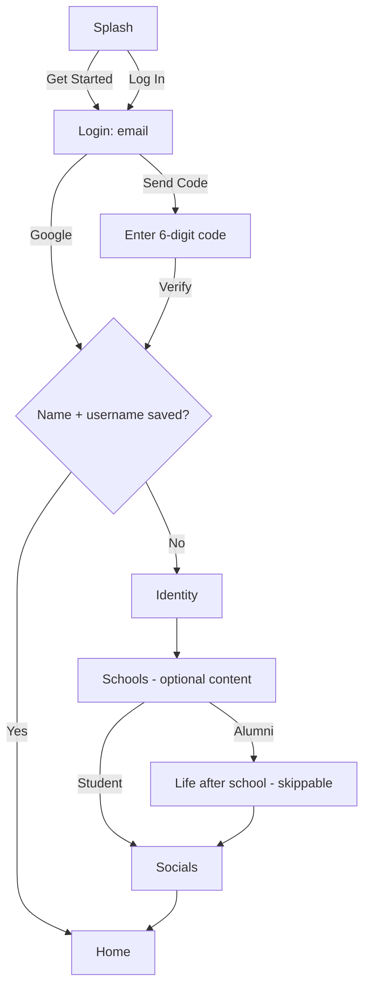
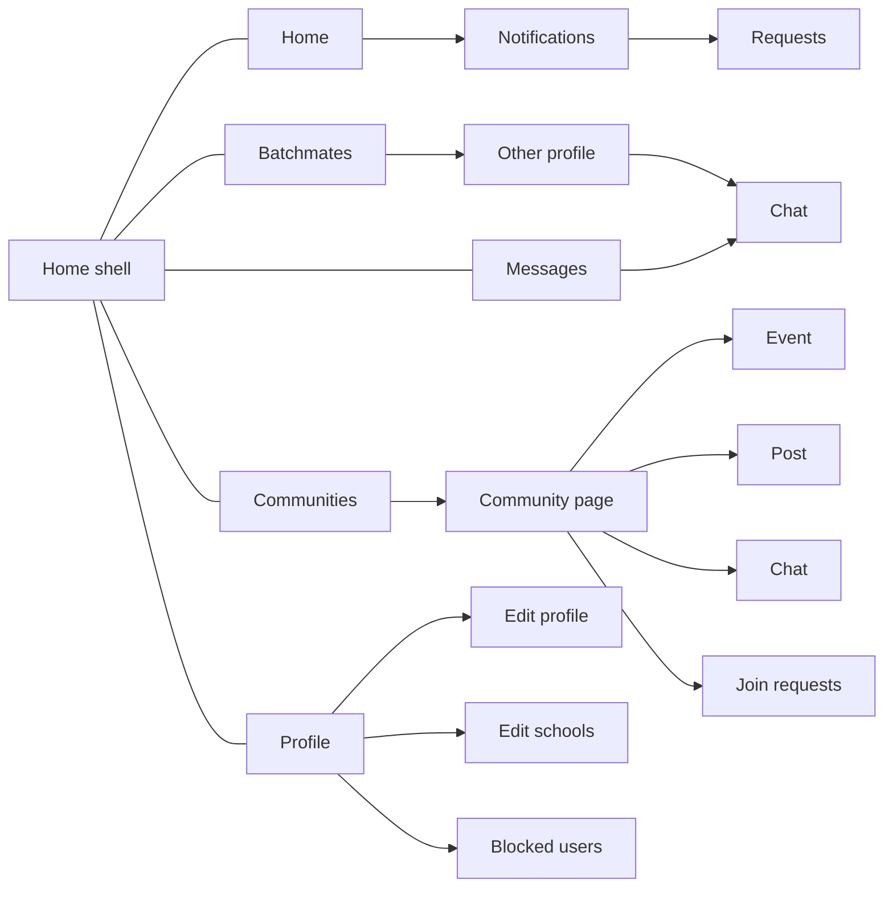
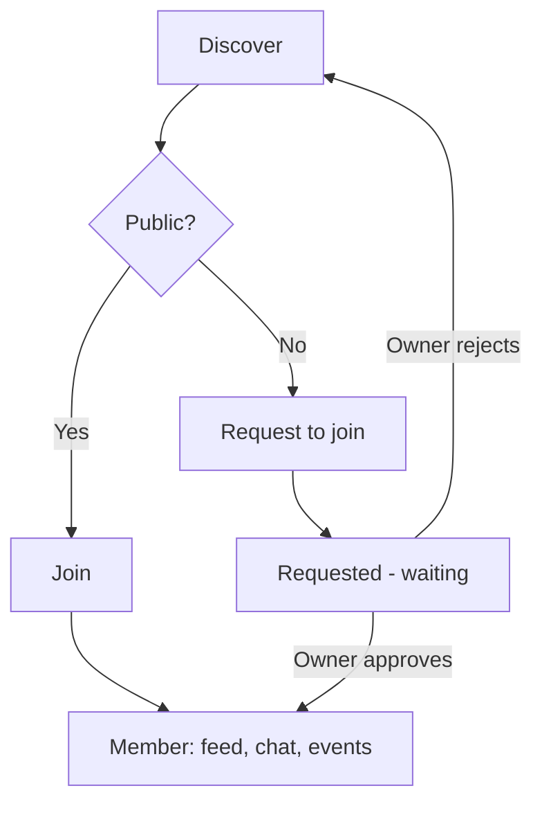
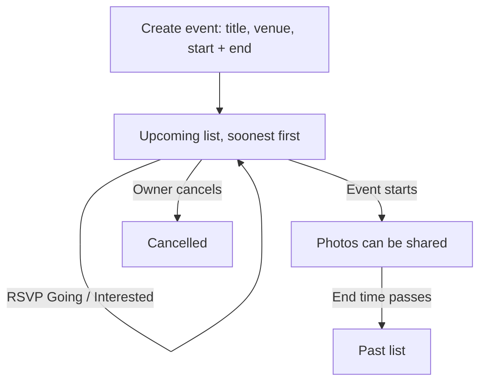
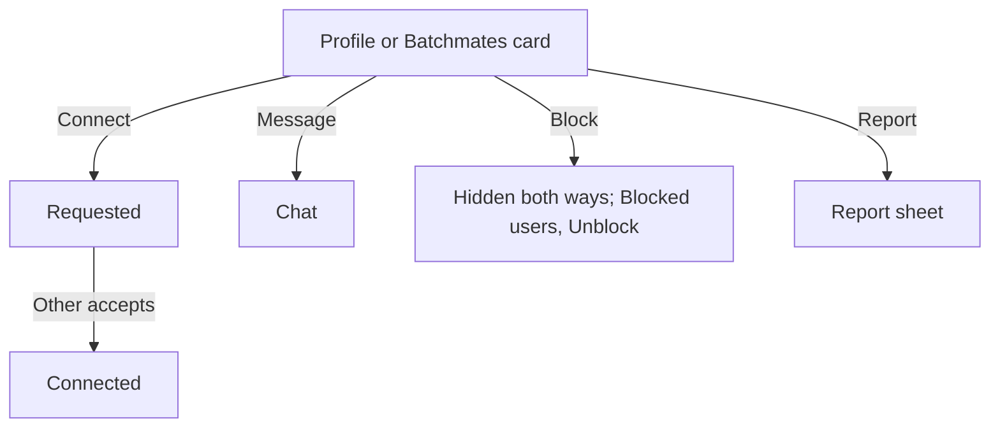

# Flows

## 1. Entry and onboarding

Rule: Identity is mandatory; Schools/Career/Socials may be left empty. Until Identity is saved, community/post/chat/search APIs refuse (403), so no other screen is usable.

## 2. Main navigation

## 3. Join a community

## 4. Event lifecycle

## 5. Connect and message

## 6. Delete account
Profile → Account → Delete account → confirm dialog → signed out. Others then see: name kept on posts, profile "Unknown user" with blank info, cannot message or connect.

## Back-button rules
Tab → Home tab first, then exit app. Pushed screens pop one level. Onboarding steps go back one step.
