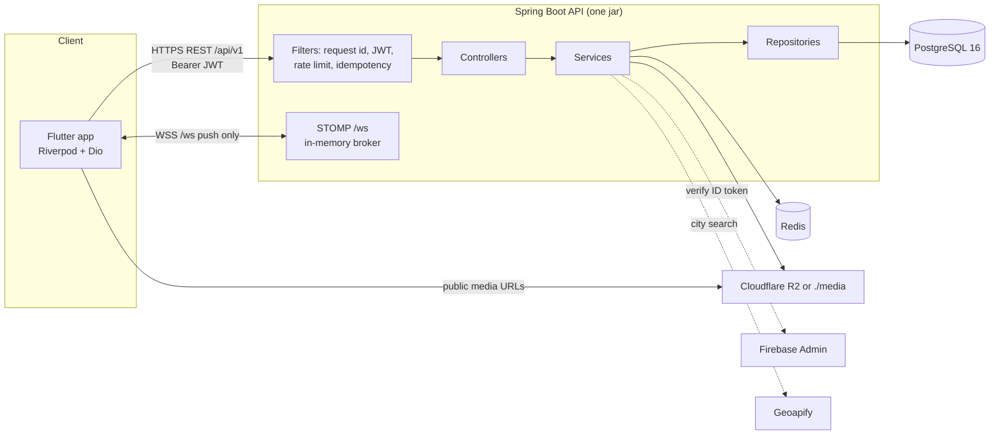

# 00 - Project Overview

What APS Brats is, who it is for, what exists today, and how the parts connect. Start here, then follow the links.

Last verified: 2026-11-16 against commit 168d987 (working tree has uncommitted changes, see [CURRENT-STATE.md](CURRENT-STATE.md))

## 1. What the app does

APS Brats is a social network for alumni and students of Army Public Schools. People sign in with email (or Google), describe the schools and years they attended, and are then connected to classmates and schoolmates, school communities, events, photo memories and chat.

Target users: Army Public School alumni and current students (`users.current_status` is `STUDENT` or `ALUMNI`). Everything is scoped to schools: a school community is only visible to people whose school history includes that school (`CommunityService.visibleCommunity`).

## 2. Major features and status

Status is verified against code (details and sources in each feature file). "Partial" means part of the flow is missing.

| Feature | Status | Detail |
|---|---|---|
| Sign-in (email OTP, Google), refresh tokens, logout-all | Partial | The OTP is generated, checked and, since 2026-11-20, emailed through Brevo (needs `BREVO_API_KEY` and `EMAIL_SENDER_ADDRESS` on the API host; not yet confirmed on the live API). Google sign-in needs Firebase credentials. [auth](03-features/auth-and-sessions.md) |
| Onboarding (profile, schools, socials, alumni career) | Implemented | Gated server-side by `OnboardingGate`. [auth](03-features/auth-and-sessions.md) |
| Profile, school history, social links, career, privacy settings, data export, account deletion | Implemented, with gaps | Deletion leaves data behind. [profile](03-features/profile-career-schools.md) |
| Communities: school (auto) and interest (user-created), join/leave, private requests, owner tools | Partial | No community edit, owners cannot remove members in the app, school communities have no owner. [communities](03-features/communities.md) |
| Events with RSVP, memories gallery | Implemented | Events cannot be deleted, only cancelled. [communities](03-features/communities.md) |
| Posts: text and up to 10 photos, likes, comments, pin, delete, report | Implemented | No edit, no replies, no reposts, no saved posts. [posts](03-features/posts-comments-likes.md) |
| Home feed (posts from joined communities) | Implemented | Time cursor, no pull-to-refresh. [feed](03-features/feed-search-discovery.md) |
| Connections (mutual request/accept), mutual connections, history, blocking | Implemented | One row per user pair, advisory lock, events table. [connections](03-features/connections-and-blocking.md) |
| Direct messages and community group chat, with real-time push | Implemented | In-memory STOMP broker: one API instance only. [messaging](03-features/messaging.md) |
| People search, circle (classmates/schoolmates) | Implemented | Legacy global search is unbounded. [feed](03-features/feed-search-discovery.md) |
| Notifications | Partial | In-app rows only. No push, no unread badge, tapping does not mark read. [notifications](03-features/notifications-and-moderation.md) |
| Reporting and moderation | Partial | Reports and an admin API exist. The app has no moderator/admin screens. [notifications](03-features/notifications-and-moderation.md) |

Not built (verified by search): editing posts or comments, comment replies, reposts, saved posts, follow, DM edit/delete, push notifications, email delivery of OTP, admin UI, backups, alerting.

## 3. Technology stack (short)

Flutter (Riverpod, go_router, Dio, hugeicons) on the client. Spring Boot 3.2.5 on Java 17 on the server. PostgreSQL 16 with Flyway migrations (V1 to V40 in the repo), Redis for limits and caches, STOMP over WebSocket for push, Cloudflare R2 (or local disk) for media. Full table: [02-technology-stack.md](02-technology-stack.md).

## 4. High-level architecture

How the pieces connect:
- The app talks JSON over REST for everything it writes and reads. WebSocket is used only for the server to push new chat messages (`/user/queue/messages`, `/user/queue/community`).
- Authentication is a Bearer access token (15 minutes) plus a refresh token (30 days) stored in secure storage. Redis holds refresh-token ids and revocation markers.
- The database is the system of record. Flyway owns the schema; Hibernate only validates it.
- Photos are uploaded to the API first (validated and re-encoded as JPEG), then the returned URL is attached to a post or message. Media URLs are public.
- Details: [01-system-architecture.md](01-system-architecture.md).

## 5. Repository map

| Path | What is in it |
|---|---|
| `frontend/` | Flutter app (`lib/core`, `lib/features/*`, `test/`) |
| `apsbrat-api/` | Spring Boot API (`src/main/java/com/apsconnect/api/<feature>`, `src/main/resources/db/migration`, `src/test`, `load/` k6 scripts) |
| `docker-compose.yml`, `Makefile` | Local Postgres + Redis + API stack |
| `.github/workflows/ci.yml` | CI: backend `mvn verify`, frontend `flutter analyze` + `flutter test` |
| `tools/api_dashboard.py` | Local analytics dashboard (dev only) |
| `website/` | Static landing page |
| `docs/` | Older docs (some stale, see [12](12-current-status-technical-debt.md)) and this wiki |
| `seed_*.sql`, `*_dump.sql` | Seed data and database dumps (the dumps are untracked and not gitignored: do not commit) |
| `CLAUDE.md` | Project rules for the AI assistant |
