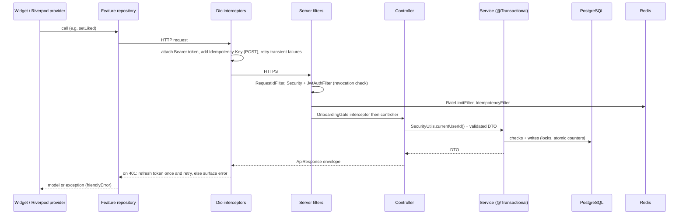

# 01 - System Architecture

How the system is put together, how a request travels through it, and which design choices shape it. Details per area are in the numbered docs.

Last verified: 2026-11-16 against commit 168d987 (working tree has uncommitted changes)

## 1. Shape of the system

A mobile client and a single Spring Boot service (a modular monolith: one deployable jar, code split into feature packages, not microservices). One PostgreSQL database and one Redis. No message broker, no job queue, no background workers except one nightly cleanup (`apsbrat-api/src/main/java/com/apsconnect/api/maintenance/MaintenanceJobs.java`).

| | Frontend (`frontend/`) | Backend (`apsbrat-api/`) |
|---|---|---|
| Owns | UI, navigation, local UI state, token storage, drafts, optimistic updates | All business rules, authorization, validation, persistence, limits, notifications |
| Never does | Trust itself for permissions | Render anything. It also never returns JPA entities, only DTOs |
| Talks to | Backend only (REST + WebSocket), public media URLs | PostgreSQL, Redis, R2/local disk, Firebase Admin, Geoapify |
| Structure | `lib/core` (network, routes, theme, media) + `lib/features/<feature>/{data,presentation}` | `api/<feature>` packages with Controller, Service, Repository, DTO |

Frontend details: [05](05-frontend-engineering.md). Backend details: [04](04-backend-engineering.md).

## 2. Components and how they communicate

| From | To | How | Purpose |
|---|---|---|---|
| App | API | HTTPS JSON, `/api/v1/**`, `Authorization: Bearer <access JWT>`, `Idempotency-Key` on POST | All reads and writes |
| App | API | STOMP over WebSocket `/ws`, access JWT checked at CONNECT, subscribe only to `/user/queue/*` | Server push of chat messages |
| App | Media host | Plain GET of the URL stored on the post/profile | Show images (public, no auth) |
| API | PostgreSQL | JPA/Hibernate (+ native SQL for set logic), Hikari pool 10 | System of record |
| API | Redis | Spring Data Redis | Refresh tokens, revocation, OTP throttles, rate limits, idempotency results, circle cache, presence throttle |
| API | R2 / disk | AWS S3 SDK (`R2StorageService`) or file writes (`LocalStorageService`) | Store re-encoded JPEGs |
| API | Firebase | `firebase-admin` `FirebaseAuthVerifier` | Verify Google sign-in ID tokens |
| API | Geoapify | `RestClient` in `PlacesService` | City autocomplete and reverse geocode |

Response contract: every endpoint returns `{ success, data, message, error, code, requestId }` (`api/common/response/ApiResponse.java`). Errors are produced by `GlobalExceptionHandler` and by the filters (same envelope).

## 3. Request lifecycle

Filter order, limits and failure behaviour: [04 section 3](04-backend-engineering.md). Token refresh and retry on the client: [05 section 4](05-frontend-engineering.md). Error mapping: [04 section 8](04-backend-engineering.md).

## 4. Data flows worth knowing

| Flow | Path (verified in the feature docs) |
|---|---|
| Home feed | `home_tab.dart` -> `postFeedProvider('')` -> `CommunityRepository.posts` -> `GET /feed/home` -> `PostService.homeFeed` -> `PostRepository.findPage` (joined communities, ACTIVE only, blocked authors excluded, `createdAt` cursor). [feed](03-features/feed-search-discovery.md) |
| Like | `post_card.dart._toggleLike` (optimistic) -> `PUT/DELETE /posts/{id}/like` -> `PostService.like/unlike` -> `PostLikeRepository.insertIfAbsent/deleteLike` + `addToLikeCount`. [posts](03-features/posts-comments-likes.md) |
| Photo post | pick -> `POST /media/images?kind=post` (validate, re-encode, store, returns URL) -> `POST /communities/{id}/posts` with `imageUrls`. Photos upload before the post is submitted. [posts](03-features/posts-comments-likes.md) |
| Connect | `POST /connections/{userId}` -> `ConnectionService.requestConnection` (pair lock, block check, one row per pair, history event, notification). [connections](03-features/connections-and-blocking.md) |
| Chat message | `POST` (REST) -> `ChatService.sendMessage` -> commit -> after-commit push on `/user/queue/messages`. [messaging](03-features/messaging.md) |
| Login | `request-otp` -> `verify-otp` or `/auth/google` -> access + refresh tokens -> tokens in secure storage. [auth](03-features/auth-and-sessions.md) |

## 5. Real-time

Only push, only chat. The client sends over REST; the server pushes the saved message to `/user/queue/messages` (DM) or `/user/queue/community` (group) after the transaction commits. The broker is Spring's in-memory simple broker (`api/chat/WebSocketConfig.java`), so push reaches only users connected to the same instance. Notifications, likes, comments and connection changes are not pushed: the app learns about them when it refetches. Details and failure modes: [messaging](03-features/messaging.md).

## 6. Infrastructure architecture

Verifiable: Dockerfile for the API, a compose stack (Postgres, Redis, API), CI that builds and tests, profiles `dev`/`qa`/`prod`. Not verifiable from the repo: where qa/prod actually run, DNS/CDN, managed Postgres/Redis providers. Single-instance constraint: the in-memory STOMP broker (the nightly cleanup has no lock but is idempotent, so extra instances are harmless). Full detail: [08](08-infrastructure-deployment.md).

## 7. Cross-cutting conventions

- IDs are UUIDs. Timestamps are `LocalDateTime` in Asia/Kolkata (JVM, Jackson, Hibernate and the DB session all pinned; see [06](06-database.md)).
- Pagination: keyset cursors by default (`CursorSupport`, `CursorPage`), offset only for popular posts and people search.
- Idempotency: the client sends an `Idempotency-Key` on every POST and the server replays 2xx results for 24 h.
- Privacy by not-found: where existence must not leak (blocked users, other schools' communities) the API answers 404, not 403.
- Authorization: URL rules in `SecurityConfig` plus explicit checks inside services. There is no method-level security.
- Schema changes only through Flyway migrations (`IF NOT EXISTS` guards by project rule).

## 8. Important architectural decisions

Recorded with reasons and trade-offs in [11-technical-decisions.md](11-technical-decisions.md): modular monolith, Flyway-owned schema, stateless JWT with Redis-backed refresh, REST for writes with STOMP only for push, keyset pagination, server-side image processing, one-row-per-pair connections with an advisory lock, no outbox.

## 9. Architectural risks (summary)

1. Chat push cannot scale beyond one API instance (in-memory broker).
2. Redis is a hard dependency with inconsistent failure behaviour (some paths fail open, some return 503, keyed POSTs may return a raw 500).
3. Authentication in qa/prod cannot work by email OTP (no delivery), and the production demo seed (V14) is part of the migration chain.
4. Block, `discoverable` and ban rules are not enforced on every read path.

Full list with file references: [12](12-current-status-technical-debt.md).
