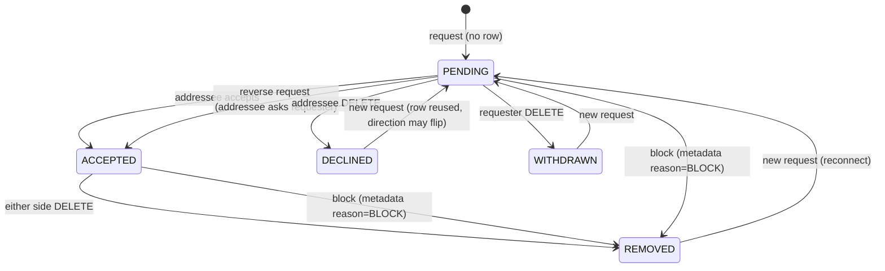
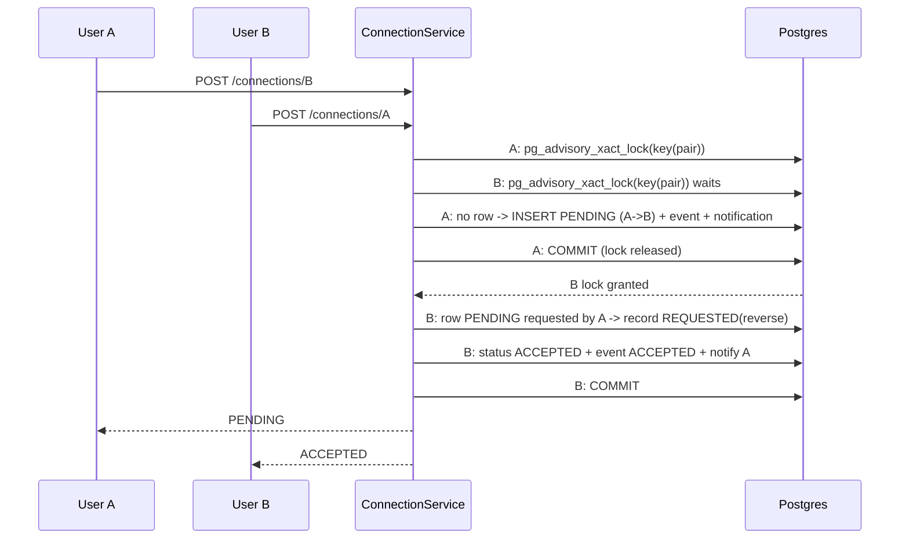

# Connections and Blocking

Mutual friend-style connections between alumni (request / accept / end) and one-way blocking that hides two people from each other.
Covers the data model, the per-pair locking design, every endpoint, the Flutter side, and every place a block is enforced.

Last verified: 2026-11-16 against commit 168d987 (working tree has uncommitted changes)

## 1. Overview

- One `connections` row per user pair, whatever the direction of the request. The row is reused on re-request, so history never produces duplicate rows.
- Statuses: `PENDING`, `ACCEPTED`, `DECLINED`, `WITHDRAWN`, `REMOVED`. Only PENDING and ACCEPTED are "live" (`ConnectionStatus.isLive()`).
- Every change goes through `ConnectionService`, which takes a Postgres advisory lock for the pair first. All reads live in `ConnectionQueryService`.
- Blocks (`user_blocks`) are a separate table. A block ends any live connection, but a connection never creates or removes a block.
- Connected vs not connected matters elsewhere: DM message length (see `messaging.md`) and the `relation` field on every `PersonDto`.

Key files:

| Area | File |
|---|---|
| Controller | `apsbrat-api/src/main/java/com/apsconnect/api/connection/ConnectionController.java` |
| Writes | `.../connection/ConnectionService.java` |
| Reads | `.../connection/ConnectionQueryService.java` |
| SQL | `.../connection/ConnectionRepository.java` |
| Pair key | `.../connection/UserPair.java` |
| Entities | `Connection.java`, `ConnectionEvent.java`, enums `ConnectionStatus`, `ConnectionEventType` |
| Block | `.../safety/BlockController.java`, `BlockService.java`, `UserBlockRepository.java`, `UserBlock.java` |
| Migrations | `apsbrat-api/src/main/resources/db/migration/V9__create_connections.sql`, `V16__add_privacy_safety_tables.sql`, `V39*` (pairs + history), `V40*` (pending indexes) |
| Flutter | `frontend/lib/features/connections/data/connection_repository.dart`, `.../connections/presentation/requests_screen.dart`, `frontend/lib/features/settings/data/block_repository.dart`, `.../settings/presentation/blocked_users_screen.dart` |

## 2. Data model

`connections` (V9 + V39):
- `user_low_id`, `user_high_id`: the two ids in canonical order. Constraint `chk_connection_pair_order` requires `low < high`.
- `requester_id`, `addressee_id`: direction of the CURRENT request. `chk_connection_pair_matches` forces them to be the same two users as low/high.
- `uq_connection_pair UNIQUE (user_low_id, user_high_id)`: the hard guarantee of one row per pair. It replaced the old per-direction `uq_connection`.
- `status`, `created_at` (first time the pair ever connected, never reset), `requested_at` (latest request), `accepted_at`, `updated_at`.
- Indexes: `idx_conn_requester_status`, `idx_conn_addressee_status`, V36 partial "accepted" indexes (friends list), V40 partial `idx_conn_pending_incoming` / `idx_conn_pending_outgoing` on `(user, requested_at DESC, id DESC) WHERE status='PENDING'` so paged request lists stop after one page.

`connection_events` (V39): history. `connection_id` (FK, ON DELETE CASCADE), `actor_id` (FK, SET NULL), `event_type` (CHECK in the five types), `created_at`, `metadata` JSONB. Index `(connection_id, created_at)`. V39 also backfilled history from old rows (marked `{"source":"backfill"}`) and merged duplicate rows from old races.

`user_blocks` (V16): `blocker_id`, `blocked_id` (both FK to users, ON DELETE CASCADE), `uq_user_blocks UNIQUE (blocker_id, blocked_id)`, index on `blocked_id`. Independent of `connections`.

Why `UserPair.of` compares the UUID TEXT and not `UUID.compareTo`: Postgres compares uuid bytes as unsigned; Java `UUID.compareTo` compares signed longs and gives a different order. Text order matches Postgres, so the `low < high` CHECK never rejects a Java-built pair.

## 3. State diagram

Note: `endForBlock` always writes REMOVED, even for a PENDING row (`ConnectionService.endForBlock`), so a blocked pending request shows up in history as REMOVED, not WITHDRAWN or DECLINED.

## 4. User actions

Common to all: frontend calls go through the shared Dio from `dioProvider` (`frontend/lib/core/network/dio_client.dart`). It adds the bearer token, adds an `Idempotency-Key` header to every POST, refreshes the token once on 401, and retries GET (and keyed POST) up to 2 times on connection errors / 502-504 with 500 ms, 1 s backoff. PUT and DELETE are NOT retried. Backend: `RateLimitFilter` (Redis, default 300 requests/min per user) applies to all endpoints; `IdempotencyFilter` replays the stored 2xx response of a POST with the same key for 24 h. All endpoints require a JWT (`SecurityUtils.currentUserId()`).

### 4.1 Send a connection request

1. Tap Connect on a profile, a batch tab card, or a community member row.
2. Frontend: `_ConnectButton._act` in `frontend/lib/features/profile/presentation/screens/profile_screen.dart` (about line 610); `_connect` in `frontend/lib/features/feed/presentation/widgets/batch_tab.dart`; `_act` in `frontend/lib/features/community/presentation/community_screen.dart` (about line 1520). All call `ConnectionRepository.request(userId)`.
3. State: no dedicated notifier. Riverpod `FutureProvider`s (`connectionStatusProvider(userId)`, `batchmatesProvider`, `pendingConnectionsProvider`, `sentConnectionsProvider`, ...). After success `refreshConnections(ref, otherUserId:)` invalidates them all (also circle summary, search, profile, notifications). Batch tab is optimistic: it adds the id to a local `_requested` set before the call and removes it on error. Profile button uses a local `_busy` flag (not optimistic).
4. API: `POST /api/v1/connections/{userId}`, no body. Response `{success, data:{status:"PENDING"|"ACCEPTED"}, message}`.
5. Backend: `ConnectionController.request` -> `ConnectionService.requestConnection`:
   1. Reject self (400).
   2. `connectionRepository.lock(pair)` (advisory lock, see section 6).
   3. Load requester; load target, must exist and `deletedAt == null` (else 404 "Target user not found").
   4. `blockRepository.existsBetween` either direction -> 404 "Target user not found" (does not reveal the block). Done after the lock so a block committed while waiting is seen.
   5. `findByPair`. No row: `saveAndFlush(Connection.newRequest)`, event REQUESTED, notification `CONNECTION_REQUEST` to the target, evict circle cache for both. Return PENDING.
   6. Row ACCEPTED, or PENDING sent by me: 409 "Connection already exists".
   7. Row PENDING sent by them: reverse request, see 4.7.
   8. Row DECLINED/WITHDRAWN/REMOVED: reuse row, set requester/addressee to the new direction, status PENDING, `requested_at=now`, `accepted_at=null`; event REQUESTED, notification.
6. DB: read `users`, `user_blocks`, `connections`; write `connections`, `connection_events`, `notifications`.
7. Response: success -> `refreshConnections`. DioException on the batch tab shows the server `error` string in a snackbar; the profile and community paths show a generic or `friendlyError` snackbar.
8. UI: button flips to "Requested" (PENDING_OUT) once `connectionStatusProvider` reloads.
9. Other users: the addressee gets a stored notification (`NotificationService.create`). UNVERIFIED: whether `create` also pushes over WebSocket; the Flutter side invalidates `notificationsProvider` on refresh only. The addressee sees it on the next notifications or Home refresh.
10. Failure: no rollback beyond the batch tab's local set; errors become snackbars. A timed-out POST is retried with the same Idempotency-Key, so no duplicate. 409 on a double tap is harmless.
11. Concurrency: advisory lock per pair + `uq_connection_pair`. Two simultaneous first requests: one waits on the lock, then sees the row. If the lock were skipped, the second insert hits the unique key and `GlobalExceptionHandler` maps `DataIntegrityViolationException` to 409.
12. Security: auth required; target must be live and not blocked either way; self-request blocked. No per-action rate limit beyond the global one (UNVERIFIED that none exists elsewhere; none found in `ConnectionService`).

### 4.2 Accept a request

1. Tap Accept (profile button when status is PENDING_IN, batch tab, requests sheet/screen, notification row, community member row).
2. Frontend: `ConnectionRepository.accept` called from `_ConnectButton._act`, `_accept` in `batch_tab.dart`, `requests_screen.dart` (about line 95), `_respond` in `notifications_screen.dart`, `community_screen.dart`.
3. State: invalidate-and-refetch via `refreshConnections`. `requests_screen.dart` and notifications keep local `_done` / `_answered` sets so the row disappears immediately (optimistic) and is restored on failure.
4. API: `PUT /api/v1/connections/{userId}/accept` where `userId` is the REQUESTER. Response `{success, message:"Connection accepted"}`.
5. Backend: `ConnectionService.acceptConnection`: lock pair; find row (404 "No pending request from this user" if none); caller must be the addressee (else 403); already ACCEPTED -> return silently (idempotent); status not PENDING -> 404; `accept()`: status ACCEPTED, `accepted_at`, event ACCEPTED, notification `CONNECTION_ACCEPTED` to the requester, evict cache.
6. DB: `connections` update, `connection_events` insert, `notifications` insert.
7. Success: `refreshConnections`; failure: snackbar "Could not accept. Try again." (generic, status code ignored).
8. UI: "Connected" state, friends list gains the person, "Message" becomes available.
9. Other users: requester receives a notification "<name> accepted your request"; sees it on refresh.
10. Failure: PUT is not auto-retried; user can tap again (idempotent).
11. Concurrency: lock; a race between accept and the requester withdrawing runs serially: whichever commits second sees a non-PENDING row (withdraw after accept would REMOVE the connection; accept after withdraw returns 404).
12. Security: only the addressee may accept (403 otherwise). There is no block check on accept, but a block always closes live rows (4.6), so a PENDING row between blocked users cannot normally exist.

### 4.3 Decline, withdraw, remove (single endpoint)

1. Decline a received request, cancel a sent one, or remove a friend (confirmation dialog `_removeFriend` for removal).
2. Frontend: `ConnectionRepository.end` (named "end"), used by `_removeFriend` in `batch_tab.dart`, the requests screen, and `_respond(accept:false)` in `notifications_screen.dart`.
3. State: same invalidate-and-refetch; requests screen and notifications remove the row locally first.
4. API: `DELETE /api/v1/connections/{userId}`. Response `{success, data:{status:"DECLINED"|"WITHDRAWN"|"REMOVED"}}`.
5. Backend: `ConnectionService.endConnection`: lock; find row, must be live else 404 "No connection with this user"; `closedStatus`: ACCEPTED -> REMOVED, else actor is addressee -> DECLINED, actor is requester -> WITHDRAWN; `close()` saves status and writes the matching event; evict cache.
6. DB: `connections` status update, `connection_events` insert. Rows are never deleted.
7. Frontend ignores the returned status; snackbar "Could not remove. Try again." on any error.
8. UI: person leaves the list; button returns to "Connect".
9. Other users: NO notification and no push for decline, withdraw or remove. The other side sees it on refresh. The old CONNECTION_REQUEST notification stays but its `actionable` flag is recomputed on read: `NotificationService.list` marks it actionable only while the connection is still PENDING.
10. Failure: not retried; if two taps race the second gets 404 and shows the generic snackbar.
11. Concurrency: lock; second concurrent call sees a non-live row -> 404.
12. Security: only the two pair members can reach the row because the pair is built from the JWT user and the path id. Why one endpoint: the server decides the correct end state from current state and caller, so the client cannot pick a wrong transition.

### 4.4 Reconnect after ending

Same as 4.1. The row is reused (see step 8 there). `created_at` is kept, `requested_at` moves, the history shows REQUESTED again. Direction can flip, so a user who was declined can be the new addressee. There is no cooldown or limit on re-requesting after DECLINED (note under risks).

### 4.5 Status with a user, lists, mutual, history

All reads are `GET`, in `ConnectionQueryService`, `@Transactional(readOnly = true)`:

| Endpoint | Method | Notes |
|---|---|---|
| `/connections/{id}/status` | `statusWith` | Returns `NONE`, `CONNECTED`, `PENDING_OUT`, `PENDING_IN`. Used by `connectionStatusProvider`. |
| `/connections` | `listBatchmates` | Legacy: all friends, A to Z by name in memory. Used by `batchmatesProvider`. |
| `/connections/page` | `pageConnections` | New: keyset page, sort `(lower(full_name), id)`. |
| `/connections/pending` | `listPending` | Legacy: all received, ordering from the repository query. Used by Flutter. |
| `/connections/pending/page` | `pageReceived` | New: newest first by `(requested_at, id)`, skips deleted users. |
| `/connections/sent` | `listSent` | Legacy: all sent. Used by Flutter. |
| `/connections/sent/page` | `pageSent` | New. |
| `/connections/{id}/mutual` | `listMutual` | Legacy: everyone, sorted in memory. Used by `mutualConnectionsProvider`. |
| `/connections/{id}/mutual/count` | `mutualCount` | Count only, in SQL. Not called by Flutter. |
| `/connections/{id}/mutual/page` | `pageMutual` | New: keyset. |
| `/connections/{id}/history` | `history` | Events oldest first, max 200 (`HISTORY_LIMIT`). 404 if no row for the pair. Not called by Flutter. |

Paged cursor: URL-safe base64 of `"{id}|{key}"` (key is a lower-cased name or an ISO request time). `limit` is clamped by `CursorSupport.clampLimit` (0 means default). A bad cursor is a 400 (`ErrorCode.BAD_REQUEST`). Response is `CursorPage` (`items`, `nextCursor`, `hasMore`; field names UNVERIFIED, see `common/response/CursorPage.java`). Keyset pages exist so deep pages cost the same as the first (V40 indexes).

Frontend state: `FutureProvider`s in `connection_repository.dart`, not paged. The Flutter client uses ONLY the legacy list endpoints, status and legacy mutual; the paged endpoints, mutual count and history are implemented on the server but unused by the app (verified by grep over `frontend/lib`).

Security notes for reads: `history` and `status` are always computed with the JWT user as one side of the pair, so nobody can read another pair's history. None of these reads checks for a block: `status`, `mutual*` and `history` still answer for a blocked user (history 404s only if no row exists).

### 4.6 Block a user

1. Profile page three-dot menu -> "Block user" -> confirm dialog.
2. Frontend: `_SafetyMenu._block` in `profile_screen.dart` (about line 350) -> `BlockRepository.block`.
3. State: after success `refreshAfterBlock(ref, userId)` in `block_repository.dart` invalidates connections lists, `communityMembersProvider`, `peopleSearchProvider`, `conversationsProvider`, `profileProvider(userId)`, `blockedUsersProvider`. Not optimistic.
4. API: `POST /api/v1/users/{userId}/block`, no body. Response `{success, message:"User blocked"}`.
5. Backend: `BlockController.block` -> `BlockService.block`: reject self (400); already blocked by me -> return (idempotent); target must exist (404; a deleted-account row still exists, so it can be blocked); insert `UserBlock`; `ConnectionService.endForBlock(blocker, blocked)`: lock pair, if a live row exists `close(REMOVED)` with event metadata `{"reason":"BLOCK"}`, evict circle cache; then `BlockService` evicts both users' circle cache again. All in one transaction (`@Transactional` on `block`, joined by `endForBlock`).
6. DB: write `user_blocks`, `connections`, `connection_events`.
7. Success: snackbar "<name> is blocked", `router.pop()`. Error: `friendlyError(e)` snackbar.
8. UI: the profile closes; the person disappears from search, community members, chat list, feed.
9. Other users: the blocked person is NOT notified and cannot tell a block from an ordinary removal (reason is only in event metadata; the status of the row is plain REMOVED). Their next fetches of profile, search, posts of the blocker behave as in section 5.
10. Failure: snackbar; transaction rolls back as a whole (block row and connection end together).
11. Concurrency: the block row is inserted BEFORE the pair lock, in the same transaction, and `endForBlock` takes the lock after. If a request holds the lock at that moment and commits a PENDING row first, `endForBlock` then sees it and closes it. If the request checks `existsBetween` before the block commits, the same ordering saves it. Gap: two simultaneous block calls both pass `existsByBlocker_IdAndBlocked_Id`, one fails on `uq_user_blocks` and the global handler returns 409 "This action conflicts with existing data" (harmless, no 500).
12. Security: auth required; only the caller's own block is created. No rate limit specific to block.

### 4.7 Reverse request (opposite requests, a race)

If B already asked A and A now taps Connect on B (or both tap at the same moment), `requestConnection` finds a PENDING row whose requester is the other user. It records REQUESTED with metadata `{"reason":"REVERSE_REQUEST"}` and calls `accept()` at `now + 1 microsecond`, so history order is REQUESTED then ACCEPTED even if timestamps tie. Result is ACCEPTED, message "Connection accepted". The original requester gets the `CONNECTION_ACCEPTED` notification; no `CONNECTION_REQUEST` is sent for the second request. One row throughout, so there is no state where both sides are "pending".

### 4.8 Unblock

1. Settings -> Blocked users -> Unblock (`blocked_users_screen.dart`).
2. Frontend: `BlockRepository.unblock`.
3. State: `refreshAfterBlock`; list reloads via `blockedUsersProvider` (autoDispose).
4. API: `DELETE /api/v1/users/{userId}/block`. Response `{success, message:"User unblocked"}`.
5. Backend: `BlockService.unblock` -> `deleteByBlocker_IdAndBlocked_Id`. Idempotent (no error if there was no block). Only deletes the caller's own block; if the other person also blocked the caller, the pair stays hidden.
6. DB: delete from `user_blocks`.
7-8. Success refreshes lists; error: `friendlyError` snackbar. Person reappears in search etc.
9. Other users: nothing; no notification.
10. Failure: snackbar, not retried (DELETE).
11. Concurrency: plain delete, unique key makes it safe.
12. Security: auth; own blocks only. The earlier connection is NOT restored; they must send a new request (history stays).

### 4.9 Blocked list

`GET /api/v1/users/me/blocks` -> `BlockController.myBlocks` -> `BlockService.myBlocks` (newest block first, `personService.toPeople(blocked)` with no viewer so `relation` and mutual count are empty). Flutter: `blockedUsersProvider` in `block_repository.dart`, shown by `blocked_users_screen.dart`. It is not paged. Only blocks I made are listed, never blocks made against me.

## 5. Where a block is enforced

All checks use `UserBlockRepository.existsBetween` (either direction) or `findBlockedIdsInvolving` (all ids blocked in either direction). Verified by grep for `blockRepository` and `user_blocks`:

| Area | Location | Behaviour |
|---|---|---|
| Connect | `ConnectionService.requestConnection` | 404 "Target user not found", after the pair lock |
| Block itself | `BlockService.block` -> `ConnectionService.endForBlock` | live connection becomes REMOVED |
| Profile | `ProfileService` line ~49 | 404 "Profile not found" (not for self) |
| Social links | `UserSocialLinkService` line ~31 | blocked either way hides links (not for self) |
| People search (filters) | `PeopleSearchService.search` + `UserRepository.searchPeople` (`NOT IN (:blockedIds)`) | excluded. This query also powers the community member directory. |
| Global search | `SearchService.search` | excluded |
| Posts feed, community feeds, saved and similar lists | `PostService.hiddenAuthors` used at lines ~122, 191, 211, 284, 379; `PostRepository` `NOT IN :hiddenAuthors` | authors hidden |
| Comments | `CommentRepository` line ~21 `NOT IN :hiddenAuthors` | hidden |
| Single post | `PostService.readablePost` line ~398 | 404 if author blocked either way |
| Event attendees | `CommunityEventService.attendees` line ~149 | filtered out |
| DM open | `ChatService.openWith` line ~48 | 404 "User not found" |
| DM list | `ChatService.listConversations` line ~102 | conversation hidden |
| DM send | `ChatService.sendMessage` line ~160 | 404 "Conversation not found" |
| Community chat history/pagination | `CommunityChatService.hiddenSenders` | messages hidden |
| Community chat live push | `CommunityChatService.pushAfterCommit` line ~230 | recipients who are blocked with the sender are skipped |

Not enforced, found by absence of any block reference (UNVERIFIED in the sense of grep only): `CircleService` classmates/schoolmates lists, `FeedController.recentJoins`, `ConnectionQueryService` `status`/`mutual*`/`history`, `PersonService.mutualCounts`, DM history read by `conversationId` (`ChatService.messages` only calls `requireParticipant`, so a blocked pair can still read old messages if they know the conversation id; list and send are checked), `markRead`, community member counts, notifications already stored. See risks.

## 6. Concurrency design

- `ConnectionRepository.lockPair(key)` runs `SELECT 1 FROM (SELECT pg_advisory_xact_lock(hashtextextended(:key, 0))) AS locked`. The key is `"connection:{low}:{high}"` (`UserPair.lockKey`). It is a transaction-scoped lock: released on commit or rollback, works across multiple API servers because the lock lives in Postgres.
- Order in every write method: lock first, then read user/block/connection rows, then write. Reading the block table after the lock means a block that committed during the wait is visible.
- Writes covered: `requestConnection`, `acceptConnection`, `endConnection`, `endForBlock`. Reads take no lock.
- Safety nets: `uq_connection_pair`, `chk_connection_pair_order`, `chk_connection_pair_matches`, the `version` column (JPA optimistic lock), and global handling of `DataIntegrityViolationException`/`OptimisticLockingFailureException` to 409.
- `Connection` has an `@Version` column (`version`), so JPA optimistic locking is a second safety net. The advisory pair lock normally serialises writers first; a stale write would raise `OptimisticLockingFailureException`, which `GlobalExceptionHandler` maps to 409.
- Hash collisions: `hashtextextended` yields a 64-bit key; a collision would only cause two unrelated pairs to serialize, never wrong data.
- Weak spot: the block insert in `BlockService.block` happens before the pair lock and no lock covers the existence check, so two block calls can race (resolved by the unique key as 409, see 4.6).

## 7. Notification side effects

| Event | Notification | Recipient |
|---|---|---|
| New request (first or re-request) | `CONNECTION_REQUEST`, ref `CONNECTION` = connection id | addressee |
| Accept (normal or reverse) | `CONNECTION_ACCEPTED`, ref `USER` = accepter id | original requester |
| Decline, withdraw, remove, block | none | none |

Request notifications are shown actionable only while the connection is still PENDING (`NotificationService.list`). V39 repointed old notification `ref_id`s to the surviving row when merging duplicates.

## 8. Not implemented (verified by search)

- Paged lists, mutual count and history are not used by the Flutter app (server-only).
- No notification on decline, withdraw, remove or block.
- No cooldown or max-pending-requests limit; no per-action rate limit for connection requests.
- No "suggested connections" endpoint in the connection package (UNVERIFIED elsewhere).
- No admin/batch endpoint to clear connections; no un-decline.
- No real-time (WebSocket) push for connection changes; other users see changes on refresh (UNVERIFIED for notification push, see 4.1).

## 9. Risks and tech debt

- Possible blocked-user leakage in circle lists, recent joins, mutual lists, status, history (section 5, last paragraph).
- Legacy `listPending` / `listSent` do not filter deleted users while the paged versions do (`ConnectionQueryService` lines ~54-70 vs the paged SQL).
- `listBatchmates`, `listPending`, `listSent`, `listMutual` return unbounded lists and sort in memory; the paged versions exist but the app does not call them yet.
- Re-request after DECLINED is unlimited, so harassment by repeated requests is possible; each sends a notification.
- A block against someone who blocked first is allowed and stays after the other unblocks.
- Frontend discards specific error messages in most connection paths (generic snackbars), only `batch_tab._connect` and block use the server text.
