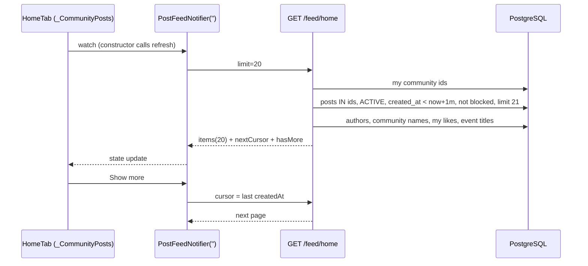

# Feed, Search and Discovery
How the Home feed is built and paged, which activity endpoints are real versus unused, the people circle (classmates/schoolmates), global and people search, and the places lookup used in onboarding.
Findings are from code reading; runtime behaviour not exercised is marked UNVERIFIED.

Last verified: 2026-11-16 against commit 168d987 (working tree has uncommitted changes)

## 1. Summary table (what the app really uses)

| Endpoint | Backend | Used by the Flutter app? |
|---|---|---|
| `GET /feed/home` | `PostController.home` -> `PostService.homeFeed` | Yes: Home tab `_CommunityPosts` via `postFeedProvider('')` |
| `GET /feed/activity` | `FeedController.activity` -> `FeedService.activity` | No. Provider `feedActivityProvider` exists, nothing watches it |
| `GET /feed/recent-joins` | `FeedService.recentJoins` | No (`recentJoinsProvider` unused) |
| `GET /feed/banner` | `FeedService.banner` | No (`batchmateBannerProvider` unused) |
| `GET /users/me/circle/summary`, `/classmates`, `/schoolmates` | `CircleController` / `CircleService` | Yes: People tab (`batch_tab.dart`) |
| `GET /people/search` | `PeopleSearchController` / `PeopleSearchService` | Yes: People tab search |
| `GET /search?q=` | `SearchController` / `SearchService` | No (`searchProvider` unused; endpoint kept) |
| `GET /places/reverse` | `PlacesController` / `PlacesService` | Yes: onboarding "Use my location" |
| `GET /places/cities` | same | No (no caller in `frontend/lib`; grep for `/places`) |

Verification: grep of `frontend/lib` for `feedActivityProvider|recentJoinsProvider|batchmateBannerProvider|searchProvider|searchCities` finds the definitions only. `lib/features/feed/data/dummy_data.dart` sets `const bool kShowDemoContent = false;` and `dummyRecentJoins`, `dummyBatchmates`, `dummyChatHistory` evaluate to empty lists, so `home_tab.dart` hides its "Recently joined" row and sample "Activity feed" cards (both are wrapped in `kShowDemoContent` / `dummyRecentJoins.isNotEmpty`). `dummyAutoReplies` is a non-gated list used by `chat_overlay.dart` (demo chat overlay, not reachable with real data, UNVERIFIED). Only `kShowDemoContent` branches remain as dead demo code (greeting text "Brat." instead of "Arjun.").

Common to every call: JWT required, `ApiResponse` envelope, Dio GET auto-retry (up to 2 retries with 500 ms / 1 s back-off on connection error, connect timeout, 502/503/504), global 300 req/min per user (`RateLimitFilter`). Errors are shown through widget-level messages (`friendlyError` in community code; "Could not search" empty state with Retry in People search).

---

## 2. Home feed

### 2.1 Load the Home feed (first page)
1. **User action**: opens the app / Home tab. The tab is built on first visit and kept alive (`IndexedStack` in `home_screen.dart`).
2. **Frontend**: `feed/presentation/widgets/home_tab.dart` `_CommunityPosts` watches `postFeedProvider('')` (`community/data/community_repository.dart`). Key `''` means "Home" (no community id). `PostFeedNotifier` constructor calls `refresh()`, which calls `CommunityRepository.posts(communityId: null)`.
3. **State management**: `StateNotifierProvider.autoDispose.family<PostFeedNotifier, PostFeedState, String>`. State = `{items, nextCursor, hasMore, loading, error}`. Likes, deletes and new posts mutate the list in place (`replace`, `remove`, `prepend`) without refetching.
4. **API**: `GET /feed/home?limit=20[&cursor=...]` -> `ApiResponse<CursorPage<PostDto>>` = `{items[], nextCursor, hasMore}`.
5. **Backend** (`PostService.homeFeed`, read-only transaction), in order:
   1. `communityService.myCommunityIds(me)` = ids of every community I belong to (`CommunityMemberRepository.findCommunityIdsByUserId`). Empty -> empty page.
   2. `page(userId, ids, includePinned=true, cursor, limit)`: `limit` clamped to 1..100 (`CursorSupport.clampLimit`, default 30); cursor = Base64URL of the last post's `createdAt` (`CursorSupport.decode`; bad cursor -> 400 "Invalid cursor"); no cursor means `now + 1 minute`.
   3. `hiddenAuthors(me)` = users I blocked plus users who blocked me, plus a placeholder UUID so `NOT IN` is never empty.
   4. `PostRepository.findPage(communityIds, ACTIVE, before, hiddenAuthors, includePinned, PageRequest.of(0, size+1))`: `WHERE community_id IN :ids AND status='ACTIVE' AND created_at < :before AND author_id NOT IN :hidden ORDER BY created_at DESC`. Fetching `size+1` rows tells whether another page exists. Pinned posts are included but not placed first on Home (they are ordered by time like any post; `includePinned` only matters for community pages, which leave pinned posts out of the list and show them on top separately).
   5. `toDtos` builds the page with a fixed number of queries (authors with school history, community names, my likes, communities I own, event titles).
6. **Database**: `posts` (index `idx_posts_community_newest (community_id, created_at DESC, id DESC)`), `community_members`, `user_blocks`, `users`, `user_school_history`, `post_likes`, `communities`, `community_events`.
7. **Response handling**: `PageOf.fromJson` -> `PostFeedState(items, nextCursor, hasMore)`.
8. **UI**: section "From your communities" with a `PostCard` per item (`showCommunity: true`). The section is hidden entirely while `feed.items.isEmpty`, which also hides errors and the empty state.
9. **Other users**: a new post by someone else appears only when this notifier is re-created or refreshed. There is no push, no polling, and HomeTab has no `RefreshIndicator` (verified: no `RefreshIndicator`/`onRefresh` in `home_tab.dart` or `home_screen.dart`). The Home notifier is invalidated only by: creating a post (`PostComposer._post`), joining/leaving through the community header, deleting a community. So a user can look at a stale Home until the app restarts.
10. **Failure handling**: `_load` catches any error -> `state.copyWith(loading:false, error:e, hasMore:false)`. On the first page this leaves `items` empty so `_CommunityPosts` renders nothing (silent failure, no retry control on Home). On "Show more" failure the existing items stay but `hasMore=false` removes the button, so the user cannot retry without a full refresh. Dio retries GETs on transient errors first.
11. **Concurrency**: `loadMore` ignores calls while `loading` or `!hasMore` (`PostFeedNotifier.loadMore`). The notifier guards `mounted` after await. A refresh racing a loadMore can interleave (UNVERIFIED), the last response wins.
12. **Security**: only communities I am a member of are queried (so Home never exposes OPEN communities I have not joined); blocked authors are excluded; HIDDEN/REMOVED posts never appear. SCHOOL eligibility is not re-checked here: a user who stopped listing a school is removed from its membership at that time (`CommunityService.dropSchoolsNoLongerListed`).

### 2.2 Load more (pagination)
- UI: a "Show more" `TextButton` under the list (`feed.hasMore`), not infinite scroll. `Home` is a `SingleChildScrollView` with a plain `for` loop over `feed.items`, so every loaded post is built at once (no lazy list). Community pages use `SliverList.builder` and infinite scroll (`onNearEnd: notifier.loadMore`).
- Flow: `PostFeedNotifier.loadMore` -> `_load(state.nextCursor, replace:false)` -> same endpoint with `cursor`. Items are appended; `nextCursor/hasMore` replaced.
- Cursor semantics: strict `created_at < cursor`. No id tiebreak, so two posts with an identical timestamp straddling a page boundary could be skipped (very unlikely, microsecond timestamps).
- A post created while the user scrolls does not shift pages (time cursor, not offset), unlike the "popular" community sort which uses offset paging (`PostRepository.findPopularPage`, marked with a `ponytail:` comment in code).

### 2.3 Variations
- Community feed (`GET /communities/{id}/posts`) uses the same `findPage` for `sort=latest` but excludes pinned posts from the list and prepends them on page 1; `sort=popular` is a different query. See `posts-comments-likes.md` section 4.
- Optimistic like on a Home card calls `PostFeedNotifier.replace` on the `''` notifier (`PostCard.onChanged`).

---

## 3. Activity feed endpoints and demo data

| Piece | What it does | Reality |
|---|---|---|
| `GET /feed/activity?limit` (`FeedService.activity`) | newest `feed_events` rows (limit clamped to 1..50 in the controller), actor cards built in one batch | Table `feed_events` has no writers: `FeedEvent` is only read (`FeedEventRepository.findAllByOrderByCreatedAtDesc`); nothing in `apsbrat-api/src/main/java` saves one. Only rows are the 3 demo rows inserted by migration `V14__seed_demo_data.sql` (hard-coded user ids such as 2222..., usually not present on a real database, in which case the insert would fail or the actor join would be empty, UNVERIFIED). It is global: no per-user filter, no block filter, no pagination. |
| `GET /feed/recent-joins` (`recentJoins`) | 12 newest live users (not deleted, not banned) excluding me | Real data, but the app does not call it. It ignores the `discoverable` setting and blocks (`FeedService.recentJoins`), so if wired as is it would show people who opted out of discovery. |
| `GET /feed/banner` (`banner`) | count of users created today (excluding me) + 3 first names + message | Real data, unused. Same lack of `discoverable`/block filter; exposes first names of new users. |

Frontend: `features/feed/data/feed_repository.dart` (`FeedRepository.activity/recentJoins/banner`) and the three providers are defined but never watched. The Home tab shows only community posts. `docs/PRODUCT_GAP_REPORT.md` already notes the activity feed is "built on the server, never connected".

Not wired to notification-style events: `feed_events` are not created by joins, connections or posts (grep: no `new FeedEvent` / `setType(FeedEventType...)`), so the type enum `JOIN | CONNECTED | GENERAL` is unused outside the seed.

---

## 4. The circle (classmates, schoolmates, summary)

Backend: `circle/CircleController.java`, `CircleService.java`, `CircleCache.java`; queries in `user/history/UserSchoolHistoryRepository` (`findClassmateIds`, `findSchoolmateIds`, `SCHOOLMATE_MATCH`, `countClassmates`, `countSchoolmates`) and `connection/ConnectionRepository` counts. Frontend: `connections/data/circle_repository.dart` (`CircleRepository`, `circleSummaryProvider`, `classmatesProvider`, `schoolmatesProvider`), UI in `feed/presentation/widgets/batch_tab.dart` (segments Friends / Classmates / Batchmates; Friends list is `batchmatesProvider` from the connections repository).

### 4.1 Summary counts
1. **Action**: opens People tab (header counts and the bell badge).
2-3. `circleSummaryProvider` (plain `FutureProvider`, invalidated by `refreshConnections` after any connection action and when returning to the People tab, `home_screen.dart` `_goTo`).
4. `GET /users/me/circle/summary` -> `{friends, incomingRequests, sentRequests, classmates, schoolmates, hasSection}`.
5. `CircleService.summary`: try Redis `circle:<me>:summary` (2 min TTL, JSON); on miss compute from my school entries and connection counts (`countAcceptedForUser`, pending incoming/outgoing); classmates only counted when at least one of my entries has a section; cache the result.
6. DB: `connections`, `user_school_history`, `users`.
10. Cache errors never fail the request (`CircleCache` catches `RuntimeException`, logs a warning) and recomputes. Note `CircleService.summary` swallows `JsonProcessingException` with an empty catch (`// fall through and recompute`), which conflicts with the project's no-swallow rule only mildly (it is a cache read).
11. Concurrency: stale up to 2 minutes; `ConnectionService.evict` and `UserSchoolHistoryService` call `CircleCache.evictUser` (uses `SCAN`, not `KEYS`) for both users on every connection/school change.
12. Security: always scoped to the JWT user; `entryId` must be one of my own school entries (`requireMyEntry`, else 404).

### 4.2 Classmates / schoolmates lists
- API: `GET /users/me/circle/classmates?entryId&page&size` and `GET /users/me/circle/schoolmates?entryId&batchOnly&page&size` (size default 30, max 50) -> `PersonDto[]`.
- Classmates = same school and same section while I was there. Schoolmates = anyone who attended any of my schools (or one entry's school), optionally same batch only.
- `CircleService.rankedPage`: ranked id list is cached in Redis for 5 minutes per scope key (`rank:classmates:all`, `rank:schoolmates:<entry>:batch`); on a miss candidates are loaded (capped at 5000, `MAX_CANDIDATES`, so very large schools silently drop the rest), then `rank` sorts by mutual friends (schoolmates only), same batch first, then name; a page is a slice of the cached ids, loaded with one `findAllById` and turned into cards by `PersonService.toPeople`.
- Filtering note: `UserSchoolHistoryRepository` queries contain no `banned_at`, `discoverable` or block conditions (grep verified) and `CircleService.rank` drops only deleted users (`findLiveNames`). So banned users, users with `discoverable=false` and blocked users can appear in classmates/schoolmates lists (UNVERIFIED whether `PersonService` hides any of them). People search does apply all three filters, so the two screens disagree.
- UI: segment switch resets pages; school picker when the user has more than one school entry; "show more" while a page is full (`kCirclePageSize = 30`).
- Failure: list-level error with retry; Redis down just recomputes.

---

## 5. People search (the real search)

### 5.1 Search by name with filters
1. **User action**: types in the People tab search box and/or opens the Filters sheet (school, batch year, class, section, stream, status, city) and optionally switches scope "Searching your schools" vs "Searching all APS brats".
2. **Frontend**: `batch_tab.dart` `_BatchTabState._onSearchChanged` (350 ms debounce) sets `_query`; `_searching = query not empty or filters set` switches the list from circle mode to `_searchBody()`, which watches `peopleSearchProvider(PeopleQuery)` for page 0 and each extra page. `SearchRepository.searchPeople` (`features/search/data/search_repository.dart`) calls the API. The default query `kEveryoneQuery` has `mine: true` (my schools only); "Everywhere" sets `mine: false`.
3. **State**: `FutureProvider.family<List<Person>, PeopleQuery>`; `PeopleQuery` is a Dart record so equal queries share one cache entry (and one request). `_pages` grows with "Show more" (`kPeoplePageSize = 30`). Invalidated by connection changes (`refreshConnections`), blocking (`block_repository.dart`), and returning to the tab.
4. **API**: `GET /people/search?q&schoolId&batch&classTo&section&stream&status&city&mine&page&size` -> `PersonDto[]`.
5. **Backend** (`PeopleSearchController` -> `PeopleSearchService.search`):
   1. size clamped 1..50 (default 30), page >= 0, `offset = page*size`.
   2. `normalize` lower-cases and collapses spaces; `tokens` (max 5) split on whitespace and `. , _ -`; `wordPrefixPattern` builds a Postgres regex requiring every token to start a word of `"full name" + " " + username` (regex metacharacters are escaped, `escapeRegex`) so "amit pra" finds "Amit Prasad" not "Sumit Prakash". `firstLike` = `%firstToken%` is a trigram pre-filter.
   3. Blocked ids (both directions) via `UserBlockRepository.findBlockedIdsInvolving`, plus placeholder UUID.
   4. One native SQL, `UserRepository.searchPeople`: `deleted_at IS NULL AND banned_at IS NULL AND id <> me AND id NOT IN blocked AND NOT EXISTS (user_settings.discoverable = FALSE)`; text filters; `status` and exact lower-case `city`; optional community membership `EXISTS` (used by the community members directory); `scopeMine` = shares at least one school with me; school filters (`schoolId`, `batch` = `batch_end`, `classTo`, `section`, `stream`) all must hold on the SAME `user_school_history` row (single `EXISTS`); `ORDER BY` rank (exact name, name prefix, word-prefix on name, otherwise), then name, then id; `LIMIT/OFFSET`.
   5. `PersonService.toPeople(users, me)` builds cards with batched queries (school history, mutual counts, relation to me, last-active visibility).
6. **Database**: `users` (trigram GIN indexes `idx_users_full_name_trgm`, `idx_users_username_trgm`, V21), `user_settings`, `user_school_history`, `community_members`, `user_blocks`, `connections` (relation/mutuals).
7. **Response handling**: `dataList(res, Person.fromJson)`; page 0 shown with `first.when(...)`, extra pages appended while loaded.
8. **UI**: person rows with relation state (connect / requested / friends), "N results"-style headline, empty state with "change filters / invite friends".
9. **Other users**: n/a (read); results reflect `discoverable` changes immediately because the SQL reads `user_settings` live.
10. **Failure**: first-page error -> "Could not search" state with a Retry button; later-page errors silently stop appending (`valueOrNull`). Dio retries GET on transient errors.
11. **Concurrency**: n/a. Offset paging over an alphabetical ordering can repeat/skip people when accounts change between pages.
12. **Security**: excludes deleted, banned, undiscoverable, blocked (both ways) and self; all parameters are bound (no string concatenation; the regex is built from escaped tokens and passed as a bound parameter); page size capped. No search-specific rate limit (only the global 300/min, and a 350 ms client debounce). A user with no `user_settings` row is treated as discoverable (default TRUE).

### 5.2 Community members directory
Same service with `communityId` set; see `communities.md` section 7.

---

## 6. Global search (`GET /search`) - exists, unused by the app
- `SearchService.search`: blank q -> empty; loads ALL users matching `userRepository.search(term)` (JPQL `LIKE %term%` on full name, username, city, case-insensitive; no limit, no paging, no `banned_at` filter), then filters in memory: not deleted, not me, not blocked, then `discoverable` via `UserSettingsService.forUsers`, then `limit(50)`, then `toPeople`.
- Response `SearchResultDto{people}` only. `docs/API.md` section 10 says it also returns communities (`DiscoverCommunityDto[]`): stale, the code returns people only.
- Issues if anyone starts using it: (a) loads every match before limiting (unbounded result set for a short term like "a"); (b) banned users are not excluded (the SQL in `searchPeople` does exclude them); (c) `%`/`_` in `term` are not escaped for `LIKE` (user can broaden the match, not an injection since it is bound); (d) it searches `city`, so it can reveal people by city even though the People search only matches name/username. Recommendation: remove it or route it through `PeopleSearchService`.
- Frontend `SearchRepository.search` and `searchProvider` are the only callers (dead code).

---

## 7. Places: city search and reverse geocode

### 7.1 "Use my location" in onboarding (the only caller)
1. **User action**: onboarding step 1 (identity), taps "use my location" next to City.
2. **Frontend**: `features/onboarding/presentation/screens/onboarding_identity_screen.dart` `_useMyLocation()`: `LocationService.currentRounded()` (`core/location/location_service.dart`: checks location services, asks permission only now, `getCurrentPosition` with medium accuracy, rounds to 3 decimals, about 100 m) then `dioProvider.get('/places/reverse', lat, lon)`.
3. **State**: sets `_cityController.text`; no provider. The city text is later saved with the rest of the identity step (`onboardingFlowProvider.saveIdentity`).
4. **API**: `GET /places/reverse?lat&lon` -> `CityResult {city, state, country, lat, lon, placeId}`. Requires a JWT (not in `permitAll` in `SecurityConfig`); onboarding users are already logged in.
5. **Backend**: `PlacesController.reverse` -> `PlacesService.reverseCity`: `requireKey()` (env var `GEOAPIFY_API_KEY`; if blank -> 503 "City search is not configured"), calls Geoapify `/v1/geocode/reverse` (type=city) with a `RestClient`, maps results (`city` else `name`), 404 "No city found for this location" when empty. The key stays on the server.
6. **DB**: none.
7-8. City field is filled; if no city: message "Could not find your city. Type it instead."
9. n/a.
10. **Failure**: `LocationException` (services off, permission denied) and `DioException` both show a snackbar and tell the user to type the city. There is no distinction between 404 and 503 in the UI.
11. n/a.
12. **Security/privacy**: coordinates are rounded on the client before leaving the phone; they are sent to our server and then to Geoapify; they are not stored (no DB write found). Latitude/longitude ranges are not validated server-side; no per-endpoint rate limit, so a user can burn Geoapify quota up to 300 req/min (global limit).

### 7.2 City autocomplete (`GET /places/cities?q=`)
`PlacesService.searchCities`: needs >= 2 chars (else empty list), Geoapify autocomplete type=city, limit 8. No caller in the app: the City field in onboarding is a free-text field. Treat as unused.

### 7.3 Reliability gaps
- `PlacesService.java:24`: `RestClient.builder().baseUrl(...)` with no connect/read timeout; a slow Geoapify call can hold a Tomcat thread. Provider errors (`RestClientException`) are not mapped to a 502/503, they fall to the catch-all and become a generic 500 (logged with stack).
- The Geoapify API key is passed as a query parameter in the outgoing URL, so it can appear in outbound HTTP logs if client logging is enabled (UNVERIFIED that it is).

---

## 8. Not implemented (verified by search)
- A real activity feed: no code creates `feed_events` rows; no app UI reads them.
- Feed ranking/algorithm: Home is purely reverse-chronological over my communities (no scoring, no "following", no suggestions); the "popular" sort exists only per community.
- Infinite scroll on Home (button only) and pull-to-refresh on Home.
- Feed posts from people I am connected to but not in a shared community: not included.
- Search over posts, communities (global) or events: none; communities have a separate name search (`communities.md`), people search is names only.
- Saved searches, search history, trending: none.
- City autocomplete in the UI (endpoint only).

## 9. Risks and tech debt
- Home silently shows nothing on error and cannot recover without restart (`home_tab.dart:454`, `community_repository.dart:523`); no refresh gesture, so Home content is only as fresh as the first load.
- `GET /feed/recent-joins`, `/feed/banner`, `/search` ignore or partially apply privacy filters (`discoverable`, banned); fix before wiring them to UI. `GET /feed/activity` leaks global events to every user and relies on demo seed data.
- `V14__seed_demo_data.sql` is part of the normal Flyway path (`resources/db/migration`), so demo users/feed rows may be created in every environment that migrates from scratch; verify it is harmless in production (UNVERIFIED, not read fully; it states "Current user is Arjun Singh ... master OTP").
- Circle lists ignore banned/undiscoverable/blocked users (section 4.2).
- `CircleService.MAX_CANDIDATES = 5000` silently truncates huge schools (code comment marks it as a known ceiling).
- Offset paging in people search and popular sort can duplicate/skip entries under change.
- Places service has no timeouts or error mapping (section 7.3).

## 10. Discrepancies with existing docs
- `docs/API.md` section 10: `/search` also returns communities. Code returns `people` only.
- `docs/API.md` 164-166 and `docs/FRONTEND.md:55` present `/feed/activity` etc. as in use; the app does not call them.
- `docs/PERFORMANCE.md` lists the feed endpoints as optimized; true, but unused.
- Home feed is not described in `docs/API.md` feed table (it is `/feed/home` in `PostController`, not `FeedController`).
