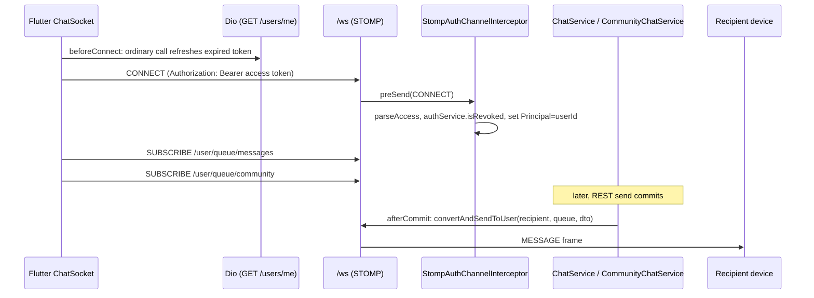

# Messaging

Direct (1:1) messages and community group chat: REST for every write, a STOMP WebSocket only for live delivery to online users.
Covers each user action end to end, the socket design, ordering/pagination, offline behaviour, and what is not built.

Last verified: 2026-11-16 against commit 168d987 (working tree has uncommitted changes)

## 1. Overview

- Writes (send, read mark, delete) are always REST calls. The server then pushes the saved message to the other online users over STOMP after the DB commit. A client SEND frame over the socket is rejected on purpose (`StompAuthChannelInterceptor`).
- Two independent chat types:
  - DM: `chat` package (`ChatController`, `ChatService`, tables `conversations`, `chat_messages`).
  - Community group chat: `community` package (`CommunityChatController`, `CommunityChatService`, table `community_messages`, read mark in `community_members.chat_read_at`).
- One WebSocket per app session in Flutter (`ChatSocket`), carrying both queues.
- Pushes are best effort and only reach connected users. REST is the source of truth: history is always re-read from REST.

Key files:

| Area | File |
|---|---|
| DM API | `apsbrat-api/src/main/java/com/apsconnect/api/chat/ChatController.java`, `ChatService.java`, `ChatMessageRepository.java`, `ConversationRepository.java` |
| Socket config/auth | `.../chat/WebSocketConfig.java`, `.../chat/StompAuthChannelInterceptor.java`, `.../common/config/SecurityConfig.java` (`/ws/**` permitAll) |
| Group chat API | `.../community/CommunityChatController.java`, `CommunityChatService.java`, `CommunityMessageRepository.java` |
| Presence | `.../user/PresenceService.java`, `.../auth/JwtAuthFilter.java` (calls `touch`) |
| Reports | `.../safety/ReportService.java` (`COMMUNITY_MESSAGE`) |
| Photos | `.../media/ImageUploadController.java` (`POST /api/v1/media/images`), `ImageUploadService.requireOwnUpload` |
| Migrations | `V12__create_conversations.sql`, `V15` (`idx_chat_unread`), `V28` (image columns), `V31__community_chat_and_presence.sql`, `V36` (conversation indexes) |
| Flutter DM | `frontend/lib/features/chat/data/chat_repository.dart`, `chat_socket.dart`, `chat_models.dart`, `presentation/chat_controller.dart`, `presentation/screens/chat_screen.dart` |
| Flutter group chat | `frontend/lib/features/community/presentation/community_chat_screen.dart`, `.../community/data/community_repository.dart` (`// Group chat` section) |
| Flutter list | `frontend/lib/features/feed/presentation/widgets/messages_tab.dart`, `.../feed/presentation/screens/home_screen.dart` |

## 2. Data model

- `conversations` (V12): `user_a_id`, `user_b_id`, `last_message_at`, `created_at`. `uq_conversation_pair UNIQUE (user_a_id, user_b_id)`, `chk_conv_not_self`. One row per pair; `ChatService.openWith` puts the smaller id (Java `UUID.compareTo`) in A. There is NO DB check that A < B, so the unique key only dedupes because every code path uses the same Java ordering.
- `chat_messages`: `conversation_id` (CASCADE), `sender_id` (CASCADE), `body TEXT`, `image_url` (V28), `read_at`, `created_at`. Indexes `(conversation_id, created_at)`, partial `idx_chat_unread` on `read_at IS NULL`. Read state is per message (`read_at`), so unread count = messages from the other person with `read_at IS NULL`.
- A conversation with `last_message_at IS NULL` is "inactive": opening a chat creates the row but it only appears in the list after the first message (`ConversationRepository.findActiveFor`). V36 partial indexes serve that query.
- `community_messages` (V31): `community_id`, `sender_id`, `body VARCHAR(2000)`, `image_url`, `status` (`ACTIVE`/`HIDDEN`/`REMOVED`, CHECK), `created_at`; index `(community_id, created_at DESC)`.
- Group read mark: `community_members.chat_read_at` (null means "since joined"). Presence: `users.last_active_at`, `user_settings.show_activity` (V31).

## 3. WebSocket / STOMP design

- Endpoint: `/ws` (`WebSocketConfig.registerStompEndpoints`), raw WebSocket (no SockJS fallback registered). Allowed origins = same list as CORS (`app.cors.allowed-origins`); the mobile app sends no Origin. HTTP security lets `/ws/**` through; authentication happens in the STOMP CONNECT frame instead. `RateLimitFilter` skips `/ws`.
- Broker: in-memory simple broker on `/queue`, user prefix `/user` (`configureMessageBroker`). Inbound channel interceptor is `StompAuthChannelInterceptor`.
- Auth on CONNECT: needs `Authorization: Bearer <access token>`; `JwtService.parseAccess` then `AuthService.isRevoked(userId, issuedAt)`; the Principal name is the user id. Failures throw `IllegalArgumentException` and the connection is refused.
- SUBSCRIBE: only destinations starting with `/user/queue/` are allowed. Because Spring resolves `/user/...` per Principal, a user can only receive their own queue.
- SEND: always rejected ("Sending over the socket is not supported"), so nobody can publish straight to the broker.
- Destinations: `/user/queue/messages` carries `ChatMessageDto` (DM). `/user/queue/community` carries `CommunityMessageDto` (new message, or the same dto with `removed=true` when a message is deleted or hidden).
- Auth is checked ONLY at CONNECT. A token that expires or is revoked later does not close an open socket (UNVERIFIED: no other check found in `chat` package).
- Flutter client (`ChatSocket` in `chat_socket.dart`, provider `chatSocketProvider`): created once; `HomeScreen.initState` calls `connect()` (login and cold start both land there); `auth_provider.dart` calls `disconnect()` on logout and session end. `connect()` reads the token and builds a `StompClient` (`stomp_dart_client`) with `url = Env.wsUrl` (dart-define `WS_URL`, default `ws://localhost:8080/ws`). `beforeConnect` makes a `GET /users/me` through Dio first, so an expired 15-minute token is refreshed by the Dio interceptor, then the fresh token replaces the header. `_onConnect` subscribes to both queues and re-subscribes after every reconnect.
- Reconnect: the library retries on its own timer. `onWebSocketError`, `onWebSocketDone`, `onStompError` set `reconnecting=true` (app-wide "Reconnecting to chat..." banner in `app.dart`), cleared in `_onConnect`. `AppLifecycleListener(onResume: reconnectIfDropped)` replaces a dead socket when the app returns from the background.
- Fallback when the socket is down: there is NO polling and no alternative transport (no `Timer.periodic` in chat code, verified by grep). Sending still works over REST. Receiving requires either a screen reload (`ChatController.load`, pull of `conversationsProvider`) or a later push.
- Missed pushes are not replayed. After reconnect the client does not refetch (UNVERIFIED: no refetch hook found in `_onConnect` or `reconnectIfDropped`), so a chat screen that stayed open while offline can miss messages until it is reopened.

Distribution inside the server: DM push targets exactly one user (`convertAndSendToUser(otherId, "/queue/messages", dto)`). Group push iterates all currently connected users from `SimpUserRegistry`, intersects with community members (`memberRepository.findUserIdsIn`), skips users blocked with the sender, and sends one frame per member. The registry is local to one server instance: the simple broker is in-memory, so with more than one API instance a user connected to instance B does not get pushes sent from instance A (UNVERIFIED how production is scaled; the code comment says to move to a broker relay at scale).

## 4. Direct messages: user actions

Common: Dio interceptors (`frontend/lib/core/network/dio_client.dart`) add the bearer token and an `Idempotency-Key` on every POST, refresh on 401, retry GET and keyed POST up to twice on connection errors/502/503/504 (500 ms, 1 s). `RateLimitFilter` allows 300 requests/min per user. `IdempotencyFilter` stores the 2xx response of a POST per key for 24 h, so a retried send does not create a second message.

### 4.1 Open a conversation

1. Tap Message on a person (profile, batch list, community member).
2. Frontend: `ChatRepository.openWith` (`chat_repository.dart`), then `context.go('/home/chat/{id}')` (e.g. `batch_tab.dart` around line 140).
3. State: no provider; the returned `Conversation` id goes into the route. Not optimistic.
4. API: `POST /api/v1/conversations/with/{userId}` -> `ConversationDto` (`id`, `person`, `preview`, `time`, `unread`, `unreadCount`).
5. Backend: `ChatController.openWith` -> `ChatService.openWith`: reject self (400); target must exist (404); deleted or blocked either way -> 404 "User not found"; order ids; `findByUserA_IdAndUserB_Id` else `createConversation` (on `DataIntegrityViolationException` it re-reads the row the other request created).
6. DB: read `users`, `user_blocks`, `conversations`; insert `conversations` if new.
7. Frontend: success navigates; error shows snackbar "Could not open chat. Try again.".
8. UI: the chat screen opens (empty if new).
9. Other users: not told (the conversation is hidden from the other person's list until a message exists).
10. Failure: POST is retried with the same key on transient errors; other errors become the snackbar.
11. Concurrency: unique pair key plus the catch-and-reread in `createConversation`.
12. Security: auth; block and deleted-user checks. Anyone can open a conversation with anyone not blocked, connected or not (limits apply at send time). No special rate limit.

### 4.2 Send a message (connected vs unconnected rules)

1. Type text and press send, or pick a photo (gallery or camera).
2. Frontend: `_send` / `_sendPhoto` in `chat_screen.dart` (around lines 79 and 90). Photo path first calls `mediaRepositoryProvider.uploadPhoto(kind: UploadKind.chat)` (`POST /api/v1/media/images`, multipart, 30 uploads/hour per user via `ImageUploadService.rateLimit`), then sends the returned URL. Both end in `ChatController.send` in `chat_controller.dart`.
3. State: `chatControllerProvider(conversationId)` (autoDispose `StateNotifier<ChatState>`). Optimistic: adds a `temp-...` message with `pendingIds`, replaces it with the server copy on success, removes it on failure and sets `error` (the server reason from `payload['error']` when present, else "Message failed to send"). A listener on `error` shows it in a snackbar and the screen puts the text back when `send` returns false. On success it also invalidates `conversationsProvider`.
4. API: `POST /api/v1/conversations/{conversationId}/messages`, body `{"body": string?, "imageUrl": string?}` (`SendChatMessageRequest`: body max 4000, imageUrl max 300). Returns `ChatMessageDto` (`id`, `conversationId`, `senderId`, `body`, `imageUrl`, `mine`, `createdAt`).
5. Backend: `ChatService.sendMessage`, in order:
   1. `requireParticipant` (404 "Conversation not found" if missing or not a participant, so ids cannot be probed).
   2. `blockRepository.existsBetween` -> 404 "Conversation not found".
   3. Relation via `PersonService.relations` (one query): CONNECTED when an ACCEPTED connection exists. Max length 4000 if connected, 300 if not.
   4. Trim body; `ImageUploadService.requireOwnUpload` accepts only a URL matching `/media/(post|chat|event)/{myUserId}/{uuid}.jpg` (400 otherwise), so nobody can attach someone else's file or an external URL.
   5. Empty text and no photo -> 400 "Write a message or add a photo".
   6. Photo while not connected -> 403 "You can send photos once you're connected" (stops strangers opening with an image).
   7. Text over limit -> 400.
   8. Not connected: if I already sent a message in this conversation and they never replied -> 403 "Wait for a reply, or connect, before sending another message". Why: stops spam to strangers (one unanswered message allowed). Once they reply, both can write (still max 300 chars).
   9. Save `ChatMessage`; set `conversation.lastMessageAt`; register `afterCommit` push to the other user on `/queue/messages`.
6. DB: read `conversations`, `user_blocks`, `connections`, `chat_messages` (two `exists` checks); write `chat_messages`, update `conversations.last_message_at`.
7. Frontend: swaps temp message for saved one; invalidates the list so the preview updates.
8. UI: bubble appears immediately with a pending icon, then settles. On failure the bubble disappears and a snackbar says why.
9. Other users: live push to `/user/queue/messages` if connected. `ChatController.receive` (open screen) appends it (deduped by id) and calls `markRead`. `HomeScreen` listens to the same stream and invalidates `conversationsProvider` so list previews and badges refresh. If offline, they get it on the next list or history fetch. No external push notification (no FCM/APNs code found).
10. Failure: HTTP errors roll back the optimistic bubble. Connection errors/timeouts are retried by the Dio interceptor with the same idempotency key (no duplicate). The photo upload failure shows "Couldn't upload the photo. Try again." (any error in the upload or the send is reported with that text in `_sendPhoto`).
11. Concurrency: no lock. The "one message to a stranger until they reply" check is read-then-write, so two simultaneous sends can both pass. Idempotency key stops duplicate retries only. Messages are ordered by `created_at`.
12. Security: JWT; participant check; block check; own-upload URL check; length limits; Bean Validation sizes. No per-conversation rate limit; only the global 300/min per user. There is NO block re-check at push time for DMs (not needed, since the send already checked).

### 4.3 List conversations and unread counts

1. Open the Messages tab (`messages_tab.dart`); DMs and group chats are merged, with filters All / Direct / Groups / Unread.
2. Frontend: `conversationsProvider` (`FutureProvider`) -> `ChatRepository.conversations`; group items from `myCommunityChatsProvider`.
3. State: invalidated by `ChatController.send`, `markRead`, and by `HomeScreen` on every push; `refreshAfterBlock` invalidates it too. Not optimistic.
4. API: `GET /api/v1/conversations` -> list of `ConversationDto`.
5. Backend: `ChatService.listConversations`: `findBlockedIdsInvolving`, `findActiveFor` (join fetch, `last_message_at IS NOT NULL`, newest first), drop blocked partners, then fixed-count queries: `findLatestIn` (DISTINCT ON, last message each) and `countUnreadIn` (group by), `personService.toPeople`.
6. DB: `conversations`, `chat_messages`, `users`, `user_blocks`, `connections`.
7-8. Shows preview ("Photo" when image only), time, unread count; Unread filter counts conversations with unread.
9. n/a (read-only).
10. Failure: standard Dio handling; the screen shows the provider's error state.
11. n/a, read-only.
12. Own conversations only (query is by my id). Not paged: all active conversations are returned.

### 4.4 Load history (pagination, ordering)

1. Open a chat, or scroll up for older messages.
2. Frontend: `ChatController.load` and `loadOlder` -> `ChatRepository.messages(id, cursor, limit=30)`.
3. State: `ChatState.messages` oldest first; `loadOlder` prepends. `hasMore` / `nextCursor` come from the server.
4. API: `GET /api/v1/conversations/{id}/messages?cursor=&limit=30` -> `CursorPage` (`items`, `nextCursor`, `hasMore`).
5. Backend: `ChatService.messages`: `requireParticipant`; limit clamped to 1..100 (`CursorSupport.clampLimit`, default 30); cursor is URL-safe base64 of the last (oldest) item's `createdAt`; query `created_at < cursor ORDER BY created_at DESC` with page size + 1 to detect `hasMore`; reversed so items are oldest first within the page; a bad cursor is 400.
6. DB: `chat_messages` via `idx_chat_msg_conv`.
7. After the first load the controller calls `markRead` (fire and forget).
8. UI: newest at the bottom; scrolling up loads older pages.
9. n/a.
10. Failure: first load sets "Could not load messages"; `loadOlder` failure is silent (it stops loading and can be retried by scrolling).
11. n/a.
12. Participant only. NO block check here: a blocked user can still read an existing conversation's history by id (see risks).

Ordering caveat: the cursor is `created_at` alone with a strict `<`, so two messages with an identical timestamp at a page boundary could be skipped (very unlikely with microsecond timestamps, but there is no tie-break on id).

### 4.5 Mark read

1. Opening a chat, or a live message arriving in an open chat.
2. Frontend: `ChatController.markRead` -> `ChatRepository.markRead`.
3. State: on success invalidates `conversationsProvider` (badge drops). Failure is ignored ("a stale badge is fine").
4. API: `POST /api/v1/conversations/{id}/read` -> `{success, message:"Marked read"}`.
5. Backend: `ChatService.markRead`: `requireParticipant`; `ChatMessageRepository.markRead` sets `read_at = now` on messages in the conversation not sent by me and still unread (one UPDATE, idempotent).
6. DB: update `chat_messages.read_at`.
7-8. Badge clears.
9. The sender is NOT told: there are no read receipts in the UI or over the socket.
10. Failure: swallowed.
11. Idempotent update; safe if called twice.
12. Participant check only.

## 5. Community group chat: user actions

Rules: only members can read, send, mark read (`communityService.requireMember`); author, community owner or staff can delete; sender limit 120 messages per hour (`rateLimit`, Redis key `ratelimit:community-chat:{userId}`, fixed window; 429 `RATE_LIMITED` with "You're sending a lot..."; note it uses `increment` without catching Redis errors, unlike the global filter); body max 2000.

### 5.1 Send a group message

1. Type or attach a photo in `CommunityChatScreen` (community page tab or full screen).
2. Frontend: `_send` in `community_chat_screen.dart` -> `CommunityChatController.send` -> `CommunityRepository.sendChatMessage`.
3. State: `communityChatProvider(communityId)` (autoDispose `StateNotifier`). NOT optimistic: the message is added from the server response via `receive`, deduped by id so the later push of the same message is ignored.
4. API: `POST /api/v1/communities/{id}/chat/messages`, body `{body?, imageUrl?}` (same `SendChatMessageRequest`) -> `CommunityMessageDto` (`id`, `communityId`, `sender` PersonDto, `body`, `imageUrl`, `removed`, `createdAt`).
5. Backend: `CommunityChatService.send`: `requireMember`; `rateLimit`; trim; length > 2000 -> 400; `requireOwnUpload`; empty and no photo -> 400; save `CommunityMessage` (status ACTIVE); set the sender's own `chat_read_at = now`; `pushAfterCommit` to connected members (see section 3).
6. DB: write `community_messages`, update `community_members.chat_read_at`.
7. Frontend: error -> `_snack(friendlyError(e))` with the server message; photo upload failure -> "Couldn't upload the photo. Try again.".
8. UI: the message appears at the bottom and the list jumps to newest.
9. Other members: live push on `/user/queue/community` if connected; `communityPushProvider` feeds every open `communityChatProvider` and the `HomeScreen` listener invalidates `myCommunityChatsProvider` (list preview and unread). Offline members see it on next fetch. Members who are blocked with the sender are skipped from the push AND filtered from history.
10. Failure: no rollback needed (not optimistic); keyed POST retried by Dio on transient errors, idempotent.
11. Concurrency: no lock needed (append only); rate limit counter is atomic in Redis.
12. Security: JWT, membership, ownership of photo URL, rate limit, size limits.

### 5.2 Load group history, read marks, unread

- `GET /api/v1/communities/{id}/chat/messages?cursor=&limit=30` -> `CommunityChatService.messages`: `requireMember`, `findPage` with `status = ACTIVE`, `created_at < cursor` (first page uses now + 1 min), `sender NOT IN hiddenSenders` (blocked either way, plus a placeholder id so `NOT IN` is never empty), size + 1, reversed to oldest-first; same cursor format as DMs (so the same tie caveat).
- `POST /api/v1/communities/{id}/chat/read` -> `markRead` sets `chat_read_at = now` for me. Called after the first load (`CommunityChatController` from `_load`) and after each live push when the screen is open. Failures are swallowed (`catchError`).
- Unread count = `countUnread`: ACTIVE messages from others, not hidden senders, `created_at > chat_read_at` (or joined time if null).
- `GET /api/v1/communities/mine/chats` (`myChats`): per joined community the latest message and unread count. It runs 2 queries per community (code comment `ponytail:` notes the ceiling).
- `GET /api/v1/communities/{id}/chat` (`summary`): last message, unread, `canModerate`, `onlineCount`.
- Frontend state: `myCommunityChatsProvider`, `communityChatSummaryProvider(id)`. Not optimistic. Security: membership. Concurrency: none; `chat_read_at` is a plain overwrite by a single user.

### 5.3 Delete a group message

1. Long-press a message -> "Delete for everyone" (`community_chat_screen.dart`, around line 260).
2. Frontend: `CommunityRepository.deleteChatMessage`; then `CommunityChatController.remove` for the local list.
3. State: local removal after success (not optimistic). Failure: `_snack(friendlyError(e))`.
4. API: `DELETE /api/v1/community-messages/{id}` -> `{success, message:"Message deleted"}`.
5. Backend: `CommunityChatService.delete`: message must exist and be ACTIVE (404 "Message not found"); allowed if sender, community owner (`ownedCommunityIds`) or staff (`isStaff`), else 403; `setStatus(REMOVED)` (soft delete) and `pushAfterCommit` with `removed=true`.
6. DB: update `community_messages.status`.
7-8. Bubble disappears.
9. Connected members receive the dto with `removed=true`; `CommunityChatController.receive` removes it. Offline members simply no longer get it in history (`status = ACTIVE` filter). Note the removal push is sent only if the recipient is not blocked with the SENDER of the message.
10. Failure: snackbar; not retried (DELETE).
11. Second concurrent delete gets 404 (status no longer ACTIVE); no lock, plain dirty-checked update.
12. Author/owner/staff only.

### 5.4 Report a group message

1. Long-press -> "Report" -> `showReportSheet(context, ref, 'COMMUNITY_MESSAGE', m.id)`.
2. API: `POST /api/v1/reports` (`ReportController`), body with `targetType=COMMUNITY_MESSAGE`, `targetId`, reason, details.
3. Backend: `ReportService.create` -> `CommunityChatService.requireReportable` (message exists and ACTIVE, reporter is a member of its community, not your own message); duplicate reports by the same reporter return the earlier report (idempotent); after `AUTO_HIDE_REPORTERS = 3` distinct reporters the message is hidden (`CommunityChatService.hide`, status `HIDDEN`, push with `removed=true`) until staff review (`restore` brings it back).
4. Other users: members see it vanish on the next push or fetch. Admin tools in `AdminService` (not covered here).

### 5.5 Online counts and presence

- `PresenceService.touch` is called from `JwtAuthFilter` on any authenticated request, throttled to one DB write per minute per user with a Redis key `active:{userId}` (`setIfAbsent`, 60 s). It writes `users.last_active_at`. This is request-based activity, not socket presence: the WebSocket does not update it, and there is no online/offline socket event.
- A user counts as online if active in the last 5 minutes (`PresenceService.ONLINE_WINDOW`).
- Group `onlineCount` (`CommunityChatService.summary`): `memberRepository.countActiveSince` counts members with `last_active_at` in the window who have `show_activity` on (`COALESCE(..., TRUE)`); it is `null` when the caller hides their own activity (they see nobody's, a reciprocity rule). UI shows "N online" / "N active now" when greater than 0 (`community_chat_screen.dart` line ~297, `community_screen.dart` line ~1547).
- Person-level "active now / 2h ago": `PresenceService.visibleLastActive`, shown only when both viewer and subject share activity.

## 6. Delivery, ordering, offline: summary

- Delivery is at-most-once over the socket; durability comes from REST history. No ack, no retry queue, no offline queue on the server.
- Ordering: by `created_at` (DB `NOW()` default or entity timestamp; UNVERIFIED which, see entity `@CreationTimestamp` or default). Pages are newest-first descending then reversed; the client keeps oldest first.
- A recipient who is offline gets the message from `GET .../messages` and sees unread counts after reopening the app. A sender who is offline cannot send: the request fails after Dio's retries (up to 2 retries, backoff 500 ms/1 s, then a snackbar) and the optimistic DM bubble is removed (the user's text is put back).
- Duplicate protection: `Idempotency-Key` server filter (retries), `receive` dedupe by message id (push versus REST response).

## 7. Not implemented (verified by search)

Searched `frontend/lib` and `apsbrat-api/src` for typing, edit, delete, archive/hide, reaction, receipt, push-notification (FCM/APNs) terms:
- DM edit, DM delete, hide/archive conversation, leave conversation: not implemented (no endpoints in `ChatController`; only list, open, history, send, read).
- Typing indicators, read receipts ("seen"), delivery receipts, message reactions, replies/threads: not implemented. The old course doc lists receipts, typing and edit/delete as future work.
- Mobile push notifications for messages: not implemented (Firebase is used only for Google sign-in).
- Group chat edit, group read receipts, mute: not implemented. Delete is soft, by moderators or author.
- Server-side offline queue, replay of missed pushes, and polling fallback: not implemented.
- WebSocket-based sending: deliberately blocked.
- Socket presence (online/offline events): not implemented; presence is request-based.
- Per-conversation DM spam limit beyond "one message until reply" for strangers and the global rate limit.

## 8. Risks and tech debt

- `ChatService.messages` and `markRead` do not check blocks: a blocked person can still read the old thread by conversation id (`ChatService.java` around line 110-125).
- Socket auth only at CONNECT: expired or revoked tokens are not re-validated while the socket stays open (`StompAuthChannelInterceptor.java`).
- Missed pushes are not recovered after reconnect; an open chat can silently lag (`chat_socket.dart` `_onConnect`, `reconnectIfDropped`).
- Group push scans all connected users per message and uses a per-instance in-memory registry (`CommunityChatService.pushAfterCommit`, code comment `ponytail:`); won't scale across instances without a broker relay.
- Stranger-DM rule has a read-then-write race (`ChatService.sendMessage` around line 185-195); no DB constraint backs it.
- `CommunityChatService.rateLimit` calls Redis without a fail-open catch, so a Redis outage fails group sends (the handler maps `RedisConnectionFailureException` to 503) while the global filter fails open.
- DM `conversations` pair order is enforced only by Java convention (signed `UUID.compareTo`), not by a DB CHECK, unlike connections (V39 uses text order). Both are consistent today; a second writer using a different ordering would create duplicate conversations.
- Cursor on `created_at` only (no id tie-break) in both DM and group history.
- `myChats` is N+1 (2 queries per joined community); `listConversations` and `listBatchmates` are unpaged.

## 9. Discrepancies with existing docs

- `docs/API.md` (around line 226) says chat is "REST; client polls, no websocket yet", and `docs/BACKEND.md` (around line 177) says chat and community messaging are REST only with no realtime push: both are stale. A STOMP WebSocket (`/ws`) with `/user/queue/messages` and `/user/queue/community` exists, and the Flutter app subscribes to both.
- `docs/chat-course/CHAT_COURSE.md` lists images and delete/edit as future work; images (photo messages) ARE implemented, edit/delete for DMs are not.
