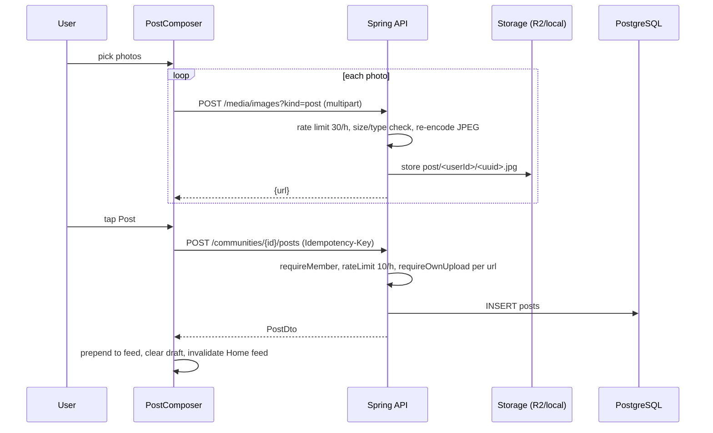

# Posts, Comments and Likes
Community posts (text, photos, memories, event photos), likes, comments, pin, delete, share and the post detail screen, end to end (Flutter + Spring Boot).
Everything below was read from code; behaviour not exercised at runtime is marked UNVERIFIED.

Last verified: 2026-11-16 against commit 168d987 (working tree has uncommitted changes)

## 1. Map of the feature

| Layer | Files |
|---|---|
| API controller | `apsbrat-api/src/main/java/com/apsconnect/api/community/PostController.java` |
| Service | `.../community/PostService.java` (posts, likes, comments, moderation hooks, DTO assembly) |
| Repositories | `PostRepository`, `PostLikeRepository`, `CommentRepository` (same package) |
| Entities | `Post` (table `posts`, has `@Version`), `PostLike` (`post_likes`), `Comment` (`comments`) |
| Photo upload | `.../media/ImageUploadController.java`, `ImageUploadService.java`, `ImageProcessor.java`, `UploadKind.java` |
| Flutter data | `frontend/lib/features/community/data/community_repository.dart` (`CommunityRepository`, `PostFeedNotifier`, providers), `community_models.dart` (`Post`, `PostComment`) |
| Flutter UI | `frontend/lib/features/community/presentation/post_card.dart`, `post_screen.dart`, `community_screen.dart` (`PostComposer`, `showPostComposer`, `_FeedTab`), `frontend/lib/core/media/photos.dart` (`pickPhotos`, `MediaRepository.uploadPhoto`) |
| HTTP client | `frontend/lib/core/network/dio_client.dart` (`dioProvider`) |

Endpoints (all under `/api/v1`, all need a JWT):

| Method + path | Purpose |
|---|---|
| `POST /media/images?kind=post` (multipart `file`) | upload one photo, returns `{url}` |
| `POST /communities/{id}/posts` | create post |
| `GET /communities/{id}/posts?sort=latest\|popular&cursor&limit` | community feed |
| `GET /feed/home?cursor&limit` | Home feed (see `feed-search-discovery.md`) |
| `GET /posts/{id}` | post detail |
| `DELETE /posts/{id}` | delete (soft) |
| `PUT` / `DELETE /posts/{id}/pin` | pin / unpin |
| `PUT` / `DELETE /posts/{id}/like` | like / unlike |
| `GET /posts/{id}/comments?cursor&limit` | comments, oldest first |
| `POST /posts/{id}/comments` | add comment |
| `DELETE /comments/{id}` | delete comment (soft) |
| `GET /communities/{id}/memories`, `/memories/years`, `GET /events/{id}/posts` | filtered lists of posts (see `communities.md`) |

Shared rules that apply to every action below:
- Response envelope is `ApiResponse<T>` (`common/response/ApiResponse.java`); lists use `CursorPage<T>` = `{items, nextCursor, hasMore}`.
- Content status enum `ContentStatus` = `ACTIVE | HIDDEN | REMOVED` (`posts.status`, `comments.status`). Only `ACTIVE` is ever shown. `HIDDEN` is set by report auto-hide (3 distinct reporters, `safety/ReportService.AUTO_HIDE_REPORTERS`), `REMOVED` by delete. Both are soft states so staff can restore (`PostService.restorePost`).
- "Readable post" (`PostService.readablePost`): post is `ACTIVE`, there is no block either way between viewer and author (`UserBlockRepository.existsBetween`), and the viewer may read the community (`CommunityService.requireReadable`). Failures return 404 (block / not active) or 403 (private community, not a member). 404 for blocks is deliberate: it does not reveal that a block exists.
- "Interactable post" (`interactablePost`) = readable + the viewer is a member (`requireMember`). Like and comment need it. Reading needs no membership for OPEN communities, and for SCHOOL communities only if the user has that school in their school history (otherwise 404); PRIVATE communities need membership (403).
- Every POST from the app gets an `Idempotency-Key` header automatically (`dio_client.dart` onRequest). The server (`common/web/IdempotencyFilter.java`) keys it by user + URI + key, stores the first 2xx response for 24 h and replays it. A second request while the first is running gets 409. Why: Dio retries keyed POSTs up to 2 times on connection errors, connect timeouts and 502/503/504 (not on receive/send timeouts) (up to 2 retries, 500 ms then 1 s back-off); without the key a retry could create two posts or comments.
- Global request budget: 300 req/min per user (`common/web/RateLimitFilter.java`, fail-open if Redis is down). `/media/**` GETs are excluded.
- Every error is shown in the app through `friendlyError()` (`community_repository.dart`): the server `error` string if present, otherwise "Couldn't connect. Check your internet..." when there is no response.

---

## 2. Create a post

### 2.1 Text post / photo post (the normal composer)

1. **User action**: taps the "Share a memory or update" card on a community page (members only), writes up to 2000 characters, optionally adds up to 10 photos, taps Post.
2. **Frontend**: `community_screen.dart` `_FeedTab` -> `showPostComposer` -> `PostComposer` / `_PostComposerState._post()`. Photos: `_addPhotos()` -> `pickPhotos` (`core/media/photos.dart`) -> `_upload()` -> `MediaRepository.uploadPhoto`. Submit: `CommunityRepository.createPost(communityId, body, imageUrls, eventId, memoryYear, memoryCategory)`.
3. **State management**: widget-local state in `_PostComposerState` (`_busy`, `_photoUrls`, `_uploading`). The Post button is disabled while `_busy` or `_uploading != null`. After success the new `Post` is pushed into the open feed with `PostFeedNotifier.prepend` (via `onPosted`). Not optimistic: the post appears only after the server answers.
4. **API**: `POST /communities/{id}/posts`, body `{body, imageUrls[], eventId?, memoryYear?, memoryCategory?}` (`CreatePostRequest`: body <= 2000, imageUrls <= 10). Response `ApiResponse<PostDto>` with id, community, author (`PersonDto`), body, imageUrls, likeCount, commentCount, likedByMe, canDelete, pinned, canPin, event id/title, memory year/category, createdAt.
5. **Backend** (`PostController.create` -> `PostService.create`, one `@Transactional`), in order:
   1. `communityService.requireMember` (readable + member; SCHOOL communities also need the user's school history, otherwise 404).
   2. `rateLimit("posts:"+userId, 10/hour)` in Redis (`INCR` + 1 h `EXPIRE`) -> 429 `RATE_LIMITED`.
   3. Trim body. Each `imageUrl` goes through `ImageUploadService.requireOwnUpload` (regex: `<media base>/(post|chat|event)/<my userId>/<uuid>.jpg`), repeats dropped, order kept. A foreign or external URL gives 400 "That photo can't be attached". Why: stops people attaching other users' photos or hot-linking arbitrary URLs.
   4. More than 10 photos -> 400. Empty body and no photos -> 400 "Write something or add a photo".
   5. If `memoryYear` or `memoryCategory` is present it is a memory (see 2.2).
   6. `eventId` present -> `CommunityEventService.requireTaggable` (event belongs to this community, not cancelled, already started) -> else 400/404.
   7. `postRepository.save` then `toDtos` to build the response.
6. **Database**: INSERT into `posts` (`body VARCHAR(2000) NOT NULL`, `image_urls TEXT[] NOT NULL DEFAULT '{}'`, `status`, `like_count`, `comment_count`, `pinned_at`, `event_id` FK `ON DELETE SET NULL`, `memory_year`, `memory_category`, `version`). Constraint `chk_post_memory` (V33): year and category are both null or both set, category in a fixed list. Index `idx_posts_community_newest (community_id, created_at DESC, id DESC)`. Reads: communities, community_members, user_school_history (membership/eligibility), users, events.
7. **Response handling**: `createPost` returns a `Post`; `_post()` sets `_posted = true`, clears the saved draft, calls `onPosted`, invalidates `postFeedProvider('')` (Home) and, for event posts, `postFeedProvider(communityId)`; for memories it invalidates `memoriesProvider` and `memoryYearsProvider(communityId)`; then closes the sheet.
8. **UI update**: the sheet closes and the new post is at the top of the community feed (above pinned posts, until the next reload puts pinned first). Home reloads lazily the next time it is built (see feed doc).
9. **Other users**: no push, no WebSocket, no notification. Others see it when their feed is next fetched (community pull-to-refresh, re-opening the screen; Home has no pull-to-refresh, see risks).
10. **Failure handling**: any error -> snackbar with the server message ("You're posting a lot...", "Join this community first", etc.); sheet stays open with text and photos intact; `_busy` reset in `finally`. Transport errors: Dio retries up to 2 times (idempotency key makes it safe). If the app is killed or the sheet is dismissed, `dispose()` saves a draft (see 2.4).
11. **Concurrency**: no unique constraint on posts; protection against double submit is the `_busy` flag (client) plus the Idempotency-Key replay (server). The post rate limit counter is a Redis `INCR`, atomic.
12. **Security**: JWT required; membership checked server-side; photo ownership regex; length limits via bean validation (`@Size`); body is stored as plain text and rendered as text by Flutter (no HTML). The rate limit is counted before validation, so a rejected post still uses one of the 10 hourly slots (`PostService.java:71`).

### 2.2 Variation: memory post (school communities only)
- Frontend: "School memory" switch in the composer (`allowMemory` is true only for school communities; `_canBeMemory` is false when `eventId != null`). Needs a year (1950..current year) and a category (`MemoryCategory`: ANNUAL_DAY, SPORTS_DAY, CLASSROOM, TRIPS, FAREWELL, CAMPUS, OTHER) and at least one photo; the client checks these before sending.
- Backend: same endpoint. `PostService.create` rejects (400) when the community is not `SCHOOL`, when only one of year/category is sent, when the year is out of range, or when there are no photos. DB `chk_post_memory` is the last line of defence.
- Result: the post carries `memoryYear`/`memoryCategory`, shows a "Throwback" label in `PostCard`, appears in the Memories gallery (`GET /communities/{id}/memories`). It is also a normal post in the feed.
- The server does not forbid memory + `eventId` together (only the UI does).

### 2.3 Variation: event-tagged post ("Share photos from an event")
- Frontend: `event_screen.dart` shows "Share" (calls `showPostComposer(eventId: ...)`) when the user is a member and `e.started && !e.cancelled`. `onPosted` is `eventPostsProvider(eventId).notifier.prepend`.
- Backend: `eventId` validated by `CommunityEventService.requireTaggable` (same community, started, not cancelled). Event posts are listed by `GET /events/{id}/posts` (`PostService.eventPosts`, index `idx_posts_event`).
- Deleting the event row sets `posts.event_id` to NULL (the post stays); cancelling an event does not touch its posts.

### 2.4 Post composer drafts (client only)
- Where: `_PostComposerState` in `community_screen.dart` (`_draftKey = post_draft:<communityId>:<eventId>:<asMemory>`, stored with `SharedPreferences` as JSON `{text, photos[]}`).
- Save: `dispose()` saves when `_posted` is false (so closing the sheet, or a failed post, keeps the draft). Empty text and no photos deletes the key. Restore: `initState` -> `_restoreDraft()` fills text and photo URLs only if the fields are empty.
- Cleared after a successful post. Not synced across devices. Photos in a draft are already uploaded (see 3), so the draft stores URLs, not files.
- Gap: uploaded files are never deleted if a draft is abandoned (no orphan clean-up job found: `maintenance/MaintenanceJobs.java` only purges rows, UNVERIFIED for storage objects).

---

## 3. Media upload flow (photos)

1. **User action**: picks photos in the composer (camera or gallery on phones, file picker on web). Up to `10 - already attached`.
2. **Frontend**: `core/media/photos.dart` `pickPhotos` (image_picker, max 2000 px, quality 85) -> `_PostComposerState._upload()` uploads one file at a time with progress text "Uploading 2 of 4..." -> `MediaRepository.uploadPhoto(file, kind: UploadKind.post)` -> `POST /media/images?kind=post`.
3. **State**: each returned URL is appended to `_photoUrls` (setState). Not optimistic: a thumbnail appears only after its upload finishes.
4. **API**: `POST /api/v1/media/images?kind=post|chat|event`, multipart field `file`. Response `{data: {url}}`.
5. **Backend**: `ImageUploadController.upload` -> `ImageUploadService.upload`: reject empty file; `rateLimit` 30 uploads/hour per user in Redis (429); `ImageProcessor.toSanitizedJpeg(bytes, contentType, 1600)`: max 5 MB (413), only `image/jpeg|jpg|png` (415), must decode as an image, scaled so the long side <= 1600 px, re-encoded to JPEG (this strips EXIF/GPS and any non-image payload); key `post/<userId>/<uuid>.jpg` stored by `StorageService` (`R2StorageService` in production, `LocalStorageService` locally, served from `/media/**`).
6. **Database**: none. Photo addresses only reach the DB when the post is created (`posts.image_urls`).
7. **Response handling**: `dataMap(res)['url']`.
8. **UI**: thumbnail strip grows; "Post" is disabled while `_uploading` is set.
9. **Other users**: none until the post is created. `GET /media/**` is public (`SecurityConfig`), so anyone with the URL can fetch the image (URLs contain random UUIDs).
10. **Failure**: snackbar with message and a Retry action that re-uploads only the files not yet uploaded (`remaining = files.sublist(done)`). Multipart POSTs are not auto-retried by Dio (`opts.data is! FormData`). Spring multipart limits: `spring.servlet.multipart.max-file-size=5MB`, `max-request-size=6MB` (`application.yml`); `GlobalExceptionHandler` maps oversize to 413.
11. **Concurrency**: uploads are sequential on the client; server stores each under a fresh UUID so no collisions.
12. **Security**: JWT; ownership is encoded in the folder name and checked by regex when attaching (`requireOwnUpload`); content re-encoded server side, never trusting the extension or content type alone; per-user hourly cap.

Why upload before posting: the Post request stays small and fast, and a failed upload can be retried without retyping. Cost: abandoned uploads become orphan files.

---

## 4. Browse, open and refresh posts

- Community feed: `_FeedTab` watches `postFeedProvider(communityId)` (`PostFeedNotifier`, autoDispose family, key = community id, re-created when `postSortProvider(communityId)` changes). `GET /communities/{id}/posts`, `limit=20`. Server: `PostService.list` (`requireReadable`, block filter, "latest" = `PostRepository.findPage`, "popular" = `findPopularPage`, score = likes + 2 x comments over the last 30 days, offset cursor). First page prepends up to 3 pinned posts (`findByCommunityIdAndStatusAndPinnedAtIsNotNullOrderByPinnedAtDesc`, index `idx_posts_pinned`).
- Post detail: tapping a card (`context.push('/home/post/{id}')`) opens `PostScreen`, which watches `postProvider(id)` -> `GET /posts/{id}` and `commentsProvider(id)` -> `GET /posts/{id}/comments?limit=50`. 404 shows "This post is gone". It keeps a local `_post` copy so likes and comment counts update instantly, and `_syncFeeds` pushes the change into any open feed notifier (community, Home, event) without refetching.
- Cursors: time cursor = Base64URL of the last `createdAt` (`common/util/CursorSupport`); the query asks for `limit+1` rows to compute `hasMore`. Ties on identical `createdAt` could skip a row (the query is `createdAt < cursor`, no id tiebreak): rare, UNVERIFIED in practice.
- Comments list: only the first 50 comments are ever shown; if `hasMore` the screen prints "Showing the first 50 comments." and there is no load-more (`post_screen.dart` ~line 222). Comments 51+ are unreachable in the app.
- Block filtering: `hiddenAuthors` = users I blocked or who blocked me (`UserBlockRepository.findBlockedIdsInvolving`), applied to posts and comments.
- DTO assembly (`toDtos`) runs a fixed number of queries per page (authors, community names, my likes, my owned communities, event titles), so a page is not N+1.

---

## 5. Like / unlike

1. **User action**: taps the heart on a post card (feed, Home, post detail).
2. **Frontend**: `post_card.dart` `_PostCardState._toggleLike()` -> `CommunityRepository.setLiked(postId, liked: bool)` -> `PUT` or `DELETE /posts/{id}/like`.
3. **State management**: optimistic. `before.toggledLike()` flips `likedByMe` and adjusts `likeCount` by +/-1 and calls `widget.onChanged(optimistic)` (the owning `PostFeedNotifier.replace`, or `PostScreen._post`). `_liking` is a per-card guard: a second tap while a request is in flight is ignored (the user's last tap is dropped, not queued).
4. **API**: `PUT /posts/{id}/like` or `DELETE /posts/{id}/like`, no body. Response: full `PostDto` with the server's `likeCount` and `likedByMe`.
5. **Backend** (`PostController.like/unlike` -> `PostService.like/unlike`, `@Transactional`): `interactablePost` (readable + member, see section 1) -> `PostLikeRepository.insertIfAbsent` (native `INSERT ... ON CONFLICT DO NOTHING`, returns 1 or 0) -> only when 1: `PostRepository.addToLikeCount(id, +1)` (`UPDATE posts SET like_count = like_count + :delta`, flush + clear persistence context) -> `get()` re-reads the post (`readablePost` again) and rebuilds the DTO. Unlike mirrors it with `deleteLike` and `-1`.
6. **Database**: `post_likes (post_id, user_id)` PRIMARY KEY, both FKs `ON DELETE CASCADE`; `posts.like_count`. No notification row is created for likes (verified: only comments notify).
7. **Response handling**: success -> `widget.onChanged(fresh)` replaces the optimistic copy with server truth. Error -> `widget.onChanged(before)` (rollback) and a snackbar via `friendlyError`.
8. **UI**: the heart label and count change instantly. The icon shape is the same Hugeicons heart for liked and unliked (`HugeIcons.strokeRoundedHeart` in both branches of the ternary); only the colour changes (red-accent vs grey-brown). Accessibility note: colour is the only liked-state signal.
9. **Other users**: count changes only on their next fetch. No push; no notification to the post author.
10. **Failure**: HTTP errors roll back and show the server message (403 "Join this community first" if the user left, 404 if the post is gone). Offline: `networkOfflineProvider` set by the Dio interceptor, rollback + "Couldn't connect" snackbar. PUT/DELETE are not auto-retried (retry interceptor only covers GET and keyed POST).
11. **Concurrency**: correct under races. The `(post_id, user_id)` primary key plus `ON CONFLICT DO NOTHING` makes double-likes a no-op, and the counter moves only when a row is really added or removed, using a relative SQL update (`like_count + 1`), so two simultaneous likes both count. `Post.@Version` is not involved because the update is a bulk JPQL update that bypasses it. A post's count can still drift from the table if rows are removed by cascade paths that do not adjust `like_count` (a deleted user's likes are not removed because accounts are soft-deleted; UNVERIFIED for hard deletes).
12. **Security**: JWT; membership + block + visibility checks run on every call; idempotent by design (PUT/DELETE), so no Idempotency-Key needed. Only the global 300 req/min limit applies (no per-like limit).

Performance note: a like is heavy for what it does. `like()` calls `readablePost` (post + block + community + school-eligibility + membership checks), `requireMember` (repeats the community/membership checks), the insert, the counter update, then `get()` repeats `readablePost` and `toDtos` (authors with school history, mutual counts, relations, presence, communities, my likes, owned communities, staff check, event titles). Roughly 15-20 SQL statements per tap (counted from code, not measured). The client only needs the new count; returning a slim `{likeCount, likedByMe}` would remove most of it.

---

## 6. Comments

### 6.1 Add comment
1. **User action**: types in the box at the bottom of the post screen and taps send.
2. **Frontend**: `post_screen.dart` `_PostScreenState._send(post)` -> `CommunityRepository.addComment(postId, body)`.
3. **State**: `_sending` flag. Not optimistic. On success: clear the text field, `post.copyWith(commentCount + 1)` into `_post`, `_syncFeeds(updated)` (updates open feeds), `ref.invalidate(commentsProvider(postId))` (refetches the list).
4. **API**: `POST /posts/{id}/comments` body `{body}` (`CreateCommentRequest`: `@NotBlank`, max 1000). Response `CommentDto {id, postId, author, body, canDelete, createdAt}`.
5. **Backend** (`PostService.addComment`): `interactablePost` -> `rateLimit("comments:"+userId, 60/hour)` -> `commentRepository.save` -> `postRepository.addToCommentCount(+1)` -> if the commenter is not the author, `NotificationService.create(authorId, GENERAL, "New comment", "<name> commented on your post", ref POST)`.
6. **Database**: INSERT `comments` (`body VARCHAR(1000)`, `status`, index `idx_comments_post (post_id, created_at)`); UPDATE `posts.comment_count` (relative update); INSERT `notifications`.
7. **Response handling**: the returned comment is ignored; the list is refetched.
8. **UI**: new comment appears at the bottom (oldest-first order), count in the header and on cards increases.
9. **Other users**: the post author gets an in-app notification row (`notifications`). No WebSocket or FCM push is sent from `NotificationService` (UNVERIFIED whether the app polls the notification list on a timer). Other viewers see the comment on their next fetch.
10. **Failure**: snackbar with the message, text kept in the field. Keyed POST: Dio retries up to 2 times on connection errors, connect timeouts and 502/503/504 (receive and send timeouts are not retried); the idempotency filter replays the first success, so a retry cannot create a duplicate comment.
11. **Concurrency**: counter uses a relative SQL update. No unique key, so intentional repeated comments are allowed. The Redis counter for the rate limit is atomic.
12. **Security**: membership + block check (a blocked commenter gets 404 on the author's posts); length limit validated by bean validation; body rendered as plain text.

Note: the count shown after commenting is computed on the client (`commentCount + 1`), not read from the server, so it can briefly differ if others commented meanwhile.

### 6.2 Delete comment
1. **User action**: long-press on a comment (`_CommentRow` `onLongPress`) opens the actions sheet -> Delete (only shown if `comment.canDelete`) -> confirm dialog.
2. **Frontend**: `_CommentRow._actions` -> `_PostScreenState._deleteComment` -> `CommunityRepository.deleteComment(id)`.
3. **State**: not optimistic. After success: `commentCount - 1` into `_post`, `_syncFeeds`, invalidate `commentsProvider`.
4. **API**: `DELETE /comments/{id}`; response `{message: "Comment deleted"}`.
5. **Backend** (`PostService.deleteComment`): find comment not `REMOVED` (404) -> load post -> `canModerate` = comment author OR owner of the community OR staff (ADMIN/MODERATOR) -> else 403 -> `setCommentStatus(REMOVED)` which saves and adjusts `comment_count` by -1 only on an ACTIVE to not-ACTIVE transition.
6. **Database**: `comments.status = 'REMOVED'` (row kept), `posts.comment_count` decremented.
7-8. As above; the comment disappears after the list refetch.
9. **Other users**: next fetch only.
10. **Failure**: snackbar. A second delete of the same comment returns 404.
11. **Concurrency**: the `wasActive != isActive` check prevents double-decrement in sequence, but two simultaneous deletes could both read ACTIVE (read-modify-write on the entity; `Comment` has no `@Version`, UNVERIFIED) and decrement twice.
12. **Security**: ownership/moderator check server-side; `canDelete` in the DTO is only a UI hint.

### 6.3 Report a comment or post (entry points only)
- Post: the "..." menu on `PostCard` always shows "Report" (also on your own post). Comment: actions sheet in `_CommentRow`. Both call `showReportSheet` (`post_card.dart`) -> `CommunityRepository.report('POST'|'COMMENT', id, reason)` -> `POST /reports`.
- Server: `ReportService.create` -> `PostService.requireReportable` (item must be visible to the reporter; reporting your own content returns 400). The own-content rule is server-only, so the menu entry on your own post ends in an error snackbar. Auto-hide at 3 distinct reporters. Details are in the safety/moderation file.

---

## 7. Delete post
1. **User action**: "..." on a post -> Delete (if `canDelete`) -> confirm "Delete this post? It will be removed for everyone. This can't be undone."
2. **Frontend**: `PostCard._delete()` -> `CommunityRepository.deletePost`.
3. **State**: not optimistic. After success `widget.onDeleted()` -> `PostFeedNotifier.remove(id)` (or, on the post screen, `_syncFeeds(removed: true)` and `context.pop()`; memory posts also invalidate `memoriesProvider`).
4. **API**: `DELETE /posts/{id}` -> `{message: "Post deleted"}`.
5. **Backend** (`PostService.delete`): find post not `REMOVED` (404) -> `canModerate` (author, community owner, or staff; else 403) -> `status = REMOVED`.
6. **Database**: `posts.status = 'REMOVED'`. Comments, likes and photos stay in the DB/storage. Pinned state is not cleared but ignored because every query filters `ACTIVE`.
7-8. Post vanishes from the list.
9. **Other users**: disappears on their next fetch; opening a stale card gives "This post is gone" (404).
10. **Failure**: snackbar with server message.
11. **Concurrency**: idempotent in effect (second call 404).
12. **Security**: server-side ownership/moderation; staff role comes from the JWT authorities (`CommunityService.isStaff`).
- Copy mismatch: the dialog says "can't be undone" but deletion is a soft delete that staff can reverse (`restorePost`).

## 8. Pin / unpin
1. **Action**: "..." -> "Pin to top" / "Unpin" (menu item shown only when `post.canPin`, which is: owner of that community or staff).
2. **Frontend**: `PostCard._togglePin()` -> `CommunityRepository.setPinned`.
3. **State**: not optimistic. On success `onChanged(fresh)` then `ref.invalidate(postFeedProvider(fresh.communityId))` so the community feed reloads in pinned-first order. Home feed (`postFeedProvider('')`) is NOT invalidated.
4. **API**: `PUT` / `DELETE /posts/{id}/pin` -> `PostDto`.
5. **Backend** (`PostService.setPinned`): `readablePost` -> must be community owner (`ownedCommunityIds`) or staff else 403 -> on pin: count ACTIVE pinned posts in the community, if `>= MAX_PINNED (3)` -> 400 "You can pin up to 3 posts. Unpin one first." -> `pinnedAt = now`. Unpin sets null.
6. **Database**: `posts.pinned_at`; index `idx_posts_pinned`.
9. **Other users**: next feed load. Pinned posts lead the first page of a community feed (both sorts); on Home they are included but sorted by creation time like other posts.
11. **Concurrency**: check-then-set without a lock. Two owners pinning two different posts at the same time can exceed 3 (`PostService.java` ~line 241). Low impact (one owner per community).
12. **Security**: owner/staff only. School communities have no OWNER member (see `communities.md`), so only staff can pin there.

## 9. Share (client-side only)
- Verified: `PostCard._share()` calls `Share.share(...)` (share_plus) with text "<author> in <community>: <body or 'Shared a photo post.'> Shared from APS Brats". No server call, no deep link or URL, so the receiver cannot open the post. A `ponytail:` comment in code records this as a deliberate shortcut. Community header "Share" is also text-only.
- Failure handling/security: none needed (OS share sheet). Photo content is not shared, only the caption text.

## 10. Home / feed lists that show posts
See `feed-search-discovery.md` for `GET /feed/home`. Post actions on Home use the same `PostCard` and `postFeedProvider('')`.

---

## Not implemented (verified by search)
Searched `apsbrat-api/src/main` and `frontend/lib` (java, dart, sql) for edit/update post, `edited_at`, `parent_id` / reply, reaction, bookmark / saved post, repost, mention, hashtag, video upload.
- Editing posts: no `PUT /posts/{id}`; controller has only like/pin as PUT. Not implemented.
- Editing comments: no endpoint. Not implemented.
- Replies / threaded comments: `comments` has no parent column. Not implemented.
- Reactions beyond a single like: none.
- Reposts, saved/bookmarked posts, mentions, hashtags: none.
- Video or file posts: `UploadKind` is `POST|CHAT|EVENT` images only and the upload accepts JPEG/PNG only. The video and file icons on the school "Share a memory or update" card (`community_screen.dart:823`, `PromptCard.actionIcons`) are decorative; the whole card just opens the same composer.
- Like notifications: not implemented (comments notify the author; likes do not).
- Photo clean-up when a post, draft or upload is abandoned: none found.
- Real-time updates of posts/likes/comments for other viewers: none (REST fetch only; WebSocket is used for chat).

## Risks and tech debt (this feature)
- `PostService.java:71` rate limit counted before validation; if Redis is down `rateLimit` throws (mapped to 503 by `GlobalExceptionHandler`), so posting/commenting/uploading fail closed while `RateLimitFilter` fails open.
- `common/web/IdempotencyFilter.java:68` has no try/catch around Redis calls and every app POST carries an Idempotency-Key: a Redis outage likely breaks all keyed POSTs (UNVERIFIED how the container reports a filter exception).
- Like round trip ~15-20 queries (section 5). Pin limit race (section 8). Comment delete read-modify-write (6.2).
- `PostFeedNotifier._load` (`community_repository.dart:523`) sets `hasMore: false` on any error, so a failed "load more" removes the Show more control until a full refresh.
- Time cursor has no id tiebreak (section 4).
- Comments beyond the first 50 on a post cannot be viewed (section 4).
- Delete dialog copy says irreversible but the delete is soft.
