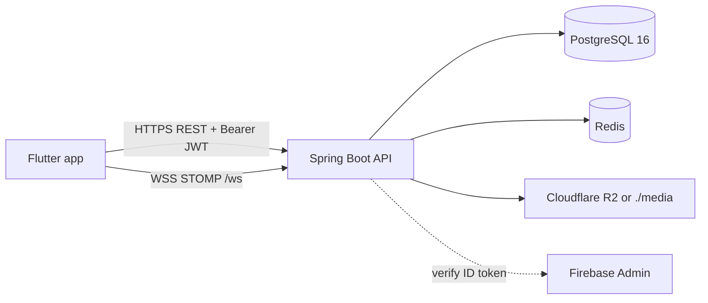
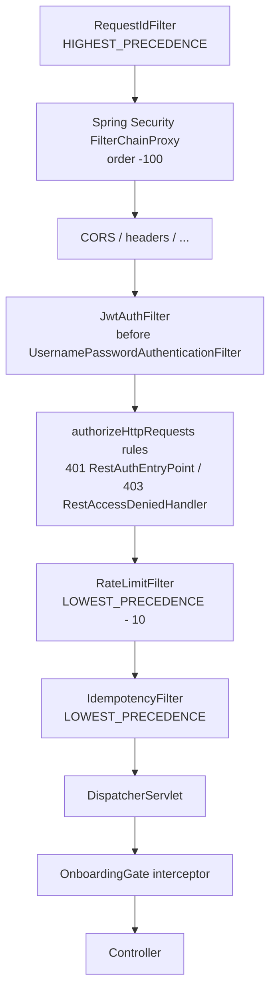

# 04 - Backend Engineering

Purpose: how the Spring Boot API is built: layers, filters, data access, caching, background work, errors, logging, and where to find things.
Audience: engineers changing `apsbrat-api`. Security details live in `07-authentication-security.md`, schema details in `06-database.md`.

Last verified: 2026-11-16 against commit 168d987 (working tree has uncommitted changes)

All paths are relative to the repo root. Source root: `apsbrat-api/src/main/java/com/apsconnect/api/` (written `api/` below).

---

## 1. Architecture at a glance

- Spring Boot 3.2.5, Java 17, one deployable jar (`apsbrat-api/Dockerfile`, `JAVA_OPTS=-Duser.timezone=Asia/Kolkata`).
- Stateless REST under `/api/v1/**`, JSON envelope `ApiResponse` (`api/common/response/ApiResponse.java`), cursor paging via `CursorPage` + `CursorSupport`.
- One STOMP WebSocket endpoint `/ws` used only to push (messages are sent over REST).
- PostgreSQL (JPA/Hibernate, `ddl-auto: validate`, Flyway owns the schema), Redis (rate limits, tokens, idempotency, cache), media on Cloudflare R2 or local disk.
- Feature packages, not technical layers: `auth`, `user`, `profile`, `connection`, `circle`, `community`, `chat`, `feed`, `notification`, `search`, `safety`, `career`, `school`, `media`, `places`, `maintenance`, `common`.

## 2. Controller / service / repository pattern

Implemented and followed consistently:

| Layer | Rule | Example |
|---|---|---|
| Controller (`*Controller`) | Thin. Reads the caller with `SecurityUtils.currentUserId()`, calls one service method, wraps in `ApiResponse.success(...)`. Request bodies are Java records with `jakarta.validation` annotations and `@Valid`. | `api/connection/ConnectionController.java` |
| Service (`*Service`) | All business rules, transactions, authorization-by-data (is this my row? are we blocked?), notifications, cache eviction. | `api/connection/ConnectionService.java`, `api/community/PostService.java` |
| Repository (`*Repository`) | Spring Data `JpaRepository`; JPQL for entity queries, native SQL for set logic (mutual friends, search, keyset paging). | `api/connection/ConnectionRepository.java`, `api/user/UserRepository.java` |
| DTO | `*Dto` records; entities are never returned. Batch DTO builders avoid N+1 (`PersonService.toPeople`). | `api/user/PersonService.java` |

Conventions worth knowing:
- Read paths use `@Transactional(readOnly = true)`; writes use `@Transactional` on the service method.
- Services throw `AppException(message, HttpStatus[, ErrorCode])`; controllers never build error envelopes.
- "Not found" is returned instead of "forbidden" where existence must not leak (blocked users, other schools' communities): `ProfileService.getById`, `CommunityService.visibleCommunity`, `ConnectionService.requestConnection`.
- `OnboardingGate` (`api/user/OnboardingGate.java`) is a Spring MVC interceptor that returns 403 for accounts that verified email but have not finished the profile step. It covers `/api/v1/communities|posts|comments|events|community-messages|conversations|connections|reports|people|search|feed|profiles/**`, `/api/v1/users/me/circle/**`, `/api/v1/users/*/block`. It does NOT cover `/users/me`, school history, social links, career, media, notifications, places (those are the onboarding steps).
- No `@PreAuthorize` / method security anywhere (`grep` finds none). Authorization is (a) URL rules in `SecurityConfig`, (b) explicit checks inside services/controllers.

## 3. Request filters, in execution order

| # | Class | File | What it does | Failure behaviour |
|---|---|---|---|---|
| 1 | `RequestIdFilter` | `api/common/web/RequestIdFilter.java` | Takes `X-Request-Id` from the client or generates a UUID; puts it in MDC key `requestId` and the response header. | n/a. The client-supplied value is not validated (length/charset). |
| 2 | Spring Security chain | `api/common/config/SecurityConfig.java` | Stateless, CSRF off, CORS, security headers, URL rules. | 401 via `RestAuthEntryPoint`, 403 via `RestAccessDeniedHandler` (JSON envelope with `requestId`). |
| 2a | `JwtAuthFilter` | `api/auth/JwtAuthFilter.java` | Parses `Authorization: Bearer`, accepts only `type=access` tokens, checks revocation (`AuthService.isRevoked`), sets a `UsernamePasswordAuthenticationToken` whose principal is the user `UUID` and authority `ROLE_<role>`. Puts `userId` in MDC. Calls `PresenceService.touch` (see 6). | Bad/expired token: stays anonymous, protected routes 401. Revocation check fails open if Redis is down. |
| 3 | `RateLimitFilter` | `api/common/web/RateLimitFilter.java` | Fixed-window counter in Redis `rl:<u:id or ip:addr>:<minute>`. 300/min per user, 60/min per IP when anonymous (`app.rate-limit.*`). Skips OPTIONS, `/actuator/`, `/ws`, `/media/`. | 429 + `Retry-After`. Fails open on Redis errors. |
| 4 | `IdempotencyFilter` | `api/common/web/IdempotencyFilter.java` | For `POST` with `Idempotency-Key` (<=100 chars) by a signed-in user: `SETNX idem:<user>:<uri>:<key>` (60 s pending). Only 2xx responses are stored (24 h) and replayed with header `Idempotent-Replayed: true`. A concurrent duplicate gets 409 CONFLICT. | Non-2xx deletes the key so the client may retry. If Redis is down the exception escapes the filter (not handled by `GlobalExceptionHandler`), so POSTs with a key return a container 500. |

The Flutter client adds an `Idempotency-Key` to every POST (`frontend/lib/core/network/dio_client.dart`) and retries transient failures with the same key.

Because RateLimitFilter runs after Security, unauthenticated requests to protected routes are rejected (401) before they are counted. Public routes (`/api/v1/auth/**`) are counted per IP.

Other web-layer pieces:
- `StompAuthChannelInterceptor` (`api/chat/`) authenticates the STOMP `CONNECT` frame with the same access JWT and revocation check, rejects client `SEND`, and only allows `SUBSCRIBE` to `/user/queue/*`.
- `MediaWebConfig` serves `/media/**` from disk when `app.storage.type=local`.
- `DevProfileGuard` refuses to boot the `dev` profile inside Docker/Kubernetes unless `SPRING_PROFILES_ACTIVE` is set explicitly.

## 4. Authentication and authorization flow (code view)

1. `POST /api/v1/auth/request-otp` -> `AuthService.requestOtp` (rate limits, store code in `otp_codes`).
2. `POST /api/v1/auth/verify-otp` or `/google` -> `AuthService.verifyOtp` / `signInWithGoogle` -> `findOrCreateByEmail` -> `issueTokens` (access JWT 15 min, refresh JWT 30 days, refresh `jti` stored in Redis `rt:<jti>` and set `rtu:<userId>`).
3. Every request: `JwtAuthFilter` -> `SecurityContext` principal = `UUID`. Controllers call `SecurityUtils.currentUserId()` (throws 401 `AppException` if absent).
4. Role checks: `SecurityConfig` requires `ADMIN` or `MODERATOR` for `/api/v1/admin/**`; `AdminService.requireAdmin` re-reads the actor from the DB for admin-only actions (ban, set role); `CommunityService.isStaff` reads the role from the token for the current user.
5. Data-level checks live in services: ownership (`CareerService.ownedEntry`, `UserSocialLinkController`, `UserSchoolHistoryController.requireSelf`), membership (`CommunityService.requireMember/requireReadable`), blocks (see section 10 of doc 07).

Details and gaps: `07-authentication-security.md`.

## 5. Database access patterns

- **JPA entities** map 1:1 to tables; `ddl-auto: validate` means a mapping/schema mismatch stops startup. Native Postgres enum types need `@JdbcType(PostgreSQLEnumJdbcType.class)` (`User.currentStatus`, `Connection.status`, `FeedEvent.type`, `Notification.type`, `UserSocialLink.platform`).
- **Native SQL** is used where JPQL is awkward or slow: mutual friends (`ConnectionRepository.countMutual / findMutualPage / countMutualBetween`), friends and request keyset pages, people search (`UserRepository.searchPeople`), classmates/schoolmates (`UserSchoolHistoryRepository.CLASSMATE_MATCH / SCHOOLMATE_MATCH`), popular posts (`PostRepository.findPopularPage`).
- **Keyset (cursor) paging** is the default: `CursorSupport` (timestamp cursors for posts/chat/comments) and composite `(lower(name), id)` / `(requested_at, id)` cursors for connections. People search and circle lists still use page/offset.
- **Atomic counters**: `like_count`, `comment_count`, `member_count` are changed with `UPDATE ... SET x = x + :delta` (`PostRepository.addToLikeCount/addToCommentCount`, `CommunityRepository.addToMemberCount`). Likes use `INSERT ... ON CONFLICT DO NOTHING` (`PostLikeRepository.insertIfAbsent`) so double-taps are safe.
- **Locks and concurrency**
  - Connections: `ConnectionRepository.lock(pair)` runs `pg_advisory_xact_lock(hashtextextended('connection:<low>:<high>', 0))` at the start of every state change (`requestConnection`, `acceptConnection`, `endConnection`, `endForBlock`). The unique key `uq_connection_pair` and `@Version` are the safety nets. `UserPair.of` orders ids by canonical lowercase text (matches Postgres uuid byte order, needed by `chk_connection_pair_order`).
  - Optimistic locking: `@Version` on `User`, `Connection`, `Post`, `Community`. `OptimisticLockingFailureException` and `DataIntegrityViolationException` map to HTTP 409.
  - Races on unique rows are caught and re-read: `ChatService.createConversation` (conversation pair).
  - No pessimistic `@Lock` and no `SELECT ... FOR UPDATE` anywhere.
- **After-commit hooks**: WebSocket pushes are registered with `TransactionSynchronizationManager` so clients never receive a message that later rolls back: `ChatService.sendMessage`, `CommunityChatService.pushAfterCommit`.
- **Batching**: `hibernate.jdbc.batch_size=50`, `order_inserts/updates=true`; `NotificationService.createAll` inserts in batches. Hikari pool 10 (`DB_POOL_SIZE`), leak detection 20 s, slow-query logging above `SLOW_QUERY_MS` (default 100 ms) to logger `org.hibernate.SQL_SLOW`.

### N+1 hot spots (known or likely)

| Where | Issue | Status |
|---|---|---|
| `PersonService.toPeople` | Designed to avoid N+1: one query for school history, one for mutual counts, one for relations, one for settings. | OK. Note it is called from many services; each call = ~4 queries. |
| `CommunityChatService.myChats` (`api/community/CommunityChatService.java:71`) | 2 queries per joined community (member row, last message, unread count). Marked with a `ponytail:` comment. | Known; fine until users join dozens of communities. |
| `ChatService.listConversations` (`api/chat/ChatService.java:101`) | Fixed query count (good) but returns ALL conversations, no paging. | Tech debt. |
| `OnboardingGate` (`api/user/OnboardingGate.java:37`) | `userRepository.findById` on every gated request (one primary-key read per gated request; with open-in-view, which Spring leaves on by default, a later `findById` of the same user in that request is served from the session cache). | Cheap but constant overhead. |
| `SearchService.search` (`api/search/SearchService.java:41`) | `UserRepository.search` is an unbounded JPQL `LIKE '%term%'` over name/username/city that loads every match, then filters blocked/deleted/non-discoverable in memory and `limit`s. Not trigram-friendly for city, no `LIMIT` in SQL. | Real performance risk as users grow. `GET /api/v1/search`. Prefer `PeopleSearchService`. |
| `CircleService.rankedPage` (`api/circle/CircleService.java:110`) | On a cache miss ranks up to 5000 candidate ids in Java (mutual counts in one IN query). Cached 5 min. | Known ceiling (`ponytail:` comment). |
| `ConnectionRepository.countMutual` | `IN (:ids)` with up to a page of ids; counts friends that may be deleted accounts (the `countMutualBetween` variants do filter deleted). | Minor inconsistency. |
| `PostService.displayName` | `findById` per call (only when creating a notification). | Low. |

## 6. Caching and Redis usage

Redis is required (readiness group includes `redis`). Uses:

| Purpose | Key pattern | TTL | Owner | If Redis is down |
|---|---|---|---|---|
| Refresh tokens | `rt:<jti>`, set `rtu:<userId>` | 30 d | `AuthService` | refresh/login fail with 503 (`RedisConnectionFailureException` handler) |
| Access-token revocation marker | `revoked:<userId>` | access TTL + 60 s | `AuthService.revokeAllFor/isRevoked` | fail open (requests allowed) |
| OTP throttles | `otp:cd:`, `otp:rq:`, `otp:ip:`, `otp:att:`, `otp:lock:` + email/ip | 60 s / 1 h / 15 min | `AuthService` | OTP endpoints 503 |
| Global request budget | `rl:<who>:<minute>` | 90 s | `RateLimitFilter` | fail open |
| Per-action limits | `ratelimit:posts:`, `ratelimit:comments:`, `ratelimit:community-chat:`, `ratelimit:uploads:` + userId | 1 h | `PostService.rateLimit`, `CommunityChatService.rateLimit`, `ImageUploadService.rateLimit` | request fails (503) |
| Idempotency | `idem:<user>:<uri>:<key>` | 60 s pending, 24 h result | `IdempotencyFilter` | unhandled 500 for keyed POSTs |
| Presence throttle | `active:<userId>` | 1 min | `PresenceService.touch` (one `UPDATE users SET last_active_at` per user per minute) | swallowed (logged WARN) |
| People-screen cache | `circle:<userId>:rank:<scope>` and `circle:<userId>:summary` | 5 min / 2 min | `CircleCache` | recompute (never breaks a request) |

`CircleCache` (`api/circle/CircleCache.java`) caches the ranked schoolmate/classmate id list and the summary counts. `evictUser` uses `SCAN` (not `KEYS`) and is called on every connection change (`ConnectionService.evict`), block (`BlockService`), and school-history change (`UserSchoolHistoryService`). Eviction is per user and does not cover a third party's cached ranking (e.g. my block changes your mutual counts only after your 5 min TTL).

Not implemented: HTTP caching/ETags for API responses, Spring Cache abstraction, any cache for profile/feed/post reads.

## 7. Background and scheduled work

- **Only one scheduled job**: `MaintenanceJobs.purgeExpired` (`api/maintenance/MaintenanceJobs.java`), cron `app.maintenance.cron` default `0 30 3 * * *` Asia/Kolkata. Deletes `otp_codes` expired > 1 day and read `notifications` older than 180 days via `JdbcTemplate`. Runs in every instance (idempotent deletes; no ShedLock, fine for one instance).
- **No `@Async`, no executors, no queues, no outbox.** Everything runs on the request thread.
- **After-commit WebSocket pushes** (see section 5). `CommunityChatService.pushAfterCommit` loops over online members of the community on the request thread (`ponytail:` comment, fine for hundreds, not thousands).
- **STOMP broker is the in-memory simple broker** (`api/chat/WebSocketConfig.java:36`, `enableSimpleBroker("/queue")`). With more than one API instance a push only reaches users connected to the instance that handled the REST call. The advisory-lock design for connections is multi-instance safe; chat push is not. Single instance today (comment in `MaintenanceJobs`).
- Not implemented: email/SMS delivery (OTP is only logged), push notifications (`users.fcm_token` column exists but nothing sends FCM), feed event generation (see doc 06), cleanup of orphaned media files, expiry of expired suspensions (computed on read via `User.isSuspended`).

## 8. Error handling

Rules: `CLAUDE.md` and `docs/conventions/error-handling.md`. Implementation:

- `AppException(message, HttpStatus[, ErrorCode])` (`api/common/exception/AppException.java`). The 2-arg form derives the `ErrorCode` from the status.
- `ErrorCode` enum: `VALIDATION_ERROR, BAD_REQUEST, UNAUTHORIZED, FORBIDDEN, NOT_FOUND, CONFLICT, RATE_LIMITED, PAYLOAD_TOO_LARGE, UNSUPPORTED_MEDIA_TYPE, METHOD_NOT_ALLOWED, SERVICE_UNAVAILABLE, INTERNAL_ERROR`.
- `GlobalExceptionHandler` (`@RestControllerAdvice`) maps:

| Exception | HTTP | code | Log |
|---|---|---|---|
| `AppException` | its status | its code | 4xx WARN no stack, 5xx ERROR with stack |
| `MethodArgumentNotValidException` | 400 | `VALIDATION_ERROR` (message = `field: message, ...`) | WARN |
| `HttpMessageNotReadable`, type mismatch, missing param | 400 | `BAD_REQUEST` | WARN |
| `MaxUploadSizeExceededException` (multipart limit) | 413 | `BAD_REQUEST` (not `PAYLOAD_TOO_LARGE`; `ImageProcessor` throws `AppException` with `PAYLOAD_TOO_LARGE` for its own size check) | WARN |
| `HttpMediaTypeNotSupportedException` | 415 | `BAD_REQUEST` (not `UNSUPPORTED_MEDIA_TYPE`; `ImageProcessor` uses the right code for its own type check) | WARN |
| `MissingServletRequestPartException`, `MultipartException` | 400 | `BAD_REQUEST` ("Attach a file to upload") | WARN |
| `HttpRequestMethodNotSupportedException` | 405 | `METHOD_NOT_ALLOWED` | WARN |
| `NoResourceFoundException` | 404 | `NOT_FOUND` | INFO |
| `RedisConnectionFailureException` | 503 | `SERVICE_UNAVAILABLE` | ERROR (no stack) |
| `AccessDeniedException` | 403 | `FORBIDDEN` | WARN |
| `DataIntegrityViolationException`, `OptimisticLockingFailureException` | 409 | `CONFLICT` | ERROR with stack (see risks) |
| `Exception` | 500 | `INTERNAL_ERROR`, generic text + `(ref: <requestId>)` | ERROR with stack |

- Envelope: `ApiResponse.error(message, code, requestId)` where `requestId` comes from MDC (`RequestIdFilter.MDC_KEY`). Filters build the same envelope by hand (`RateLimitFilter`, `IdempotencyFilter`, `RestAuthEntryPoint`, `RestAccessDeniedHandler`) because `@RestControllerAdvice` does not see filter-level errors.
- Gaps against the convention: no handler for `ConstraintViolationException`, `MissingRequestHeaderException`, `HttpMediaTypeNotAcceptableException`, `TransactionSystemException` (they fall to the catch-all 500 or default Spring page); 409 from integrity errors is logged at ERROR with a stack instead of WARN; the two framework-level code mismatches above (the application-level checks in `ImageProcessor` use the right codes, so the two paths disagree); a 4xx raised inside a filter that is not hand-written (e.g. an exception from `IdempotencyFilter`) bypasses the advice. Test coverage for the 400/404/409/forced-500 matrix: UNVERIFIED (tests exist under `apsbrat-api/src/test/java/com/apsconnect/api/common/`, not reviewed in detail).

## 9. Logging

- SLF4J/Logback (Lombok `@Slf4j` or `LoggerFactory`). Note the project rule for C# (log4net) does not apply here.
- Pattern (`apsbrat-api/src/main/resources/logback-spring.xml`): `time LEVEL [requestId] [userId] logger - message`. `userId` is put in MDC by `JwtAuthFilter`.
- dev/default: console at INFO. qa/prod: console plus rolling file `${app.logging.dir:/var/log/apsbrat}/api.log` (50 MB x 30 days, 2 GB cap, gz).
- Slow SQL (>100 ms by default) goes to `org.hibernate.SQL_SLOW`. `show-sql: true` only in dev.
- Known logging hazards: `AuthService.requestOtp` logs the OTP in every profile except `prod` (so also `qa`); `AuthService`/`JwtAuthFilter` log the user id in plain text (acceptable); `FirebaseAuthVerifier` logs rejected-token exception messages.

## 10. Configuration and profiles

`apsbrat-api/src/main/resources/application.yml` (single file, profile blocks `dev` (default), `qa`, `prod`). Key properties: `app.jwt.*`, `app.otp.master`, `app.rate-limit.*`, `app.storage.type`, `app.media.*`, `app.firebase.credentials-path`, `app.cors.allowed-origins`, `app.actuator.public-metrics` (dev only), `app.maintenance.cron` and `app.client.*` (neither is set in `application.yml`; both use in-code defaults in `MaintenanceJobs` / `AppClientController`; min build, maintenance flag; defaults, consumed by `GET /api/v1/app/config`). Env var names are listed in `07-authentication-security.md` section 12.

Actuator exposes `health,info,metrics,prometheus`; `SecurityConfig` permits health and info, and allows metrics/prometheus only when `app.actuator.public-metrics=true` (dev). In qa/prod those endpoints are denied to everyone (even admins), so a scraper needs a separate network path or a config change (UNVERIFIED how production scraping is meant to work).

## 11. Where to look for X

| Topic | Look in |
|---|---|
| Login, OTP, tokens, logout-all | `api/auth/AuthService.java`, `JwtService.java`, `JwtAuthFilter.java`, `AuthController.java` |
| Google sign-in | `api/auth/FirebaseAuthVerifier.java` |
| URL access rules, CORS, headers | `api/common/config/SecurityConfig.java` |
| Rate limit / idempotency / request id | `api/common/web/*Filter.java` |
| Error mapping | `api/common/exception/GlobalExceptionHandler.java`, `AppException.java`, `ErrorCode.java` |
| Current user helper | `api/common/security/SecurityUtils.java` |
| Onboarding completeness gate | `api/user/OnboardingGate.java`, `User.isOnboarded` |
| Profile read + privacy | `api/profile/ProfileService.java`, `api/user/settings/*` |
| Profile edit, username availability | `api/user/UserService.java`, `UserController.java` |
| Account export / deletion | `api/user/AccountService.java` |
| Connections (state machine, lock, history) | `api/connection/ConnectionService.java`, `ConnectionQueryService.java`, `ConnectionRepository.java`, `UserPair.java` |
| Mutual connections | `ConnectionRepository.countMutual / findMutualPage`, `PersonService.mutualCounts` |
| Classmates / schoolmates / ranking | `api/circle/CircleService.java`, `UserSchoolHistoryRepository.java`, `CircleCache.java` |
| People search | `api/search/PeopleSearchService.java`, `UserRepository.searchPeople` |
| Global search (legacy) | `api/search/SearchService.java` |
| School history / socials / career | `api/user/history/`, `api/user/social/`, `api/career/` |
| Communities, join requests, roles | `api/community/CommunityService.java`, `CommunityController.java` |
| Posts, comments, likes, pins, memories, home feed | `api/community/PostService.java`, `PostRepository.java` |
| Events and RSVP | `api/community/CommunityEventService.java` |
| 1:1 chat | `api/chat/ChatService.java`, `ChatController.java`, `WebSocketConfig.java`, `StompAuthChannelInterceptor.java` |
| Community group chat | `api/community/CommunityChatService.java` |
| Notifications | `api/notification/NotificationService.java` |
| Blocking, reporting, moderation | `api/safety/BlockService.java`, `ReportService.java`, `AdminService.java`, `AdminController.java` |
| Home banner / recent joins / activity | `api/feed/FeedService.java` |
| Uploads (avatar, post/chat/event photos) | `api/media/ImageProcessor.java`, `ImageUploadService.java`, `AvatarService.java`, `R2StorageService.java`, `LocalStorageService.java` |
| City autocomplete | `api/places/PlacesService.java` |
| Nightly cleanup | `api/maintenance/MaintenanceJobs.java` |
| Forced update / maintenance flag for the app | `api/common/config/AppClientController.java` |

## 12. Tech debt and risks (backend engineering view)

1. `GET /api/v1/search` loads every LIKE match into memory (`api/search/SearchService.java:41`, `UserRepository.search` at `UserRepository.java:44`) and does not exclude banned users. Replace with the SQL in `searchPeople` or move the app to people search (the Flutter app still calls it, `frontend/lib/features/search/data/search_repository.dart:60`, so this is a live path).
1b. `GET /api/v1/users` (`api/user/UserController.java:25`, `UserService.getUsers`) lists every non-deleted account page by page (max 50/page). It ignores `discoverable=false`, blocks and bans, and is not behind `OnboardingGate` (a bare account can call it). At 300 req/min a logged-in user could enumerate the directory quickly. Also see `07-authentication-security.md`.
2. `IdempotencyFilter` keys on user + URI + key only, not the request body: reusing a key with a different body returns the first response (`IdempotencyFilter.java:66`). Fine for client-generated random keys.
3. Redis outage behaviour is inconsistent: rate limit and revocation fail open, OTP/uploads/posts return 503, idempotent POSTs return a raw 500.
4. `ChatService.listConversations` is unpaged; `CommunityChatService.myChats` is N+1 per community.
5. In-memory STOMP broker prevents horizontal scaling of push.
6. `GlobalExceptionHandler` logs expected 409s at ERROR with a stack (`GlobalExceptionHandler.java:118`), which will make alerting noisy and contradicts the 4xx = WARN rule.
7. Dead code: `PasswordEncoder` bean (`SecurityConfig.java`), `users.password_hash`, `notifications.group_key`.
8. `LocalDateTime.now()` is used for all timestamps, so the JVM default timezone matters (see `06-database.md` section on time zones); only the Docker image pins it.
