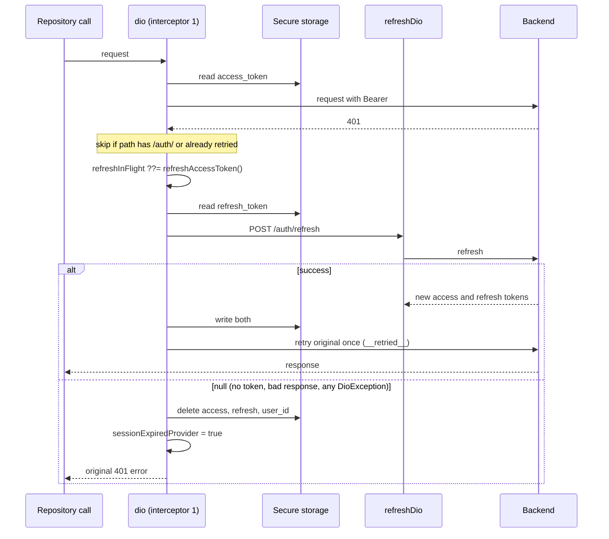
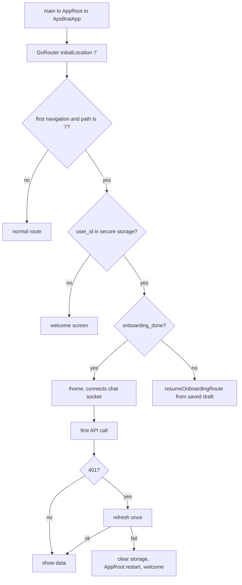

# 05. Frontend Engineering

Purpose: how the Flutter app in `frontend/` is built (structure, routing, state, networking, storage, tests), so a new engineer can change it safely.
Scope: `frontend/lib` and `frontend/test`. Backend behaviour is mentioned only where the client depends on it.

Last verified: 2026-11-16 against commit 168d987 (working tree has uncommitted changes)

Stack (`frontend/pubspec.yaml`): Flutter, `flutter_riverpod` ^2.5, `go_router` ^12, `dio` ^5, `flutter_secure_storage`, `shared_preferences`, `stomp_dart_client`, `cached_network_image`, `hugeicons`, `firebase_core/auth`, `google_sign_in`. Riverpod codegen packages are listed, but every provider found is hand-written (no `@riverpod`).

---

## 1. Application structure

Feature-first: `lib/features/<feature>/{data,presentation}` plus shared `lib/core`. `data/` holds the repository (Dio calls), models and providers; `presentation/` holds screens and widgets. Providers sit next to the repository in `data/` (exceptions: `auth` and `onboarding` have `presentation/providers/`). About 68 feature files, 27k lines.

| Path | What lives there |
|---|---|
| `lib/main.dart`, `main_dev.dart`, `main_staging.dart`, `main_prod.dart` | Entrypoints; each sets an `AppFlavor` and runs `AppRoot`. |
| `lib/app.dart` | `ApsBratApp`: `MaterialApp.router`, flavor banner, 640px width clamp (`_PhoneWidth`), offline/reconnecting strip (`_ConnectionBanner`), listener on `sessionExpiredProvider`. |
| `lib/core/app_root.dart` | `AppRoot` owns the `ProviderScope`. `AppRoot.restart()` swaps in a new scope to drop all cached state (after logout/session expiry). |
| `lib/core/routes/app_router.dart` | `appRouterProvider` (GoRouter). |
| `lib/core/network/` | `dio_client.dart` (Dio, interceptors, token keys), `api_response.dart` (`dataList`, `dataMap`), `paged_result.dart`, `app_config.dart`. |
| `lib/core/constants/` | `api_endpoints.dart` (`ApiEndpoints`), `env.dart` (`Env`, `AppFlavor`), `social_platforms.dart`. |
| `lib/core/theme/` | `app_color_palette.dart` (`AppColors`), `app_theme.dart` (`AppTheme`, `AppRadius`, `AppTextStyles`), `app_icons.dart` (`AppIconData`), `app_inputs.dart`. |
| `lib/core/media/photos.dart` | Pick/compress/upload photos, `NetworkPhoto`, `PhotoSlider`, viewer, `mediaUrl()`. |
| `lib/core/{location,models,observability,widgets}` | `LocationService`, shared `Person`, `ErrorReporter`, `TankLoader`. |
| `lib/features/auth` | Login/splash screens, `AuthRepository`, `AuthController`. |
| `lib/features/onboarding` | Registration steps, `OnboardingFrame`, `onboardingFlowProvider`, `OnboardingDraftStore`. |
| `lib/features/feed` | `HomeScreen` (tab shell), `home_tab`, `batch_tab`, `messages_tab`, `profile_tab`, `feed_shared.dart`. |
| `lib/features/chat` | 1:1 chat: `ChatSocket`, `ChatController`, `ChatRepository`, `ChatScreen`. |
| `lib/features/community` | Communities, posts, events, memories, group chat. Most providers are in one file, `data/community_repository.dart`. |
| `connections`, `profile`, `career`, `notifications`, `search`, `settings` | Requests/circles, profiles and editors, career history, notification list, search, blocked users/account. |

Why it matters: tabs are not routes (section 2), so most main-app "screens" are widgets inside `HomeScreen`. Several files are very large (`batch_tab.dart` 2250 lines, `community_screen.dart` 2037, `profile_tab.dart` 1492), hard to review and test.

---

## 2. Routing and navigation

File: `lib/core/routes/app_router.dart`. One `GoRouter` from `appRouterProvider`, navigated with `context.go()` (project rule). Routes are nested so go_router builds a real back stack (system back pops instead of closing the app).

| Path | Screen | Notes |
|---|---|---|
| `/` | `SplashScreen` | Actually the welcome/landing screen. |
| `/login` (`?mode=signup`) | `LoginScreen(signUp:)` | |
| `/onboarding` | `OnboardingIdentityScreen` | Profile step |
| `/onboarding/schools` | `OnboardingSchoolsScreen` | |
| `/onboarding/schools/socials` | `OnboardingSocialsScreen` | students: schools to socials |
| `/onboarding/schools/after-school` | `OnboardingAfterSchoolScreen` | alumni only |
| `/onboarding/schools/after-school/socials` | `OnboardingSocialsScreen` | alumni; nested so back returns to After school |
| `/home` | `HomeScreen` | 4-tab shell |
| `/home/notifications`, `/home/requests`, `/home/blocked` | notifications, connection requests, blocked users | |
| `/home/edit-profile`, `/home/edit-schools` | editors | |
| `/home/profile/:id` | `ProfileScreen` | |
| `/home/communities` | `MyCommunitiesScreen` | |
| `/home/community/:id` (+ `/requests`, `/chat`) | `CommunityScreen` (keyed by id), `JoinRequestsScreen`, `CommunityChatScreen` | |
| `/home/event/:id`, `/home/post/:id` | `EventScreen`, `PostScreen` | |
| `/home/chat/:conversationId` | `ChatScreen` | |

The Verify step of the CLAUDE.md flow (email OTP) happens in `LoginScreen`, not in `/onboarding`. Fallback: `errorBuilder` shows an `EmptyState` "This page doesn't exist" with a "Go to Home" button.

### Redirects and guards

One global async `redirect`:

1. Any `/onboarding*` path: read `currentUserId()` from secure storage. No user id sends the user to `/login?mode=signup`; otherwise `onboardingFlowProvider.notifier.hydrate()` loads the saved draft before the screen builds (matters on web reload).
2. Only on the first navigation of the app run (`firstNavigation` flag) and only for `/`: user id present means `/home` if `onboardingDone()`, else `resumeOnboardingRoute(...)`. The flag exists so a later visit to `/` (back arrow from login) shows the welcome screen instead of bouncing into onboarding.
3. Any storage exception is treated as logged out.

There is no guard on `/home/**`: a logged-out deep link is not redirected.

### Shell / tabs

`HomeScreen` (`features/feed/presentation/screens/home_screen.dart`) is not a go_router ShellRoute. It is a `Scaffold` with an `IndexedStack` and a custom `_BottomNav`:

| Index | Label | Widget |
|---|---|---|
| 0 | Home | `HomeTab` |
| 1 | Batchmates | `BatchTab` |
| 2 | Social (messages and communities merged) | `MessagesTab` (const `_messagesTab = 2`) |
| 3 | Profile | `ProfileTab` |

- Tabs 1-3 build on first visit (`_visited`), then stay alive in the `IndexedStack`.
- Returning to Batchmates invalidates `circleSummaryProvider`, `batchmatesProvider`, `peopleSearchProvider`.
- System back (`PopScope`): close an overlay, then go to tab 0, leave the app only from tab 0.
- Tab index is local `setState`: not deep-linkable. A comment in `_BottomNav` still says "Five tabs" (stale).
- `initState` connects the chat socket and subscribes to pushes (section 7).

---

## 3. State management (Riverpod)

Riverpod 2 without codegen:

| Type | Used for | Examples |
|---|---|---|
| `Provider` | Singletons | `dioProvider`, `appRouterProvider`, `chatSocketProvider`, `authRepositoryProvider` |
| `FutureProvider` (+family) | Server reads, session-long | `profileProvider`, `conversationsProvider`, `notificationsProvider`, `batchmatesProvider`, `careerProvider` |
| `FutureProvider.autoDispose` | Community reads | `communityProvider`, `eventProvider`, `postProvider`, `commentsProvider`, `blockedUsersProvider` |
| `StateNotifierProvider` (+autoDispose/family) | Mutable lists and forms | `authControllerProvider`, `onboardingFlowProvider`, `chatControllerProvider`, `postFeedProvider`, `communityChatProvider` |
| `StateProvider` | Flags | `sessionExpiredProvider`, `networkOfflineProvider`, `postSortProvider` |
| `StreamProvider` | One live stream | `communityPushProvider` (`community_chat_screen.dart`) |
| `ChangeNotifier` (not Riverpod) | Username availability check | `AvailabilityChecker` |

No `Notifier`/`AsyncNotifier` providers exist; all mutable state uses legacy `StateNotifier`.

### How main state is held

- Posts: `PostFeedNotifier` + `PostFeedState` (`community/data/community_repository.dart`): `items`, `nextCursor`, `hasMore`, `loading`, `error`. It takes a fetch function, so one class backs `postFeedProvider` (key = community id, `''` = Home feed), `memoriesProvider`, `eventPostsProvider`. `refresh()` resets, `loadMore()` follows the cursor, and `prepend/replace/remove` patch the list locally so likes, new posts and deletes need no reload. `postFeedProvider` watches `postSortProvider`, so changing sort rebuilds and reloads.
- 1:1 chat: `ChatController` (`chat/presentation/chat_controller.dart`), family by conversation id, autoDispose. Loads the newest page, `loadOlder()` for history, listens to `ChatSocket.messages` while its screen is open (cancelled with the provider), dedups by message id.
- Community group chat: `communityChatProvider` and `communityPushProvider`.
- Profile: `profileProvider(userId)` for others; own data (`meProvider`, `mySocialLinksProvider`, `mySchoolHistoryProvider`, `mySettingsProvider`) uses `localFirst` (section 6). Edit screens call `ref.invalidate` after saving.
- Auth: `AuthController` holds only transient login UI state (`loading`, `otpSent`, `error`, `user`). The real session is in secure storage (section 5).
- Onboarding: `onboardingFlowProvider` (`OnboardingFlowNotifier`) holds all registration fields and persists a draft (section 6).

### Invalidation conventions

About 94 `ref.invalidate`/`ref.refresh` calls, always by hand at the call site after a mutation (e.g. `ChatController` invalidates `conversationsProvider` after send and mark-read; `HomeScreen` invalidates `conversationsProvider` and `myCommunityChatsProvider` on socket pushes). There is no central map of "after X refresh Y", so a forgotten invalidate means stale UI.

### Optimistic updates

Implemented: chat send in `ChatController.send`. It appends a `temp-<micros>` message tracked in `pendingIds`, swaps in the server copy on success, removes it and sets `error` on failure, and returns `false` so the screen can restore the text.
Implemented: post like in `community/presentation/post_card.dart` (`_toggleLike`). It applies `Post.toggledLike()` through `onChanged` at once (heart and count change), calls `CommunityRepository.setLiked`, replaces the post with the server copy on success, and on failure restores the previous post and shows a snackbar. A `_liking` flag ignores taps while a request is running.
Not implemented (inferred from provider layout, UNVERIFIED per screen): connection requests, RSVP, comments, profile edits wait for the server and then invalidate. `PostFeedNotifier.prepend/replace/remove` run after server confirmation, so they are not optimistic.

---

## 4. API integration

### Dio setup (`lib/core/network/dio_client.dart`)

- Base URL: `Env.baseUrl` from `--dart-define=BASE_URL`, default `http://localhost:8080/api/v1`. Connect and receive timeouts 15 s. Default `Content-Type: application/json`.
- A second plain `Dio` (`refreshDio`) is used only to refresh, so refresh can never re-enter the 401 interceptor.

Interceptors in registration order:

1. Auth/offline `InterceptorsWrapper`.
   - `onRequest`: reads `access_token` from secure storage on every request and sets `Authorization: Bearer`. For every `POST`, `putIfAbsent` an `Idempotency-Key` (16 random bytes as hex, `Random.secure`). `putIfAbsent` so retries reuse the same key.
   - `onResponse`: `networkOfflineProvider = false`.
   - `onError`: sets `networkOfflineProvider = true` only for connection error/timeout without a response, then runs the 401 flow below.
2. Retry interceptor: retries connection error, connect timeout and HTTP 502/503/504 up to 2 times (500 ms, then 1000 ms). Replayable only for `GET`, or `POST` with an idempotency key, a non-`FormData` body and a path without `/auth/`.
3. `PrettyDioLogger`, only when `dart.vm.product` is false. Request headers/body are off; response bodies are on in debug.

Why single-flight: several screens fire requests together; without the shared `refreshInFlight` future each 401 would try to use a refresh token the server may rotate. Caveat: `refreshAccessToken` returns `null` on any `DioException`, including a network failure, and then `clearSession()` runs (risk 2).

`ChatSocket.connect()` also relies on this: before each (re)connect it calls `GET /users/me` so an expired token gets refreshed (code comment says access tokens live 15 minutes).

### Response unwrapping and errors

- Backend envelope: `{ success, data, message, error }`. `api_response.dart` has `dataList(res, fromJson)` and `dataMap(res)`; many repositories read `res.data['data']` directly. `paged_result.dart` and `PageOf<T>` (community repo) model cursor pages.
- `friendlyError(error, [fallback])` and `statusOf(error)` are in `features/community/data/community_repository.dart` (~lines 439-456), not in `core/`. `friendlyError` returns the server `error` string if present, a "Couldn't connect" text when there is no response, else the fallback. `statusOf` returns the HTTP status (used for 404 states in `community_screen.dart`, `event_screen.dart`).
- Not universal: `AuthController` maps every failure to a fixed string; `ChatController._serverMessage` duplicates `friendlyError`.
- The backend `code` and `requestId` fields are not read anywhere in `frontend/lib` (grep for `requestId` returns nothing).

### ApiEndpoints

`lib/core/constants/api_endpoints.dart`: static const paths, plus small static functions for parameterised ones (e.g. `userBlock(id)`), grouped by area. Paths are relative to `Env.baseUrl`. Repositories get Dio via `ref.watch(dioProvider)`.

### Remote config

`appRemoteConfigProvider` (`core/network/app_config.dart`) fetches `/app/config` (`minSupportedBuild`, `latestBuild`, `maintenance`, `message`). Grep shows nothing else references it: the force-update/maintenance gate is defined but not enforced.

---

## 5. Authentication state

Login methods (`features/auth/data/auth_repository.dart`): email OTP (`requestOtp`, `verifyOtp`) and Google (Google sign-in, Firebase credential, Firebase ID token posted to `/auth/google`). No password.

Secure storage keys (constants in `dio_client.dart`):

| Key | Meaning |
|---|---|
| `access_token`, `refresh_token` | JWT pair; written by `_storeAndReturn` and by the refresh flow |
| `user_id` | The "logged in" signal used by the router |
| `onboarding_done` | non-empty once the profile step is done (`needsOnboarding` from the server decides `''` or `'1'` at login) |

Restore on launch: no network call and no token validation. The router checks `user_id` and `onboarding_done` only. An expired or revoked session is found by the first API call (401, refresh, maybe reset).

Logout: `AuthController.logout()` calls `AuthRepository.logout()` (best-effort `POST /auth/logout` with 5 s timeout, then `clearLocal()`: Google sign-out, Firebase sign-out, `_storage.deleteAll()`), then disconnects the chat socket. `logoutEverywhere()` calls `/auth/logout-all` first and throws if the server fails. UNVERIFIED: that the settings UI follows logout with `AppRoot.restart()`, which is needed so in-memory providers do not keep the old user's data.

Session expiry: refresh failure sets `sessionExpiredProvider`; `ApsBratApp` listens, runs `clearLocal()` and `AppRoot.restart(context)` (which also clears the Flutter image cache and `CachedNetworkImage` disk cache).

---

## 6. Local storage, persistence, caching

| Store | Key | Content | Cleared by |
|---|---|---|---|
| Secure storage | `access_token`, `refresh_token`, `user_id`, `onboarding_done` | session | logout (`deleteAll`) |
| Secure storage | `onboarding_draft` | `{userId, state}` JSON of the unfinished registration (`OnboardingDraftStore`); a draft for another user id is deleted on load | `clear()`, logout |
| Secure storage | `cache_<name>_<userId>` | local-first copy of own data (`me` and others in `profile_repository.dart`) | logout |
| SharedPreferences | `post_draft:<communityId>:<eventId or empty>:<asMemory>` | composer text and photo URLs (`community_screen.dart`, `_restoreDraft`/`_saveDraft`) | removed when the draft is emptied; UNVERIFIED after a successful post (a `_posted` flag exists) |

`SharedPreferences` is not touched by logout (risk 3).

`localFirst` (`profile/data/profile_repository.dart`): for the user's own data, the first build in a session returns the stored copy at once, fetches in the background and swaps fresh data in with `ref.state = AsyncData(fresh)`. Rebuilds after `ref.invalidate` (edit screens) skip the cache and hit the server, so users never see old data after saving. Secure storage ties the copy to logout.

In-memory caching:
- Non-autoDispose `FutureProvider`s (`profileProvider`, `conversationsProvider`, `batchmatesProvider`, `notificationsProvider`, `searchProvider`, `peopleSearchProvider`) live until the `ProviderScope` is replaced and refresh only on manual invalidation. Family providers keep one entry per key (every distinct search query stays for the session).
- Community providers are `autoDispose`: refetched when a screen reopens.
- No `keepAlive()` anywhere. Tabs keep their widget state through `IndexedStack`.
- Images: `CachedNetworkImage` (default disk/memory cache) via `NetworkPhoto`. `mediaUrl(path)` returns absolute URLs unchanged, otherwise `<origin of BASE_URL><path>`. `Env.cdnUrl` is declared but referenced nowhere else.
- Photos are downscaled by `image_picker` itself (`maxWidth: 2000`, `imageQuality: 85`) in `core/media/photos.dart`. `flutter_image_compress` is declared but never imported.

---

## 7. Realtime (STOMP over WebSocket)

`lib/features/chat/data/chat_socket.dart`, class `ChatSocket`, one per `ProviderScope` (`chatSocketProvider`).

- URL `Env.wsUrl` (`WS_URL`, default `ws://localhost:8080/ws`). `Authorization: Bearer` is sent in STOMP connect headers and WebSocket headers.
- `connect()` is called in `HomeScreen.initState` (login and cold start both land on `/home`); it is a no-op if already active or if no token is stored.
- `beforeConnect` calls `GET /users/me` (token refresh), then copies the fresh token into the headers.
- Subscriptions in `_onConnect`: `/user/queue/messages` (parsed to `ChatMessage`, broadcast on `messages`) and `/user/queue/community` (raw map on `communityMessages`). Malformed frames are dropped silently.
- Reconnect: `stomp_dart_client` built-in retry. `reconnecting` (`ValueNotifier<bool>`) is true after a socket error, close or STOMP error and false on connect. `AppLifecycleListener(onResume: reconnectIfDropped)` replaces a dead socket on app resume. `app.dart` shows "Reconnecting to chat…" only after 10 s and never on `/` or `/login`.
- Consumers: `ChatController` (open conversation), `HomeScreen` (invalidates lists on any push), `communityPushProvider`.
- Not implemented: replay of messages missed while disconnected, refetch after reconnect (UNVERIFIED beyond the `HomeScreen` invalidate-on-next-push), typing/presence. Push notifications: `firebase_messaging` and `flutter_local_notifications` are dependencies with no use in `lib/`.
- UNVERIFIED: browsers cannot set custom WebSocket headers, so on Flutter web only the STOMP header can carry the token; how the backend authenticates the handshake is for the backend wiki.

---

## 8. Error, loading and empty states

- Loading: mostly `AsyncValue.when(loading: ...)`. `TankLoader` (`core/widgets/tank_loader.dart`) is a branded animated loader. There is no single enforced loading widget.
- Empty and error: `EmptyState` (`feed/presentation/widgets/feed_shared.dart`) takes `icon` (`AppIconData`), `title`, `message`, optional `image` and `action`. `action` is how Retry is done (a button calling `ref.invalidate(provider)` or `notifier.refresh()`). `kEmptyInboxImage` is the illustration constant. The router 404 and community 404 (`statusOf(e) == 404`) use it too.
- `PostFeedNotifier` keeps `error` and sets `hasMore: false` on failure, so the UI must offer retry.
- Offline: global strip in `app.dart`, driven by real request results through `networkOfflineProvider`, not a connectivity plugin.
- Messages: `friendlyError()`; unmatched failures show "Something went wrong. Try again."
- `EmptyState` lives in the feed feature but is used app-wide.

---

## 9. Reusable widgets and helpers

| Name | File | Purpose |
|---|---|---|
| `EmptyState` | `features/feed/presentation/widgets/feed_shared.dart` | Icon/illustration, text, action |
| `CrimsonHeader`, `FeedIconBtn`, `FeedSearchBar`, `AvatarCircle`, `SectionLabel`, `StripesPainter` | same | Feed/tab chrome |
| `OnboardingFrame` | `features/onboarding/presentation/widgets/onboarding_frame.dart` | Header, step nodes, footer for every onboarding screen |
| `NetworkPhoto`, `PhotoSlider`, `showPhotoGallery`, `showPhotoViewer`, `mediaUrl`, `pickPhoto(s)`, `photoPart`, `MediaRepository` | `core/media/photos.dart` | Photos: pick, compress, upload, show |
| `ProfilePhotoButton`, `changeProfilePhoto` | `features/profile/presentation/widgets/profile_photo.dart` | Avatar change |
| `CommunityPill`, `AvatarStack`, `MyAvatar`, `PromptCard` | `features/community/presentation/community_ui.dart` | Community UI pieces |
| `TankLoader` | `core/widgets/tank_loader.dart` | Branded loader |
| `localFirst` | `features/profile/data/profile_repository.dart` | Cache-then-refresh |
| `friendlyError`, `statusOf` | `features/community/data/community_repository.dart` | Error mapping |
| `dataList`, `dataMap` | `core/network/api_response.dart` | Envelope unwrap |
| `usernameInputFormatters` | `core/theme/app_inputs.dart` | Username input rules |
| `AppIconData` | `core/theme/app_icons.dart` | Typedef for Hugeicons data |
| `ErrorReporter` | `core/observability/error_reporter.dart` | Crash sink (logs only) |

---

## 10. Theming and design tokens

- `AppColors` (`core/theme/app_color_palette.dart`, re-exported by `app_theme.dart`): crimson `0xFF7B1414`, crimsonDark `0xFF5C0F0F`, crimsonMuted `0xFFB44040`, gold `0xFFD4A84A` (match CLAUDE.md), cream `0xFFF4F0E2`.
- Two palettes coexist. `AppColors` still carries a legacy green set (`g1`..`g3`, `inputBg`, `mud`), and `AppTheme.lightTheme` uses green for `primary`, `AppBar` and dark input fills. Crimson screens use feed constants (`kCrimsonLight`, `kCrimsonMed`, `kTxt`, `kTxt3` in `feed_shared.dart`), `SplashScreen` has private color constants, and `app.dart` hard-codes `0xFFF3F0EC`. So `ThemeData` does not reflect the real brand.
- Light theme only, Material 3. Shared tokens: `AppRadius` (sm 9, md 12, phone 40) and `AppTextStyles.fieldLabel`.
- Every screen is clamped to 640 px and centred (`_PhoneWidth`).
- Icons: Hugeicons (`HugeIcon(icon: HugeIcons.strokeRounded...)`). Give every icon an explicit `size`; icons in a field's `prefixIcon`/`suffixIcon` go through `fieldIconSlot` or they are stretched to 48 px (see D17).
- UNVERIFIED: which font is applied app-wide (`google_fonts` plus `assets/fonts/`), and a full grep for the deprecated `withOpacity` / `DropdownButtonFormField value:` (`app.dart` uses `withValues`).

---

## 11. Build flavors and configuration

Compile-time config only (`lib/core/constants/env.dart`):

| `--dart-define` name | Default | Use |
|---|---|---|
| `BASE_URL` | `http://localhost:8080/api/v1` | API base (Dio, `mediaUrl`) |
| `WS_URL` | `ws://localhost:8080/ws` | STOMP endpoint |
| `CDN_URL` | `https://cdn.apsbrat.in` | Declared, not used |

Flavors: three entrypoints choose `AppFlavor`, which only changes the corner banner in `ApsBratApp` (transparent on prod). No Gradle/Xcode flavors were checked (UNVERIFIED; `android/app/build.gradle.kts` not inspected). `main.dart` hard-codes `AppFlavor.dev`.

Firebase: only `lib/main.dart` calls `Firebase.initializeApp()` (inside try/catch). `main_dev.dart`, `main_staging.dart` and `main_prod.dart` do not. `google-services.json` is git-ignored and absent from the working tree, as is `GoogleService-Info.plist`. Without them Google sign-in is unavailable, email OTP works.

Platform folders: `android`, `ios`, `web`, `linux`, `macos`, `windows`. Android manifest has `INTERNET`, label `APS Brat`. `analysis_options.yaml` excludes the platform folders.

Dev shortcut: `AuthController.devSkipLogin()` logs in as a seeded user with a fixed OTP; the button shows only under `kDebugMode` (`login_screen.dart` ~303), but the method is compiled into all builds (comment: "Remove before release").

---

## 12. Tests

`frontend/test/`: 22 test files (112 cases) plus the `hugeicon_finder.dart` helper, flat, plus `test/fixtures/connections/`. Run `flutter test` in `frontend/`.

Covered (by file): onboarding draft/steps/DOB/school years/overlap, login mode, back navigation, launch redirect, career, community UI and tabs, chat screen, connection contract, photos, profile cache/photo, account safety, username input, empty state.
Not covered: `dio_client.dart` (refresh, retry, idempotency), `ChatSocket`, `PostFeedNotifier`, router guards beyond `launch_redirect_test`, theme.

Run on 2026-11-16: 88 passed, 18 failed.
- `widget_test.dart` "renders splash screen route": finds 0 widgets with "Get Started — It's Free" (stale text).
- `username_input_test.dart` (2): not text lookups. Expected `tejas.dhole_99` but got `tejasdhole_99`, and expected a 30-char cap but got 20. The test is stale against `usernameInputFormatters` (UNVERIFIED which side is intended).
- `school_years_test.dart` (3) and `login_mode_test.dart` (1): "found 0 widgets with text ..." (text lookups).
- `career_test.dart` (4), `onboarding_draft_test.dart` (2), `community_ui_test.dart` (2), `communities_tab_test.dart` (1), `launch_redirect_test.dart` (1), `back_nav_test.dart` (1): root cause not checked individually (UNVERIFIED). `communities_tab_test.dart` says "five tabs fit a phone" while the app has four, consistent with the Social-tab merge.

So the "18 failing, text lookups" figure is right on count, but at least 2 are formatter-rule mismatches.

---

## 13. Implemented vs not implemented

Implemented: email OTP and Google login; secure token storage; single-flight 401 refresh; idempotent, retrying POSTs; offline/reconnect banner; one STOMP socket with resume handling; cursor-paged post feed with local patching; optimistic chat send; local-first own-profile cache; onboarding draft persistence; session-expiry reset with state wipe; photo compression/upload; custom 404.

Not implemented: push notifications (deps only); force-update/maintenance enforcement; auth guard on `/home/**`; dark theme; crash-reporting backend; offline write queue; message replay after reconnect; app localisation; tests for networking and realtime.

---

## 14. Frontend gaps / risks

1. Mock data in the live UI, against the "No mock data" rule in `CLAUDE.md`. `features/feed/data/dummy_data.dart` is imported by `home_screen.dart`, `home_tab.dart` (`dummyRecentJoins` drives the recent-joins strip), `batchmate_overlay.dart` and `chat_overlay.dart`. `ChatOverlay` (opened by `HomeScreen` via `_chatPerson`) is a fake chat using `dummyChatHistory` and random `dummyAutoReplies`. Real alternatives exist (`recentJoinsProvider`, `ChatScreen` at `/home/chat/:conversationId`).
2. Logout on a network blip: `refreshAccessToken` (`core/network/dio_client.dart`) returns `null` on any `DioException`, then `clearSession()` wipes tokens. It should clear only when the server rejects the refresh token.
3. Post draft survives logout: `SharedPreferences` key `post_draft:*` (`community_screen.dart` ~1075) is outside `deleteAll()` and has no user id. Privacy issue on shared devices.
4. Entrypoints drift: only `main.dart` initialises Firebase; `main_dev.dart`, `main_staging.dart` and `main_prod.dart` skip it, so Google sign-in only works when the app is launched through `main.dart`. `main.dart` is `main_dev.dart` plus the Firebase init and hard-codes `dev`.
5. Localhost defaults in `Env` (`http://`, `ws://`): a release build without `--dart-define` silently targets localhost in cleartext.
6. `devSkipLogin()` (`auth_provider.dart`) with a fixed email and OTP ships in release binaries; the guard is UI-only. Remove it or gate by compile-time constant. Check the backend never accepts that OTP in prod.
7. No guard on `/home/**` and no startup session validation (`app_router.dart`): an expired session shows `/home` until the first 401 resets the app.
8. Error handling is inconsistent: `friendlyError`/`statusOf` sit in the community repository, `ChatController._serverMessage` duplicates them, `AuthController` hides server messages (such as rate limits), and `code`/`requestId` are never surfaced.
9. Stale caches: non-autoDispose providers refresh only when invalidated, and socket reconnect does not refetch. `peopleSearchProvider` keeps an entry per query for the session.
10. Pagination failure is terminal: `PostFeedNotifier._load` sets `hasMore: false` on any error.
11. Maintainability: files over 1000 lines (`batch_tab.dart`, `community_screen.dart`, `profile_tab.dart`, `event_screen.dart`, `onboarding_socials_screen.dart`); `EmptyState` and color constants under `feed_shared.dart` rather than `core`; two color systems.
12. Unused code/dependencies: `appRemoteConfigProvider` and `Env.cdnUrl` (no references), `firebase_messaging` and `flutter_local_notifications` (no use in `lib/`). Declared but never imported under `frontend/lib` (grep-verified): `riverpod_annotation`, `riverpod_generator`, `reactive_forms`, `shimmer`, `url_launcher`, `video_player`, `chewie`, `flutter_image_compress`. `font_awesome_flutter` is used (`onboarding_socials_screen.dart`).
13. Tests: 18 failures block `flutter test` as a CI gate; the Dio interceptors, socket and `PostFeedNotifier` have no tests.
14. `ErrorReporter.report` only prints (`core/observability/error_reporter.dart`): production crashes are invisible.
15. `PrettyDioLogger(responseBody: true)` logs response bodies (personal data) in debug builds only.

---

## 15. Discrepancies with existing docs

- `frontend/README.md`: dev command uses `BASE_URL=http://localhost:8080/api`, but `Env` defaults to `.../api/v1` (staging/prod examples also omit `/v1`; which is right is UNVERIFIED, see backend context path). It describes "JWT header injection" and "Clean Architecture" while the code is feature-first with refresh, retry and idempotency. It does not mention `WS_URL` or `CDN_URL`.
- `docs/FRONTEND.md` exists but was not compared in detail; verify it against sections 1-11 before trusting it.
