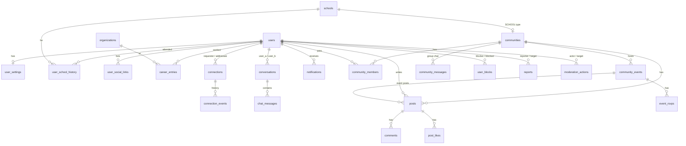

# 06 - Database

Purpose: the PostgreSQL schema as it exists after migrations V1..V40, how it is accessed, how rows are retired, and how migrations are managed.
Audience: engineers writing migrations, queries or data fixes. Sources: `apsbrat-api/src/main/resources/db/migration/V*.sql` and JPA entities under `apsbrat-api/src/main/java/com/apsconnect/api/**`.

Last verified: 2026-11-16 against commit 168d987 (working tree has uncommitted changes)

Note: `V38__add_user_address.sql`, `V39__connection_pairs_and_history.sql` and `V40__pending_request_paging_indexes.sql` are untracked in git (not yet committed) at the time of verification. Do not deploy a build without them: the entities (`Connection.userLowId/userHighId/requestedAt`, `User.state/country/latitude/longitude/placeId`) require those columns and `ddl-auto: validate` will stop startup otherwise.

---

## 1. Architecture

- PostgreSQL 16, one schema (`public`), one database (`apsbrat_db` in dev). Extensions: `uuid-ossp` (V1), `pg_trgm` (V15/V21). `gen_random_uuid()` (built in) is used by later migrations.
- Access: Spring Data JPA/Hibernate (`ddl-auto: validate`, so Hibernate never changes the schema), plus native SQL in repositories, plus `JdbcTemplate` for two things only: `MaintenanceJobs` and the `account_deletions` insert in `AccountService`.
- Primary keys are `UUID` (default `uuid_generate_v4()` or `gen_random_uuid()`); join tables use composite PKs.
- All timestamps are `TIMESTAMP` (without time zone), written as `LocalDateTime` by the JVM (see section 8).
- Status/enum columns come in two styles: real Postgres enum types (`user_status`, `social_platform`, `connection_status`, `feed_event_type`, `notification_type`) mapped with `@JdbcType(PostgreSQLEnumJdbcType.class)`, and `VARCHAR` + `CHECK` (everything newer: communities, posts, career, events, connection_events). New work should prefer `VARCHAR` + `CHECK` (adding enum values needs `ALTER TYPE`, which is what V22 had to do for `connection_status`).
- 28 application tables plus Flyway's `flyway_schema_history`.

## 2. Tables

Legend: PK = primary key, FK = foreign key, `CASCADE` = ON DELETE CASCADE. "Entity" names the JPA class. Only important columns are listed; "all columns" = the migration list below plus entity.

### 2.1 Identity and profile

**users** (entity `user/User.java`). The account. One row per email.
- PK `id`. `email VARCHAR(100) NOT NULL UNIQUE` (login identity); `username VARCHAR(50)` nullable until onboarding, `UNIQUE` plus unique index `uq_users_username_lower` on `LOWER(username)` (V34); `full_name VARCHAR(100)` nullable until onboarding.
- Profile: `dob`, `gender VARCHAR(20)`, `bio`, `city`, `profession`, `website_url`, `profile_pic_url`, `current_status user_status (STUDENT|ALUMNI)`; location (V38): `state`, `country`, `latitude/longitude NUMERIC(9,6)`, `place_id`.
- Auth/safety: `is_verified`, `role VARCHAR(20) NOT NULL DEFAULT 'USER'` (USER/MODERATOR/ADMIN, no CHECK), `suspended_until`, `banned_at`, `deleted_at` (soft delete), `version BIGINT` (optimistic lock), `last_active_at` (written only by `PresenceService`, `insertable=false, updatable=false` in the entity).
- Legacy: `phone VARCHAR(40) UNIQUE` (nullable since V23; no longer collected or editable, but still read and returned in the profile, `UserDto` and the export), `password_hash VARCHAR(255)` (unused), `fcm_token` (only ever set to null).
- Indexes: `idx_users_username`, `idx_users_phone`, `idx_users_email` (all redundant with the UNIQUE constraints), `idx_users_created_at`, trigram GIN on `LOWER(full_name)` (created twice under two names: `idx_users_fullname_trgm` V15 and `idx_users_full_name_trgm` V21), on `LOWER(username)` (`idx_users_username_trgm`) and `LOWER(city)` (`idx_users_city_trgm`, V15), `idx_users_city_lower` (btree), partial `idx_users_lat_lng`.
- Differences migration vs entity: entity sets `created_at/updated_at/is_verified/role/current_status` in `@PrePersist`; the DB also has defaults.

**user_settings** (`user/settings/UserSettings.java`). Privacy toggles, one row per user (created lazily by `UserSettingsService`).
- PK/FK `user_id` CASCADE. `is_private` (default false: hides phone and social links from others), `discoverable` (default true: people/global search), `show_activity` (default true: last-active visibility), `created_at`, `updated_at`. V19 dropped `show_phone` and `batchmates_only`.

**user_social_links** (`user/social/UserSocialLink.java`). PK `id`; FK `user_id` CASCADE; `platform social_platform (INSTAGRAM|LINKEDIN|WHATSAPP|TWITTER|CUSTOM)`; `handle VARCHAR(200)`; `label` (required for CUSTOM, enforced in service only); `is_visible`. `UNIQUE (user_id, platform)` (`uq_user_platform`); `idx_social_links_user` is redundant with it.

**otp_codes** (`auth/OtpCode.java`). Login codes. PK `id`; `email VARCHAR(100)` (renamed from `phone` in V23, widened V24, no FK); `code VARCHAR(6)` stored in plain text; `expires_at`; `consumed`; `created_at`. Index `idx_otp_email`. Purged nightly (`expires_at` older than 1 day).

**account_deletions** (no entity, `JdbcTemplate`). Audit row per account deletion. PK `id`; `user_id UUID` (deliberately no FK); `deleted_at`; `request_id VARCHAR(64)`. Index `idx_account_deletions_user`.

### 2.2 Schools and career

**schools** (`school/School.java`). Reference data. PK `id`; `name NOT NULL`; `city`, `state`, `cantonment`; `school_code VARCHAR(20) UNIQUE`; `address`, `principal_name`, `phone`, `email`, `website`; `is_active`. Index `idx_schools_name` on `LOWER(name)`. UNVERIFIED: how the production school list is loaded (V14 only seeds three demo schools; no admin endpoint writes schools).

**user_school_history** (`user/history/UserSchoolHistory.java`). A person's stints at a school. PK `id`; FK `user_id` CASCADE; FK `school_id` ON DELETE RESTRICT; `class_from/class_to SMALLINT` (1..12, `chk_class_range`), `batch_start/batch_end SMALLINT` (`chk_batch_range`), `section VARCHAR(5)` nullable with `chk_section_letter` (`^[A-Z]{1,2}$`), `stream VARCHAR(30)` with `chk_school_history_stream` (SCIENCE_MEDICAL, SCIENCE_NON_MEDICAL, SCIENCE_PCMB, COMMERCE, ARTS), `is_primary`.
- Indexes: `idx_school_history_user`, `idx_school_history_lookup` and `idx_school_history_classmates` (identical columns `school_id, section, batch_start, batch_end`, one is redundant), `idx_school_history_filters (school_id, batch_end, class_to, section, stream)` for people search.
- Written as replace-all (`UserSchoolHistoryService`: `deleteAllByUser_Id` then `saveAll`), so row ids change on every save.

**organizations** (`career/Organization.java`). Companies/institutions entered by users. PK `id`; `type` (`COMPANY|INSTITUTION`), `name`, `name_key` (normalised, see `career/NameKeys.java`), `industry`, `website`, `status` (`UNVERIFIED|VERIFIED`), FK `created_by` SET NULL. `UNIQUE (type, name_key)`; trigram GIN `idx_org_name_trgm`.

**job_titles** (`career/JobTitle.java`). PK `id`; `title`, `title_key UNIQUE`, `job_function`, `status`. Trigram GIN `idx_job_titles_trgm`.

**career_entries** (`career/CareerEntry.java`). PK `id`; FK `user_id` CASCADE; `kind` (`WORK|EDUCATION`); FK `organization_id` RESTRICT; FK `job_title_id` SET NULL; `title`, `field_of_study`, `location`, `description VARCHAR(1000)`, `start_date`, `end_date` (`chk_career_dates`), `is_hidden` (hidden from other viewers, enforced in `CareerService.list`). Indexes `idx_career_user (user_id, start_date DESC)`, `idx_career_org (organization_id, kind)`.

### 2.3 Connections

**connections** (`connection/Connection.java`). One row per user pair (V39), reused across request/decline/withdraw/remove cycles.
- PK `id`; FK `requester_id`, `addressee_id` CASCADE; `user_low_id`, `user_high_id` (the pair in canonical order, NOT NULL, not updatable); `status connection_status` (`PENDING|ACCEPTED|DECLINED|WITHDRAWN|REMOVED`, last three added in V22); `created_at` (first ever request), `requested_at` (current request), `accepted_at`, `updated_at`, `version`.
- Constraints: `chk_not_self`, `chk_connection_pair_order (user_low_id < user_high_id)`, `chk_connection_pair_matches` (requester/addressee equal the low/high pair in either order), `uq_connection_pair UNIQUE (user_low_id, user_high_id)`. The old `uq_connection (requester_id, addressee_id)` was dropped.
- Indexes: `idx_conn_requester_status`, `idx_conn_addressee_status`; partial `idx_conn_requester_accepted` / `idx_conn_addressee_accepted` (ACCEPTED, ordered by `accepted_at DESC`, V36); partial `idx_conn_pending_incoming (addressee_id, requested_at DESC, id DESC)` and `idx_conn_pending_outgoing (requester_id, ...)` (PENDING, V40, serve keyset paging).
- Writes are serialised per pair by `pg_advisory_xact_lock` (see `04-backend-engineering.md`).

**connection_events** (`connection/ConnectionEvent.java`). Append-only history. PK `id`; FK `connection_id` CASCADE; FK `actor_id` SET NULL; `event_type` (`REQUESTED|ACCEPTED|DECLINED|WITHDRAWN|REMOVED`, CHECK); `created_at`; `metadata JSONB` (e.g. `{"reason":"BLOCK"}`, `{"reason":"REVERSE_REQUEST"}`, `{"source":"backfill"}`). Index `idx_conn_events_connection_created`. Only the event type `REMOVED` with reason BLOCK reveals a block, and only in this internal table (the blocked user sees a normal removal).

### 2.4 Communities, posts and events

**communities** (`community/Community.java`; recreated in V27, the V11 version was dropped in V25). PK `id`; `type` (`SCHOOL|INTEREST`); FK `school_id UNIQUE` CASCADE; `name`, `name_key`, `description VARCHAR(500)`, `visibility` (`OPEN|PRIVATE`), FK `created_by` SET NULL, `member_count` (maintained by `UPDATE ... + delta`), `version`. `chk_community_school` ties `type='SCHOOL'` to `school_id IS NOT NULL`. Partial unique index `uq_interest_community_name` on `name_key` for INTEREST. No trigram index any more (V15's `idx_communities_name_trgm` died with the table in V25).
- SCHOOL communities are created only by the V27 backfill (one per school existing then). No application code creates them (`grep` for `setType(CommunityType.SCHOOL` finds nothing), so schools added after V27 have no community: UNVERIFIED whether a manual process covers this.

**community_members** (`community/CommunityMember.java`, `@IdClass`). PK `(community_id, user_id)`, both CASCADE; `role` (`OWNER|MEMBER`), `joined_at`, `chat_read_at` (V31). Index `idx_community_members_user`. V17 added `version` to the old table; the recreated table has no `version` and the entity has no `@Version`, consistent.

**community_join_requests** (`community/JoinRequest.java`). PK `(community_id, user_id)` CASCADE; `created_at`. Index `idx_join_requests_user`.

**posts** (`community/Post.java`). PK `id`; FK `community_id` CASCADE; FK `author_id` CASCADE; `body VARCHAR(2000)`; `status` (`ACTIVE|HIDDEN|REMOVED`, CHECK); `like_count`, `comment_count` (denormalised, atomic updates); `image_urls TEXT[] NOT NULL DEFAULT '{}'` (V29, replaced `image_url`); `pinned_at`; FK `event_id` SET NULL (V32); `memory_year SMALLINT`, `memory_category` (V33, `chk_post_memory`: both null or both set, category in ANNUAL_DAY, SPORTS_DAY, CLASSROOM, TRIPS, FAREWELL, CAMPUS, OTHER); `version`.
- Indexes: `idx_posts_community_newest (community_id, created_at DESC, id DESC)`, partial `idx_posts_pinned`, `idx_posts_event`, `idx_posts_memories`. No index supports the "popular" sort (`like_count + 2*comment_count`), which scans a community's recent posts (`PostRepository.findPopularPage`).

**post_likes** (`community/PostLike.java`). PK `(post_id, user_id)` both CASCADE; `created_at`.

**comments** (`community/Comment.java`). PK `id`; FK `post_id` CASCADE; FK `author_id` CASCADE; `body VARCHAR(1000)`; `status` (`ACTIVE|HIDDEN|REMOVED`). Index `idx_comments_post (post_id, created_at)`.

**community_messages** (`community/CommunityMessage.java`; V31). Group chat. PK `id`; FK `community_id`, `sender_id` CASCADE; `body VARCHAR(2000) DEFAULT ''`; `image_url VARCHAR(300)`; `status` CHECK. Index `idx_community_messages_newest (community_id, created_at DESC)`.

**community_events** (`community/CommunityEvent.java`; V32, V35). PK `id`; FK `community_id` CASCADE; FK `organizer_id` CASCADE; `title VARCHAR(120)`, `description`, `venue`, `starts_at NOT NULL`, `ends_at NOT NULL` (V35 backfilled `starts_at + 3 hours`), `cover_url`, `cancelled`. `chk_event_times`. Indexes `idx_community_events_when`, `idx_community_events_end`.

**event_rsvps** (`community/EventRsvp.java`). PK `(event_id, user_id)` CASCADE; `status` (`GOING|INTERESTED`). Index `idx_rsvps_user`.

### 2.5 Messaging, notifications, feed

**conversations** (`chat/Conversation.java`). 1:1 chat. PK `id`; FK `user_a_id`, `user_b_id` CASCADE; `last_message_at`. `uq_conversation_pair (user_a_id, user_b_id)`, `chk_conv_not_self`. The DB does NOT enforce canonical order; `ChatService.openWith` always puts the smaller id (by `UUID.compareTo`, signed-long order) in `user_a_id`, so (A,B) and (B,A) cannot both exist unless that code is bypassed. Note this order differs from Postgres's uuid order (compare `connection/UserPair.java`); harmless here because no DB constraint depends on it.
- Indexes: `idx_conv_user_a` (redundant with the leading column of `uq_conversation_pair`), `idx_conv_user_b`, partial `idx_conv_user_a_last`, `idx_conv_user_b_last` (V36).

**chat_messages** (`chat/ChatMessage.java`). PK `id`; FK `conversation_id` CASCADE; FK `sender_id` CASCADE; `body TEXT NOT NULL` (length enforced in service: 4000 connected / 300 unconnected); `image_url VARCHAR(300)`; `read_at`. Indexes `idx_chat_msg_conv (conversation_id, created_at)`, partial `idx_chat_unread (conversation_id) WHERE read_at IS NULL`.

**notifications** (`notification/Notification.java`). PK `id`; FK `user_id` CASCADE; FK `actor_id` SET NULL; `type notification_type (JOIN|CONNECTION_REQUEST|CONNECTION_ACCEPTED|MESSAGE|GENERAL)`; `title VARCHAR(200)`, `body`; `ref_type VARCHAR(30)` (entity enum `NotificationRef`: CONNECTION, USER, CONVERSATION, POST, EVENT), `ref_id`; `group_key VARCHAR(120)` (mapped but no code sets it); `is_read`.
- Indexes: `idx_notif_user (user_id, created_at)` and `idx_notif_user_created_desc` (redundant pair), partial `idx_notif_group`, partial `idx_notif_unread (user_id) WHERE is_read = FALSE`.

**feed_events** (`feed/FeedEvent.java`). PK `id`; FK `actor_id` CASCADE; `type feed_event_type (JOIN|CONNECTED|GENERAL)`; `title`, `body`, `meta`. Index `idx_feed_created`. Read by `FeedService`/`GET /api/v1/feed/activity`, but no application code inserts rows (`grep` finds no `new FeedEvent`/`save`), so the table only holds the V14 demo seed. UNVERIFIED whether events were meant to be generated elsewhere.

### 2.6 Safety and moderation

**user_blocks** (`safety/UserBlock.java`). PK `id`; FK `blocker_id`, `blocked_id` CASCADE; `UNIQUE (blocker_id, blocked_id)`; index `idx_user_blocks_blocked`. No DB check against self-block (service checks).

**reports** (`safety/Report.java`). PK `id`; FK `reporter_id` CASCADE; FK `target_user_id` SET NULL; `target_type VARCHAR(30)` (entity enum: USER, MESSAGE, POST, COMMENT, COMMUNITY_MESSAGE); `target_id UUID`; `reason VARCHAR(50)`; `details`; `status VARCHAR(20) DEFAULT 'OPEN'` (free text, no CHECK; `AdminService.resolveReport` writes whatever the moderator sends, upper-cased). `uq_reports_once` unique on `(reporter_id, target_type, COALESCE(target_id, target_user_id))` (V34 de-duplicated existing rows first). Indexes `idx_reports_status`, `idx_reports_target_user`.

**moderation_actions** (`safety/ModerationAction.java`). Audit log. PK `id`; FKs `actor_id`, `target_user_id` and `report_id` (none has an ON DELETE rule, so they block hard-deleting any user who was ever moderated or acted, and any report with an audit row); `action VARCHAR(40)` (e.g. `BAN`, `SUSPEND_7D`, `REPORT_RESOLVED`, `SET_ROLE_ADMIN`), `reason VARCHAR(500)`. Index `idx_moderation_actions_target`. Restore actions are not logged (see doc 07).

## 3. Relationships (core tables)

## 4. Soft delete and data lifecycle

| Thing | Mechanism | Where |
|---|---|---|
| Account deletion (`DELETE /api/v1/users/me`) | Soft delete + anonymise: `deleted_at` set; `username`, `phone`, `email` replaced by tombstones (`deleted_<hex>`, `deleted+<hex>@deleted.invalid`, `phone=<hex>`, where `<hex>` is the UUID without dashes; `is_verified` is also set to false); bio, city, profession, gender, dob, profile pic, website, fcm token, password hash cleared; school history and social links hard-deleted; audit row in `account_deletions` (same transaction); all tokens revoked (`AuthService.revokeAllFor`). `full_name` is kept so posts and messages still show an author. | `user/AccountService.java:62` |
| What deletion does NOT clear | `career_entries`, `state`, `country`, `latitude`, `longitude`, `place_id`, `community_members` rows (member_count stays inflated), `connections`, `user_blocks`, `notifications`, `reports`, uploaded media files in R2/disk. `GET /api/v1/users/{id}/career` (`CareerService.list`) does not check `deleted_at`, so a deleted user's non-hidden career entries stay readable by id. | `AccountService.deleteAccount` (verified: it touches only the entities listed above) |
| Where deleted users are filtered | profile (`ProfileService.getById` returns an empty profile flagged deleted), chat open (`ChatService.openWith`), connect (`ConnectionService.requestConnection`), people search and circle (`u.deleted_at IS NULL` in native SQL), global search. Bans: only `searchPeople` and the "recent joins" queries filter `banned_at`. | various |
| Posts/comments/community messages | Never hard-deleted by the app. Author/owner/staff "delete" sets `status='REMOVED'`; 3 distinct reporters auto-set `HIDDEN` (`ReportService.AUTO_HIDE_REPORTERS`); staff `restore` sets `ACTIVE`. All reads filter `status='ACTIVE'`. `comment_count` counts ACTIVE only. | `community/PostService.java`, `CommunityChatService` |
| Connections | A row is never deleted: status moves to DECLINED / WITHDRAWN / REMOVED and `connection_events` records why. Blocks end a live connection as REMOVED (reason BLOCK in the event only). | `connection/ConnectionService.java` |
| Hard-delete cascades | Deleting a `users` row (not done by the app) would cascade to nearly everything (settings, school history, links, career, connections, events, chats, notifications, memberships, posts, comments, likes, blocks, reports) except `moderation_actions` (no ON DELETE, blocks deletion) and `account_deletions` (no FK). `schools` rows referenced by history or career orgs referenced by entries are protected by `RESTRICT`. | migrations |
| Data export | `GET /api/v1/users/me/export` returns profile, school history, social links, settings. Career entries, posts, messages and connections are not included. | `AccountService.export` |
| Retention jobs | Nightly: OTP rows older than 1 day past expiry; READ notifications older than 180 days. Nothing purges chat messages, REMOVED content, `connection_events`, or `account_deletions`. | `maintenance/MaintenanceJobs.java` |
| Suspension | `suspended_until` is a timestamp compared on read (`User.isSuspended`); nothing needs to clear it. | `user/User.java:130` |

## 5. Important queries

| Feature | Query / method | File |
|---|---|---|
| People search (name, school filters, city, community directory) | `UserRepository.searchPeople`: one native statement: trigram `LIKE` pre-filter on the first token, regex word-prefix match on `"name username"`, EXISTS sub-selects on the same school-history row for school/batch/class/section/stream filters, rank (exact, prefix, word-prefix, other) then name, `LIMIT/OFFSET`. Excludes the viewer, deleted, banned, blocked (either way, `NOT IN (:blockedIds)` with a sentinel UUID so the list is never empty) and `discoverable=false`. | `api/user/UserRepository.java`, `api/search/PeopleSearchService.java` |
| Global search (legacy) | `UserRepository.search`: JPQL `LIKE '%term%'` on name/username/city, filtered in Java. Unbounded. | `UserRepository.java:44`, `search/SearchService.java` |
| Home feed | `PostRepository.findPage`: posts in the caller's communities, `status='ACTIVE'`, `created_at < cursor`, `author_id NOT IN (hiddenAuthors)`, newest first; uses `idx_posts_community_newest`. Cursor is the last post's `created_at` only (posts with identical timestamps at a page boundary can be skipped). | `community/PostRepository.java`, `PostService.homeFeed` |
| Community posts, popular sort | `PostRepository.findPopularPage`: native, recent window (`created_at >= :since`), order by `like_count + 2*comment_count`. | `PostRepository.java:44` |
| My connections / requests | Keyset pages `ConnectionRepository.findFriendsPage` (A-Z by `lower(full_name), id`), `findReceivedPage`, `findSentPage` (by `requested_at DESC, id DESC`, joined to live users). Indexed by V36/V40. | `connection/ConnectionRepository.java` |
| Mutual connections | `countMutual` (batch of candidates), `countMutualBetween`, `findMutualPage` (INTERSECT of both friend sets joined to live users), `findMutualIds`. Friend set = either column of `ACCEPTED` rows. | `ConnectionRepository.java` |
| Classmates / schoolmates | `UserSchoolHistoryRepository.CLASSMATE_MATCH` (same school and non-null section, overlapping batch years (strict `<`, sessions run April-March) and overlapping classes) and `SCHOOLMATE_MATCH`; ranked in Java by `CircleService.rank` (mutual count desc, same batch, name), cached in Redis. These queries filter deleted users only: no blocks, bans or `discoverable`. | `user/history/UserSchoolHistoryRepository.java`, `circle/CircleService.java` |
| Pair lock | `ConnectionRepository.lockPair`: `pg_advisory_xact_lock(hashtextextended(key, 0))`. | `ConnectionRepository.java:34` |
| Unread counts | `ChatMessageRepository.countUnreadIn` (grouped), partial index `idx_chat_unread`; community chat `CommunityMessageRepository.countUnread` since `chat_read_at`/`joined_at`. | `chat/`, `community/` |

## 6. Migration strategy

- **Flyway** (`flyway-core`), scripts in `apsbrat-api/src/main/resources/db/migration`, naming `V<n>__description.sql`, never edited after release (V1 to V40 form a linear history). `ddl-auto: validate` guarantees entity and schema agree at startup.
- **Baseline per profile** (`apsbrat-api/src/main/resources/application.yml`):
  - `dev`: `baseline-on-migrate: true`, `baseline-version: 4`. For a local DB that already has tables but no Flyway history, V1..V4 are treated as applied and V5+ run. On an empty DB all migrations run.
  - `qa`, `prod`: `baseline-on-migrate: ${SPRING_FLYWAY_BASELINE_ON_MIGRATE:false}`, so a non-empty database without history fails fast unless the env var is set.
- **Rule (CLAUDE.md): always use `IF NOT EXISTS` / `IF EXISTS` guards.** V5+ mostly follow it; enum creation uses a `DO $$ ... EXCEPTION WHEN duplicate_object` block; V39 wraps `ADD CONSTRAINT` in the same kind of block. V1, V2 and V5 (`CREATE TABLE users/schools/user_social_links`, `CREATE TYPE`, plain `CREATE INDEX`) predate the rule and are unguarded (safe only because they never re-run after baseline).
- Postgres enum gotcha: `ALTER TYPE ... ADD VALUE` (V22) cannot be used in the same transaction, so V39 compares `status::text`. Prefer `VARCHAR + CHECK` for new enums.
- Data migrations are inside the same files (V22 section clean-up, V23 placeholder emails, V34 de-duplicating reports, V35 `ends_at` backfill, V39 pair merge and event backfill). Large backfills run in one transaction; fine at current size, review before running on a big table.
- Demo seed V14 inserts demo schools, users, history, messages, connections, feed events, conversations and notifications into every environment that runs it from empty (qa/prod fresh DBs included). The communities/messages it seeds were dropped in V25, but the seeded users, schools, history, connections, chats and notifications remain. After V23 the demo users have placeholder emails (`...@placeholder.apsbrat.in`) and can only log in if an OTP can be obtained (master OTP, dev only; no email delivery exists). They still appear in people search. UNVERIFIED whether prod was baselined past V14 or cleaned.
- Rollbacks: none. Fix forward with a new migration (the free community version of Flyway has no undo).
- Adding a migration checklist: new `V41__*.sql` with guards; entity + `@Column` or `columnDefinition`; for a Postgres enum add `@JdbcType(PostgreSQLEnumJdbcType.class)`; index with `CREATE INDEX IF NOT EXISTS`; for large tables consider `CREATE INDEX CONCURRENTLY` in its own non-transactional migration (not used so far).

## 7. Migration history

| Version | Summary |
|---|---|
| V1 | `users`, `user_status` enum, `uuid-ossp`. |
| V2-V3 | `schools` and its detail columns (`address`, `principal_name`, `is_active` ...). |
| V4 | `user_school_history` with class/batch/section checks. |
| V5 | `social_platform` enum, `user_social_links`. |
| V6-V7 | `users.password_hash` (now unused), `users.gender`. |
| V8 | `otp_codes` (phone-based at the time). |
| V9 | `connections` (PENDING/ACCEPTED, one row per direction). |
| V10-V13 | `feed_events`, first `communities` family, `conversations` + `chat_messages`, `notifications`. |
| V14 | Demo seed data (see strategy notes). |
| V15 | Performance indexes, `pg_trgm`, trigram indexes on users/communities, `idx_chat_unread`. |
| V16 | `users.deleted_at`, `user_settings`, `user_blocks`, `reports`; `phone` widened to 40. |
| V17 | `version` columns (users, connections, community_members) for optimistic locking. |
| V18 | `users.role/suspended_until/banned_at`, `moderation_actions`. |
| V19 | Privacy simplified to a single `is_private`; drops `show_phone`, `batchmates_only`. |
| V20 | `user_school_history.stream` + CHECK. |
| V21 | People-search indexes (second trigram on full_name, `idx_users_city_lower`, filters index). |
| V22 | `connection_status` gains DECLINED/WITHDRAWN/REMOVED; `accepted_at`, `updated_at`; notification actor/ref/group columns and indexes; section becomes optional letters-only; classmates index. |
| V23 | Email becomes the login identity: placeholder emails for old rows, `email NOT NULL`; `phone`, `username`, `full_name` nullable; `otp_codes.phone` renamed `email`. |
| V24 | Widen `otp_codes.email`. |
| V25 | Drops the first communities tables and `community_type` enum. |
| V26 | Career timeline: `organizations`, `job_titles`, `career_entries` (+ trigram indexes). |
| V27 | New communities model (SCHOOL/INTEREST), members with roles, join requests, `posts`, `post_likes`, `comments`; backfills one SCHOOL community per school. |
| V28-V30 | Photos on posts and chat (`image_url`), post photo slider (`image_urls TEXT[]`), `pinned_at`. |
| V31 | Community group chat (`community_messages`), `chat_read_at`, `users.last_active_at`, `user_settings.show_activity`. |
| V32 | `community_events`, `event_rsvps`, `posts.event_id`. |
| V33 | Memory posts (`memory_year`, `memory_category` + CHECK + partial index). |
| V34 | Case-insensitive unique username; de-duplicates and uniquely indexes reports. |
| V35 | Events must have an end (`ends_at NOT NULL`, backfill +3h). |
| V36 | Query-performance partial indexes (pins, unread notifications, conversations, rsvps, join requests, accepted connections). |
| V37 | `account_deletions` audit table. |
| V38 | User address/location columns and `idx_users_lat_lng`. (untracked in git) |
| V39 | Connections become one row per user pair: pair columns, `connection_events` history with backfill, duplicate merge, pair constraints; drops old unique and single-column indexes. (untracked in git) |
| V40 | Partial indexes for pending-request keyset paging. (untracked in git) |

## 8. Time zones

- The product runs in India Standard Time. Three settings must agree: JVM default zone (`-Duser.timezone=Asia/Kolkata` in `apsbrat-api/Dockerfile` `JAVA_OPTS`), Hibernate `jdbc.time_zone: Asia/Kolkata` (every profile), and Hikari `connection-init-sql: SET TIME ZONE '+05:30'` (every profile), plus `spring.jackson.time-zone: Asia/Kolkata`.
- Columns are `TIMESTAMP` without zone and hold IST wall-clock time. SQL `now()` (defaults, `MaintenanceJobs`) is evaluated in the session zone (+05:30) so it agrees with Java `LocalDateTime.now()` only when the JVM zone is also IST.
- Risk: local `dev` runs outside Docker do not set `user.timezone`; on a laptop in another zone `LocalDateTime.now()` (used for `created_at`, OTP expiry, suspension, presence) would be in that zone while DB defaults are IST. UNVERIFIED whether developers set it in their IDE run config.
- No timestamp carries an offset to the client; the Flutter app has to interpret values as IST (UNVERIFIED in the client).

## 9. Schema issues and tech debt

1. Duplicate or redundant indexes: `idx_users_fullname_trgm` + `idx_users_full_name_trgm` (identical), `idx_school_history_lookup` + `idx_school_history_classmates` (identical), `idx_notif_user` vs `idx_notif_user_created_desc`, `idx_users_username/phone/email` vs their UNIQUE constraints, `idx_social_links_user` vs `uq_user_platform`. Extra indexes slow writes and bloat storage; drop in one cleanup migration.
2. `otp_codes.code` is stored in plain text (6 digits, short-lived). `users.password_hash`, `users.fcm_token`, `notifications.group_key` are unused; `users.phone` is legacy (still returned, no longer written).
3. No `CHECK` for `users.role` and `reports.status`; admin input can write arbitrary status text up to 20 characters (longer text raises an integrity error that surfaces as 409).
4. `moderation_actions.actor_id/target_user_id/report_id` have no ON DELETE rule.
5. Deleted accounts keep location, career and membership rows (section 4).
6. `feed_events` is never written; SCHOOL communities are only created by a one-off backfill.
7. Entity vs migration drift found: none that breaks `validate`. Intentional differences: DB defaults for timestamps vs entity `@PrePersist`; DB `CHECK`s have no entity equivalent; `Connection.status` and other enums need the PG enum JDBC type, set per entity.
