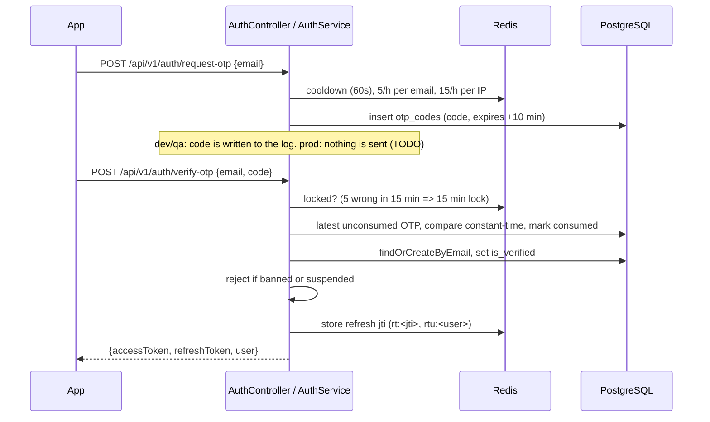

# 07 - Authentication and Security

Purpose: how users sign in, how requests are authenticated and authorized, and every protection the API applies (limits, validation, privacy).
It separates what is implemented from what is missing, and ends with a list of known gaps backed by code references.

Last verified: 2026-11-16 against commit 168d987 (working tree has uncommitted changes)

Paths are relative to the repo root; `api/` = `apsbrat-api/src/main/java/com/apsconnect/api/`. Secrets are never written here: only environment variable names.

---

## 1. Summary

| Area | Implemented | Not implemented / planned |
|---|---|---|
| Login | Email + 6-digit OTP, Google via Firebase ID token, both "log in or create bare account" | Sending the OTP by email in qa/prod (TODO in code), password login, MFA, social providers other than Google |
| Tokens | HS256 JWT access (15 min) + refresh (30 d, rotated, server-side revocable), logout, logout-all, revocation on ban/suspend/delete/role change | Refresh-token reuse detection, device list, key rotation (`kid`), issuer/audience claims |
| Authorization | URL rules, USER/MODERATOR/ADMIN roles, per-method checks in services | `@PreAuthorize` / method security, per-resource ACL framework |
| Abuse control | Global per-user/IP limit, OTP limits, per-action limits (posts, comments, chat, uploads), idempotency keys | Per-action limits for 1:1 chat, connection requests, reports, avatar upload; CAPTCHA; device fingerprinting |
| Privacy | `is_private`, `discoverable`, `show_activity`, blocks (many but not all read paths) | Block enforcement on circle lists, career, school history, community member list |
| Media | Re-encode to JPEG (strips EXIF), type/size limits, own-upload URL check | Pixel-count limit, virus scan, private (signed-URL) media |

## 2. Login and registration

There is no separate registration endpoint. `AuthService.findOrCreateByEmail` logs in the existing account for an email or creates a bare `users` row (email only). Onboarding (`PUT /api/v1/users/me`, school history, etc.) fills it in later; `OnboardingGate` (`api/user/OnboardingGate.java`) blocks social features until name + username exist (`User.isOnboarded`).

### 2.1 Email OTP (`api/auth/AuthService.java`)
- `requestOtp`: email is trimmed and lower-cased; per-email 60 s cooldown (`otp:cd:`), max 5 requests/hour per email (`otp:rq:`), max 15/hour per client IP (`otp:ip:`). Code is `SecureRandom` 6 digits stored in `otp_codes.code` (plain text), TTL 10 minutes (`OTP_TTL_MINUTES`).
- `verifyOtp`: checks the lock key first; takes the newest unconsumed row for the email; rejects expired; constant-time compare (`MessageDigest.isEqual`); on mismatch increments a counter (5 failures in 15 minutes sets `otp:lock:<email>` for 15 minutes); on success marks the row consumed and clears the counter.
- Delivery: `requestOtp` only logs the code when the profile is not `prod` (`AuthService.java:72`). The comment at `AuthService.java:74` says email sending is a TODO, and the project has no mail dependency. So in qa and prod no user can receive an OTP. UNVERIFIED whether another deployment-time mechanism exists (nothing in the repo).
- Master OTP: `app.otp.master` (`OTP_MASTER`). Accepted only if the profile is not `prod`, the value is non-blank and equal (constant time). Dev default is set in `application.yml` (dev profile only); qa and prod default to empty. Note that qa is "not prod", so if `OTP_MASTER` were set in qa the master code would work there (intended for test environments).
- `DevProfileGuard` (`api/common/config/DevProfileGuard.java`) prevents the `dev` profile (weak JWT secret, master OTP) from starting in a container without an explicit `SPRING_PROFILES_ACTIVE`.

### 2.2 Google / Firebase (`api/auth/FirebaseAuthVerifier.java`)
- App signs in with Google on the device, sends the Firebase ID token to `POST /api/v1/auth/google`.
- Server verifies it with Firebase Admin (`FirebaseAuth.verifyIdToken`), requires an email and `email_verified=true`, lower-cases the email, then follows the same find-or-create path. New accounts get the Google display name and picture URL (`profile_pic_url` initially points to Google's host).
- Firebase initialises lazily from the service-account file at `FIREBASE_CREDENTIALS_PATH`; if unset the endpoint returns 503 ("not configured"), the app still starts.
- An account created by OTP and later used with Google (same email) is the same account.

### 2.3 Banned, suspended, deleted
- `ensureNotBannedOrSuspended` runs on OTP verify, Google sign-in and refresh: banned (permanent) and suspended (until a date) both return 403 `FORBIDDEN`.
- Deleted accounts have a tombstone email, so the old email signs up as a brand-new account (deleted data is not restored).

## 3. JWT access and refresh tokens (`api/auth/JwtService.java`)

| Item | Value |
|---|---|
| Algorithm | HS256 (jjwt). Key = SHA-256 of `JWT_SECRET`, so any length works technically |
| Access token | `app.jwt.access-token-expiry` = 900000 ms (15 min). Claims: `sub` = user UUID, `type=access`, `email`, `role`, `iat`, `exp` |
| Refresh token | `app.jwt.refresh-token-expiry` = 2592000000 ms (30 d). Claims: `sub`, `type=refresh`, `jti`, `iat`, `exp` |
| Secret rules | `JwtService.validateSecret`: in `qa`/`prod` startup fails if the secret is blank, contains `change-me` or is shorter than 32 characters; in dev it only logs a warning |
| Validation | `parseAccess` verifies signature and expiry and requires `type=access` (a refresh token as bearer gives 401) |
| Revocation (access) | `revoked:<userId>` Redis marker holds a timestamp; `JwtAuthFilter` rejects tokens with `iat <= marker` (`AuthService.isRevoked`). Marker lives access-TTL + 60 s |
| Revocation (refresh) | refresh `jti` stored in Redis `rt:<jti>` with 30 d TTL, plus per-user set `rtu:<userId>` |

Flows:
- **Refresh** `POST /api/v1/auth/refresh`: validates `type=refresh`, atomically deletes the `rt:<jti>` key (so each refresh token works once), checks the user exists and is not banned/suspended, issues a new pair (role re-read from the DB). Rotation is implemented; reuse detection (revoke the whole family when an old token is replayed) is not: a replay just returns 401.
- **Logout** `POST /api/v1/auth/logout` {refreshToken}: deletes that `jti`. The current access token stays valid until it expires (max 15 min).
- **Logout all** `POST /api/v1/auth/logout-all` (needs a valid access token): deletes every refresh token of the user and sets the revocation marker so existing access tokens die immediately.
- `revokeAllFor` is also called by `AdminService` on suspend, ban and role change, and by `AccountService.deleteAccount`. `reinstate` does not need to undo anything (marker expires).
- Redis outage: `isRevoked` fails open (a revoked token would be accepted for up to 15 minutes), while refresh/login return 503.
- The WebSocket CONNECT frame uses the same access-token parse and revocation check (`api/chat/StompAuthChannelInterceptor.java`). A WebSocket opened before a ban is not closed by the ban; it stops receiving only when the app reconnects (UNVERIFIED whether the broker disconnects the session; nothing in the code does).
- Client storage of tokens: `secureStorageProvider` in `frontend/lib/core/network/dio_client.dart` (flutter secure storage, not reviewed in detail).

Minor edge case: JWT `iat` has one-second resolution while the revocation marker is in milliseconds, so a token issued in the same second after a `revokeAllFor` can be rejected as "revoked" (`AuthService.isRevoked`, `AuthService.java:191`). It self-corrects on the next refresh/login.

## 4. Roles and permissions

Roles: `USER`, `MODERATOR`, `ADMIN` (`api/user/UserRole.java`, `users.role`). The role is embedded in the access token (`ROLE_<role>` authority) by `JwtAuthFilter`; changing a role revokes the user's tokens so the next token carries the new role.

| Rule | Where | Who |
|---|---|---|
| `/api/v1/admin/**` | `SecurityConfig` (`hasAnyRole("ADMIN","MODERATOR")`) | staff |
| Ban, set role | `AdminService.requireAdmin` (re-reads actor from DB) | ADMIN only |
| Suspend a normal user | `AdminService.suspendUser` (1 to 365 days) | staff; suspending a MODERATOR/ADMIN needs ADMIN |
| Reinstate (clears ban and suspension) | `AdminService.reinstateUser` | any staff, no extra check (see gaps) |
| Resolve reports, restore post/comment/community message | `AdminController` | any staff |
| Delete any post/comment/chat message | `PostService.canModerate`, `CommunityChatService.canModerate`, `CommunityService.isStaff` | author, community OWNER, or staff |
| Pin posts | `PostService.setPinned` | community owner or staff (max 3 per community) |
| Approve/reject join requests, remove members, delete community | `CommunityService.requireOwner` | community OWNER only (membership role in `community_members.role`, not the global role; staff cannot) |
| Create/edit/cancel events | `CommunityEventService.canManage` / `requireManager` | community OWNER or staff (ADMIN/MODERATOR) |
| Edit own school history / social links | `UserSchoolHistoryController.requireSelf`, `UserSocialLinkController` (path id must equal caller) | self |
| Career entries | `CareerService.ownedEntry` | owner |
| Moderation audit | `AdminService.log` into `moderation_actions` (suspend, ban, reinstate, role change, report resolution). Restore actions are not logged | n/a |

Self-service role elevation: none; `UpdateProfileRequest` has no role field. The first ADMIN must be set in the database (UNVERIFIED how this is done operationally).

## 5. API protection: route access (`api/common/config/SecurityConfig.java`)

Public (no token):
- `OPTIONS /**` (CORS preflight).
- `/actuator/health/**`, `/actuator/info`.
- `/v3/api-docs/**`, `/swagger-ui/**`, `/swagger-ui.html` (springdoc is disabled in qa/prod, so these 404 there).
- `/ws/**` (the STOMP handshake; authentication is done on the STOMP CONNECT frame).
- `GET /media/**` (uploaded images, local-disk mode).
- `GET /api/v1/app/config` (min build, maintenance flag).
- `/api/v1/auth/**` (all methods). `logout-all` is inside this pattern but fails with 401 without a valid token because the controller calls `SecurityUtils.currentUserId()`.
- `GET /api/v1/schools/**`.
- `GET /api/v1/users/username-available` (username enumeration is possible, limited only by the 60/min per IP budget).

Conditional: `/actuator/prometheus`, `/actuator/metrics`, `/actuator/metrics/**` allowed only when `app.actuator.public-metrics=true` (dev profile only); otherwise denied for everyone.

Role-gated: `/api/v1/admin/**`. Everything else: `anyRequest().authenticated()`.

Not authenticated-by-default gaps: none found (default deny). Not all authenticated routes require onboarding (see `OnboardingGate` coverage in doc 04).

Stateless: `SessionCreationPolicy.STATELESS`, CSRF disabled (appropriate for bearer tokens with no cookies), `UserDetailsServiceAutoConfiguration` excluded. Unauthorized responses use `RestAuthEntryPoint` (401) and `RestAccessDeniedHandler` (403) with the standard JSON envelope and request id.

## 6. Rate limiting

Layer 1, global (`api/common/web/RateLimitFilter.java`): fixed 1-minute window in Redis, key `rl:<u:userId | ip:remoteAddr>:<minute>`.
- Signed-in: 300/min (`RATE_LIMIT_USER_PER_MINUTE`). Anonymous: 60/min per IP (`RATE_LIMIT_IP_PER_MINUTE`).
- Skips OPTIONS, `/actuator/`, `/ws`, `/media/`. Returns 429 + `Retry-After` + `RATE_LIMITED`. Fails open if Redis is down.
- Client IP = `request.getRemoteAddr()`, which is the real client only because `server.forward-headers-strategy: native` (Tomcat RemoteIpValve) rewrites it from `X-Forwarded-For` when the immediate hop is a trusted (private-network) proxy. If the production proxy is not in that trusted range, all users would share the proxy's IP budget (60/min and 15 OTP/hour). UNVERIFIED for the actual hosting topology (docs mention Render and Cloudflare; check `docs/DEPLOYMENT.md`).

Layer 2, per action (all Redis counters, fixed window):

| Action | Limit | Code |
|---|---|---|
| OTP request | 60 s cooldown per email; 5 per hour per email; 15 per hour per IP | `AuthService.enforceRequestLimits` |
| OTP verify | 5 wrong codes per 15 min per email, then 15 min lock | `AuthService.registerFailedAttempt` |
| Create post | 10 per hour per user | `PostService.MAX_POSTS_PER_HOUR` |
| Create comment | 60 per hour per user | `PostService.MAX_COMMENTS_PER_HOUR` |
| Community chat message | 120 per hour per user | `CommunityChatService.MAX_MESSAGES_PER_HOUR` |
| Photo upload (`POST /api/v1/media/images`) | 30 per hour per user | `ImageUploadService.MAX_UPLOADS_PER_HOUR` |
| Interest communities created | 5 per user in total (cap, not a rate) | `CommunityService.MAX_CREATED_PER_USER` |
| Pinned posts | 3 per community | `PostService.MAX_PINNED` |

No dedicated limit (only the global 300/min): 1:1 chat messages, connection requests, reports, likes, RSVPs, avatar upload (`POST /api/v1/users/me/avatar`), account actions. 1:1 chat does restrict content for unconnected pairs (300 characters, no photos; `ChatService`).

Per-action counters are `INCR` then `EXPIRE` in two calls; a crash between them could leave a key without TTL (a permanent block for that user). Low probability.

## 7. Idempotency

`api/common/web/IdempotencyFilter.java`: `POST` + `Idempotency-Key` header + signed-in user. First request wins a `SETNX idem:<user>:<uri>:<key>` lock (60 s). A concurrent duplicate gets 409; a repeat after success replays the stored 2xx response (24 h) with `Idempotent-Replayed: true`. Failures are not stored. The key is bound to user and URI but not to the request body. The Flutter client attaches a random key to every POST and reuses it on retries (`frontend/lib/core/network/dio_client.dart`), except it does not retry multipart or `/auth/` POSTs. Anonymous requests (login endpoints) bypass the filter.

## 8. Input validation

- Bean Validation (`@Valid`, `@NotBlank`, `@Size`, `@Email`) on request records; failures become 400 `VALIDATION_ERROR` via `GlobalExceptionHandler`. 12 controllers use `@Valid`. Request bodies without `@Valid`: the four admin requests (`api/safety/AdminRequests.java`: resolve, suspend, ban, set role) and `CommunityEventController.rsvp` (`RsvpRequest`). Admin `status` and `reason` lengths are therefore unchecked until the database rejects them.
- Business validation lives in services (school history overlap rules, username rules, dob/age, profile fields in `UserService.validateProfileFields`, attach-only-own-photos).
- `CLAUDE.md` says `RegisterUserRequest` intentionally has no annotations; that class no longer exists (registration was merged into the OTP flow).
- SQL injection: all repositories use bound parameters. People search builds a Postgres regex from user text but escapes metacharacters (`PeopleSearchService.escapeRegex`) and caps tokens at 5. `LIKE` wildcards (`%`, `_`) in search text are not escaped, which only changes matching, not safety.
- Output encoding: JSON API, no HTML rendering on the server.
- Paging inputs are clamped (`CursorSupport.clampLimit`, `MAX_PAGE_SIZE = 50`).

## 9. Upload sanitisation

- Endpoints: `POST /api/v1/users/me/avatar` (`AvatarController`) and `POST /api/v1/media/images?kind=post|chat|event` (`ImageUploadController`). Multipart limits 5 MB file / 6 MB request (`application.yml`).
- `ImageProcessor.toSanitizedJpeg` (`api/media/ImageProcessor.java`): rejects empty files and bytes over 5 MB, accepts content-types `image/jpeg|jpg|png` only, decodes with `ImageIO.read` (so the real content must be a decodable image regardless of the client-declared type), scales to at most 1024 px (avatar) or 1600 px (post/chat/event), redraws into an RGB bitmap and re-encodes as JPEG. This drops EXIF/GPS and any appended payload.
- Storage key: `<folder>/<userId>/<random uuid>.jpg` (the folder is the upload kind for post, chat and event photos and `profile/` for avatars) (`ImageUploadService.upload`, `AvatarService.updateAvatar`), written by `StorageService` (R2 or local). The client never chooses the file name or path.
- Attaching: `ImageUploadService.requireOwnUpload` accepts only a URL matching the configured media base URL, the caller's own user id and the `post|chat|event` folder, so users cannot attach external links or someone else's photos.
- Gaps: no pixel-dimension cap before decode (a small, highly compressed PNG can expand to a very large bitmap in memory: decompression bomb); avatar upload is not rate-limited; replaced or removed images are never deleted from storage; uploaded media is public to anyone who has the URL (including chat photos); local `/media/**` is served without authentication.

## 10. Blocking and privacy enforcement points

Block data: `user_blocks` (`BlockService`, `UserBlockRepository.existsBetween` / `findBlockedIdsInvolving` both directions). Blocking also ends a live connection (`ConnectionService.endForBlock`) and evicts the circle cache. Unblock does nothing else.

Where blocks are enforced (verified in code):
- 1:1 chat: `ChatService.openWith`, `listConversations` (hides), `sendMessage` (404 if blocked).
- Connections: `ConnectionService.requestConnection` (checked after taking the pair lock, so a block that committed while waiting is seen).
- Profile: `ProfileService.getById` (404), social links `UserSocialLinkService.getLinks` (404).
- Posts, comments, memories, event posts: `PostService.readablePost`, `hiddenAuthors` in all feed/list queries (`author_id NOT IN`).
- Community chat: `CommunityChatService.hiddenSenders`, and live push skips blocked pairs (`pushAfterCommit`).
- Event attendees: `CommunityEventService.attendees`.
- People search and global search: `PeopleSearchService`, `SearchService`.

Where blocks are NOT enforced (gaps):
- Classmates / schoolmates / circle lists (`CircleService`, `UserSchoolHistoryRepository` queries filter only deleted users), also ignoring `discoverable=false` and banned users.
- Career list (`GET /api/v1/users/{userId}/career`), school history (`GET /api/v1/users/{userId}/school-history`), community members list, `GET /api/v1/users` directory, mutual connection lists and counts (`ConnectionQueryService`), recent joins/banner (`FeedService`, only banned/deleted are excluded).

Other privacy switches:
- `user_settings.is_private`: hides phone and social links from non-owners (`ProfileService`, `UserSocialLinkService`). Name, schools, city, profession and bio stay visible by design (comment in `ProfileService`). Career entries have their own `is_hidden` flag. School history has no privacy control.
- `discoverable=false`: excluded from `searchPeople` and `SearchService`, not from circle lists, communities or `GET /api/v1/users`.
- `show_activity=false`: `PresenceService.visibleLastActive` hides last-active both ways.
- Unconnected messaging: allowed to anyone not blocked; 300 characters, no photos.
- Reports: unique per reporter and target; 3 distinct reporters auto-hide content pending staff review (`ReportService`). Reporting does not auto-block.
- Account deletion anonymises the account (see `06-database.md` section 4) but leaves location, career and community membership rows.

## 11. CORS, headers and transport

- CORS (`SecurityConfig.corsConfigurationSource`): allowed origin patterns come from `app.cors.allowed-origins` (`CORS_ALLOWED_ORIGINS`, comma separated). Default when the property is absent (dev): `http://localhost:*,http://127.0.0.1:*`. qa/prod: the web app's address (`https://app.apsbrats.com`) unless the variable is set, which replaces it (include the app address in your value); any other browser origin gets 403 "Invalid CORS request" (the mobile app does not use CORS). Before 2026-11-20 the qa/prod default was empty, which blocked the web app (measured against the live API). Methods GET/POST/PUT/PATCH/DELETE/OPTIONS, headers `*`, credentials true. The same list is used for the WebSocket handshake (`WebSocketConfig`).
- Response headers: HSTS (1 year, includeSubDomains), `Referrer-Policy: no-referrer`, `Content-Security-Policy: frame-ancestors 'none'; object-src 'none'; base-uri 'none'`, `Permissions-Policy: camera=(), microphone=(), geolocation=()`, plus Spring defaults (`X-Content-Type-Options: nosniff`, `X-Frame-Options: DENY`, cache-control no-cache).
- TLS is terminated outside the app (hosting layer). The Tomcat connector itself serves HTTP (`EXPOSE 8080`).
- Geolocation permission policy denies the browser feature only; the mobile app sends coordinates in the profile update (`users.latitude/longitude`, rounded before saving per the `User` comment).

## 12. Secrets handling (names only)

Configuration is by environment variables referenced in `apsbrat-api/src/main/resources/application.yml`:
- Auth: `JWT_SECRET`, `OTP_MASTER`, `FIREBASE_CREDENTIALS_PATH` (path to a service-account JSON mounted on the server).
- Database: `DATABASE_URL`, `DB_USER`, `DB_PASSWORD`, `DB_POOL_SIZE`.
- Redis: `SPRING_DATA_REDIS_HOST`, `SPRING_DATA_REDIS_PORT`, `SPRING_DATA_REDIS_PASSWORD`, `SPRING_DATA_REDIS_SSL_ENABLED`.
- Storage: `STORAGE_TYPE`, `R2_ACCOUNT_ID`, `R2_ACCESS_KEY_ID`, `R2_SECRET_ACCESS_KEY`, `R2_BUCKET`, `MEDIA_DIR`, `MEDIA_BASE_URL`.
- Other: `GEOAPIFY_API_KEY` (city search), `CORS_ALLOWED_ORIGINS`, `RATE_LIMIT_USER_PER_MINUTE`, `RATE_LIMIT_IP_PER_MINUTE`, `SLOW_QUERY_MS`, `SPRING_FLYWAY_BASELINE_ON_MIGRATE`, `SPRING_PROFILES_ACTIVE`.
- qa/prod blocks have no fallback values for `JWT_SECRET`, `DATABASE_URL`, `DB_USER`, `DB_PASSWORD`, `SPRING_DATA_REDIS_HOST`, so startup fails if they are missing (good). The `dev` block does carry committed fallback defaults for the database account, `JWT_SECRET` and `OTP_MASTER` for local convenience; `DevProfileGuard` and `JwtService.validateSecret` limit the damage if dev runs somewhere real.
- `.gitignore` excludes the local `media/` directory (see commit 168d987). `.env` is git-ignored; a Firebase service-account JSON is NOT covered by any `.gitignore` pattern (keep it outside the repo).

## 13. Security considerations / known gaps

Each item is backed by code. Severity is a suggestion.

1. **High, qa/prod login is impossible as written.** OTP is never delivered outside logs (`api/auth/AuthService.java:72-76`) and the master OTP is disabled in prod. Implementing an email sender is a prerequisite for production; when added, do not log the code (also currently logged in qa).
2. **Medium, blocks and visibility not applied everywhere.** Circle lists (`api/circle/CircleService.java:113`, `api/user/history/UserSchoolHistoryRepository.java:34-37`), career, school history, community members, mutual lists, `GET /api/v1/users` (`api/user/UserController.java:25`) ignore blocks, `discoverable` and sometimes bans. A blocked user can still discover and view the blocker.
3. **Medium, user directory enumeration.** `GET /api/v1/users` pages through all non-deleted users (50 per page) for any authenticated account including bare, not-onboarded ones (not behind `OnboardingGate`). `GET /api/v1/users/username-available` and `GET /api/v1/schools` are public.
4. **Medium, moderator can undo an admin ban.** `AdminService.reinstateUser` (`api/safety/AdminService.java:73`) has no role check; `banUser` requires ADMIN. A moderator can also reinstate a banned administrator. Restore endpoints (`AdminController.restorePost/restoreComment/restoreCommunityMessage`) are not audit-logged and `PostService.restorePost` makes an author-deleted post ACTIVE again.
5. **Medium, OTP lockout can be used to deny service.** Anyone who knows an email can trigger 5 wrong guesses and lock that user out for 15 minutes (`AuthService.registerFailedAttempt`, `AuthService.java:95`); OTP request limits are per email and IP (shared NAT/proxy issue above). Account takeover by brute force is bounded (about 5 guesses per 15 minutes against a 10 minute code).
6. **Medium, refresh-token reuse is not detected.** `AuthService.refresh` rotates but a stolen token that is used first simply wins; the legitimate client gets 401 and no family-wide revocation occurs.
7. **Medium, revocation and rate limit fail open when Redis is down** (`AuthService.isRevoked`, `RateLimitFilter`): banned or role-changed tokens stay valid up to 15 minutes. Idempotent POSTs return an unhandled 500 instead (`IdempotencyFilter.java:68`).
8. **Medium, ban/suspend relies entirely on token revocation.** `JwtAuthFilter` does not check `banned_at`/`suspended_until`/`deleted_at` on each request; `OnboardingGate` loads the user on gated paths but does not check ban status either (`OnboardingGate.java:37`). Open WebSocket sessions are not closed.
9. **Medium, account deletion is incomplete.** Location columns, career entries, memberships (member counts stay inflated), uploaded files and notifications remain (`api/user/AccountService.java:62-90`). `GET /api/v1/users/{id}/career` still returns a deleted user's entries. The export does not include career, posts or messages.
10. **Medium, demo seed in every environment.** `V14__seed_demo_data.sql` runs on fresh databases in all profiles (demo users, chats, connections remain after V25 dropped the community seed). They have placeholder emails (V23) but appear in people search.
11. **Low/Medium, media is public by URL.** Chat and event photos are served from the public media base URL / `GET /media/**` with no auth; URLs contain random UUIDs only. No decompression-bomb guard and no avatar rate limit (`api/media/ImageProcessor.java:49`, `AvatarController`).
12. **Low, OTP stored in plain text** in `otp_codes.code` (10 minute life; purged nightly). Consider hashing.
13. **Low, `X-Request-Id` is trusted from the client** (`api/common/web/RequestIdFilter.java:28`) with no length or character check; it is echoed in responses and logs (log injection / log bloat).
14. **Low, error mapping drift.** Framework-level upload errors (multipart size limit, unsupported content type) return 413/415 with code `BAD_REQUEST`, while `ImageProcessor` raises the correct `PAYLOAD_TOO_LARGE` / `UNSUPPORTED_MEDIA_TYPE` codes, so the two paths disagree; integrity conflicts are logged at ERROR with stack (`api/common/exception/GlobalExceptionHandler.java:67-118`), contrary to `docs/conventions/error-handling.md`.
15. **Low, JWT design.** Single static HMAC secret with no `kid`, issuer or audience; access token includes the email; secret strength enforced only in qa/prod. A leaked secret requires re-issuing every token (rotate `JWT_SECRET`, which signs everyone out).
16. **Low, global search leaks banned users.** `SearchService` (`api/search/SearchService.java:41`) does not exclude `banned_at`; `UserRepository.search` is unbounded (also a DoS vector on large tables).
17. **Low, missing per-action limits** on connection requests, 1:1 chat, reports (reports are unique per target), likes and avatar upload. Notification spam via connection requests is bounded only by the 300/min global limit (`ConnectionService.requestConnection`).
18. **Low, dead password code.** `PasswordEncoder` bean (`SecurityConfig.java`) and `users.password_hash` remain although no password flow exists; harmless but confusing.
19. **Info, security headers and CSRF choices** are appropriate for a bearer-token API; the CSP is intentionally minimal (frame/object/base only).
20. **Info, no automated security testing found.** Unit tests exist under `apsbrat-api/src/test/java/com/apsconnect/api/` (auth, connection, media, search, circle, user, common) but coverage of the gaps above is UNVERIFIED.
