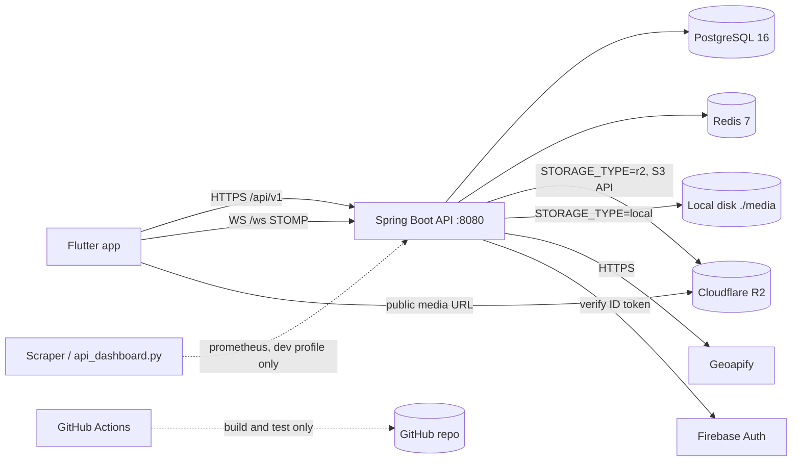

# 08 - Infrastructure and Deployment
What is verifiable about hosting, configuration, CI and operations. Code/config is the source of truth; planned items are labelled.

Last verified: 2026-11-16 against commit 168d987 (working tree has uncommitted changes)

## 1. Verified in the repo vs not

| Item | Status | Evidence |
|---|---|---|
| Dockerfile for API | Implemented | `apsbrat-api/Dockerfile` |
| Local compose stack (Postgres, Redis, API) | Implemented | `docker-compose.yml` |
| CI (build, test, analyze) | Implemented | `.github/workflows/ci.yml` |
| Profiles dev / qa / prod | Implemented | `apsbrat-api/src/main/resources/application.yml` |
| R2 storage code | Implemented | `apsbrat-api/src/main/java/com/apsconnect/api/media/R2StorageService.java` |
| CD / deploy automation in repo | NOT present | No deploy workflow. `docs/DEPLOYMENT.md` describes Cloud Run continuous deploy configured in the GCP console |
| Where qa/prod actually run | UNVERIFIED | Only guides: `docs/DEPLOYMENT.md` offers Render, VPS + Cloudflare Tunnel, Cloud Run |
| Domains `api / qa-api / dev-api / media` on apsbrats.com, Cloudflare DNS/TLS/WAF | UNVERIFIED | Only in `docs/DEPLOYMENT.md`. Code default for media URL is `/media`. The app's default `CDN_URL` is `https://cdn.apsbrat.in` (`frontend/lib/core/constants/env.dart`), a different domain than the docs |
| Managed Postgres (Neon) / Redis (Upstash) | UNVERIFIED | Named only in `docs/DEPLOYMENT.md`. qa/prod config just needs `DATABASE_URL` and a TLS Redis host |
| Backups / restore | NOT implemented | No script or config. `docs/PRODUCTION-READINESS.md` and `docs/QA_AUDIT_REPORT.md` (4.19) list it as missing |
| Alerting, crash reporting | NOT present | Same docs; nothing in code |

## 2. Deployment diagram (verifiable parts)

Hosting layer in front of the API (Cloudflare, Cloud Run/Render/VPS, Neon, Upstash) is UNVERIFIED: guide only (`docs/DEPLOYMENT.md`).

## 3. Profiles (`application.yml`)

| Profile | Datasource | Flyway | Redis | Other |
|---|---|---|---|---|
| dev (default via `spring.profiles.active: dev`) | `localhost:5432/apsbrat_db` | on, `baseline-on-migrate: true`, baseline V4 | `localhost:6379`, SSL off | `show-sql`, springdoc on, master OTP allowed, public metrics on, latency histograms on |
| qa | `DATABASE_URL` required | on, baseline off unless env set | host required, SSL default on | springdoc off, CORS from env, rolling log file |
| prod | same as qa | same | same | same as qa. The only code difference is `AuthService.isProd()`: in prod the OTP is not logged and the master OTP is never accepted; in dev and qa the OTP is logged and the master OTP works whenever `OTP_MASTER` is non-blank (blank by default in qa) |

Guard: `common/config/DevProfileGuard.java` aborts startup when the dev profile is active by default (no `SPRING_PROFILES_ACTIVE` env var) inside Docker or Kubernetes.

## 4. Environment variables (names only)

| Variable | Purpose | Behaviour when unset |
|---|---|---|
| `SPRING_PROFILES_ACTIVE` | dev / qa / prod | defaults to dev (blocked in containers by DevProfileGuard) |
| `DATABASE_URL` | JDBC URL for qa/prod (must start `jdbc:postgresql://`) | qa/prod fail at start |
| `SPRING_DATASOURCE_URL` | Overrides datasource URL (used by compose) | dev default localhost |
| `DB_USER`, `DB_PASSWORD` | DB credentials | dev has defaults in yml; qa/prod required |
| `DB_POOL_SIZE` | Hikari max pool | 10 |
| `SPRING_FLYWAY_BASELINE_ON_MIGRATE` | Baseline an existing DB | dev true (baseline V4); qa/prod false. Compose sets false |
| `SPRING_DATA_REDIS_HOST`, `SPRING_DATA_REDIS_PORT`, `SPRING_DATA_REDIS_PASSWORD`, `SPRING_DATA_REDIS_SSL_ENABLED` | Redis connection | dev: localhost / 6379 / blank / false. qa/prod: host required, SSL true |
| `JWT_SECRET` | JWT signing secret | dev and compose have weak defaults; qa/prod required |
| `OTP_MASTER` | Universal dev OTP | dev and compose: a default exists; qa/prod: blank = disabled |
| `STORAGE_TYPE` | `local` or `r2` | local |
| `R2_ACCOUNT_ID`, `R2_ACCESS_KEY_ID`, `R2_SECRET_ACCESS_KEY`, `R2_BUCKET` | R2 access | blank; bucket has a default name |
| `MEDIA_BASE_URL` | Public URL prefix for media. Full URL required for R2 | `/media` |
| `MEDIA_DIR` | Local media directory | `./media` |
| `CORS_ALLOWED_ORIGINS` | Browser origins (qa/prod) | empty = none |
| `FIREBASE_CREDENTIALS_PATH` | Service-account JSON path for Google sign-in | blank: Google sign-in returns 503 |
| `GEOAPIFY_API_KEY` | Places API key | blank: places calls fail via `requireKey()` |
| `SLOW_QUERY_MS` | Slow query log threshold | 100 |
| `RATE_LIMIT_USER_PER_MINUTE`, `RATE_LIMIT_IP_PER_MINUTE` | Global rate limits | 300 / 60 |
| `JAVA_OPTS` | JVM flags in the image | `-Duser.timezone=Asia/Kolkata` |
| `app.logging.dir` (env `APP_LOGGING_DIR`) | Log directory in qa/prod | `/var/log/apsbrat` |
| `app.client.min-supported-build`, `latest-build`, `maintenance`, `message` (env e.g. `APP_CLIENT_MAINTENANCE`) | Force-update / maintenance flags served by `/api/v1/app/config` (`common/config/AppClientController.java`). Not present in `application.yml`: the defaults come only from `@Value` in that class | 1 / 1 / false / empty |
| `SERVER_PORT` | HTTP port | 8080 |

`.env` is gitignored; `.env.example` is the template. Compose reads `DB_USER`, `DB_PASSWORD`, `JWT_SECRET`, `OTP_MASTER`, R2 vars with `${VAR:-default}` fallbacks.

## 5. Database and Redis hosting
- Local: compose containers `postgres:16` (volume `pgdata`) and `redis:7` (256 MB, `volatile-lru`, so TTL-less keys such as token-revocation markers are never evicted).
- qa/prod: any Postgres/Redis reachable through the env vars. Provider UNVERIFIED.
- Redis down affects the rate-limit filter, OTP flow and the readiness probe (readiness group = `readinessState,db,redis`).

## 6. Object storage
- `STORAGE_TYPE=local` (default): `media/LocalStorageService`, files in `MEDIA_DIR`, served publicly by `MediaWebConfig` at `GET /media/**`. Not suitable for stateless hosts. `apsbrat-api/media/` is gitignored.
- `STORAGE_TYPE=r2`: `media/R2StorageService` through the AWS S3 SDK. `ImageUploadService` only accepts attached photo URLs that start with `MEDIA_BASE_URL`.

## 7. CI pipeline (`.github/workflows/ci.yml`)
Triggers: push to `main`, pull_request to `main`.

| Job | Runner | Steps |
|---|---|---|
| `backend` (API build & test) | ubuntu-latest, dir `apsbrat-api` | checkout, JDK 17 temurin with Maven cache, `mvn -B verify` (includes Testcontainers tests; hosted Ubuntu runners have Docker) |
| `frontend` (Flutter analyze & test) | ubuntu-latest, dir `frontend` | checkout, flutter-action `stable` (cached), `flutter pub get`, `flutter analyze`, `flutter test` |

Not in CI: deploy, image build/push, dependency or secret scanning, coverage, APK/IPA build. The Flutter channel is unpinned `stable`, so CI may use a different Flutter than the local 3.38.9. Locally 18 frontend tests fail (see `testing.md`), so the frontend job would fail on this commit (UNVERIFIED on GitHub: not run there).

## 8. Deployment process
- Local stack: `make up` (= `docker compose up --build -d`), API at `http://localhost:8080`, profile dev, Flyway baseline off.
- Image: `apsbrat-api/Dockerfile`; tests are skipped in the image build (`-DskipTests`). Exposes 8080, entrypoint `java $JAVA_OPTS -jar app.jar`. Image has `curl` for the compose healthcheck.
- Cloud: manual, per `docs/DEPLOYMENT.md` (Cloud Run: 512 MiB, 1 CPU always allocated, min = max = 1 instance because the STOMP broker is in-process). UNVERIFIED whether it was ever done.
- Rollback: not documented (`docs/QA_AUDIT_REPORT.md` 14.9). Flyway migrations are forward-only.

## 9. Monitoring and logging
- Log pattern: `date LEVEL [requestId] [userId] logger - message` (`logback-spring.xml`). Request ids are also meant to come back as `X-Request-Id` (per `CLAUDE.md`).
- qa/prod additionally write `${LOG_DIR}/api.log`: rolls at 50 MB or daily, 30 days, 2 GB cap, gzip. Needs a mounted volume or it dies with the container.
- Slow queries: logger `org.hibernate.SQL_SLOW` at INFO, threshold `SLOW_QUERY_MS`.
- Actuator exposure list: `health,info,metrics,prometheus`. Health probes on, details never shown. `/actuator/health/**` and `/actuator/info` are public. `/actuator/prometheus` and `/actuator/metrics/**` are allowed only when `app.actuator.public-metrics=true` (set only in the dev profile; `SecurityConfig.java`), otherwise denied to everyone. So in qa/prod nothing can scrape metrics today. No Grafana or Prometheus config in the repo.
- Metrics tag `application=aps-brats-api`.

## 10. Resource limits

| Limit | Value | Source |
|---|---|---|
| Hikari max pool | 10 (`DB_POOL_SIZE`); connection timeout 10 s; leak detection 20 s | `application.yml` |
| Upload size | 5 MB per file, 6 MB per request | `spring.servlet.multipart` |
| Rate limit | 300/min per user, 60/min per IP; skipped for `/actuator/`, `/ws`, `/media/` | `common/web/RateLimitFilter.java` |
| Idempotency | pending 60 s, stored result 24 h | `common/web/IdempotencyFilter.java` |
| JWT | access 15 min, refresh 30 days | `application.yml` |
| Hibernate JDBC batch | 50 | `application.yml` |
| Redis memory (compose) | 256 MB | `docker-compose.yml` |
| Cloud Run (guide only) | 512 MiB, 1 CPU, 300 s timeout, 1 instance | `docs/DEPLOYMENT.md` |

Single-instance constraint: chat uses `enableSimpleBroker("/queue")` in `chat/WebSocketConfig.java`. A second API instance would not share chat delivery.

## 11. Costs
Only in `docs/DEPLOYMENT.md`: Cloud Run roughly 5-10 USD/month for a 512 MB always-on instance; Neon, Upstash and R2 on free tiers. Actual spend: UNVERIFIED.
